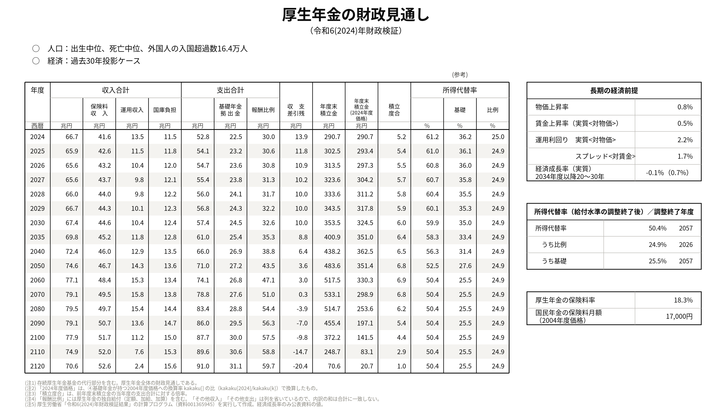

# はじめに — AI に日本語で頼んで、このリポジトリを動かす

**このリポジトリ：[p72/nenkin-zaisei-kensyo-2024](https://github.com/p72/nenkin-zaisei-kensyo-2024)**
— 厚生労働省が公開した2024年財政検証の計算プログラム（C/C++・111本）をそのまま動かし、
財政見通しを公表値と突き合わせ（41,904項目・不一致0）、Python に移植し、原本の不具合を台帳にした**非公式**のリポジトリです。
全体の説明は [README](README.md)、年金制度の勉強は [勉強/README.md](勉強/README.md) から。

公表値の再現だけでなく、「もし〜だったら」の思考実験（制度を変えたら年金はどうなるか）もできます。

プログラムは C/C++ で、本来は黒い画面（ターミナル）でコマンドを打って動かします。
でも今は、**AI のコーディング助手に日本語で頼めば、コマンドは AI が打って、結果も説明してくれます。**
このページは、プログラミングをしたことがない人向けに、そのやり方をまとめたものです。

> **これは厚生労働省が作成したものではありません。** 非公式のリポジトリです。
> 数値が公表値と食い違う場合、原因はこちら側にあると考えてください。
> ここで出てくる年金額は、個人の年金見込額ではありません。

---

## 1. まずは、これを貼るだけ

パソコンの中でコードを実行できる AI（[Claude Code](https://claude.com/claude-code)、ChatGPT の [Codex](https://openai.com/codex/) など）に、
次の文をそのまま貼り付けてください。

```text
https://github.com/p72/nenkin-zaisei-kensyo-2024 を手元にダウンロードして、
何か適当に年金のシミュレーションを見せてください
```

- ChatGPT や Claude の**チャット画面のように、コードを実行できない AI では計算できません**（コードの説明はできます）
- 足りないソフトや、ネットワークの設定が要るときは、**AI が教えてくれます**。
  でも、つまずきやすいところなので、このページの下のほうにも解説しておきます
  （3. クラウドで動かす・4. 自分のパソコンで動かす・5. ChatGPT の Codex で動かす）

### 1-1. AI がやること

慣れてきたら、頼み方を具体的にできます。たとえば

> 高成長実現ケースを計算して、所得代替率が公表値の56.9%と合うか確かめて

と頼むと、AI が

1. リポジトリの説明（README）を読んで、手順を考える
2. 厚労省の資料を取ってくるコマンド（`./fetch.sh`）を打つ
3. 計算するコマンド（`検証/実行/run_pipeline.sh 3001`）を打つ
4. 出てきた数字（`最終代替率　一元化モデル：56.9122495807026`）を読んで、「合っています」と説明する

ところまでやってくれます。資料の取得とビルドを含めて、数分ほどで終わります（計算そのものは1ケース2分半ほど）。

このページでは、Anthropic の **Claude Code** を中心に説明します（このリポジトリも Claude Code を使って作りました）。
OpenAI の **Codex** での動かし方は 5. にあります。ほかの AI コーディング助手でも、考え方は同じです。

### 1-2. 厚労省と同じ形の表が、自分の「もし」で出せます

このリポジトリのいちばんの見どころは、**財政検証で公表されているのと同じ形の表を、
公表に無いケース（自分で考えた「もし」）でも出せる**ことです。たとえば、こう頼みます。

> 過去30年投影ケースで、積立金の運用利回りが名目4.95%（GPIF の実績）で続いたら、財政見通しはどうなる？
> 現行制度と1行ずつ並べた対照表にして、変わったところを太字にして

すると、厚生年金と国民年金の収入・支出・積立金・積立度合・所得代替率を、
現行制度と並べた表が出てきます（下の表は、実際にこのリポジトリで AI とのやりとりから作ったものです）。


*非公式の思考実験です。厚生労働省の試算ではありません。読み方と前提は [運用利回りと保険料](勉強/応用編/運用利回りと保険料.md)。*

もちろん、公表されているケースそのものも、厚労省の資料と同じ体裁で出せます。
数字は公表値と**全項目一致**しています（財政見通し11ケース・41,904項目、不一致0）。

> 過去30年投影ケースの「厚生年金の財政見通し」を、厚労省の概要資料と同じ体裁の表にして



*非公式の再現です。作り方は [検証/図/README.md](検証/図/README.md)。*

### 1-3. 1ケース計算すると何が手に入るか

1ケース流すと、177本・約2GBの出力ができます。表にできるのは、たとえば次のものです。

| 出せるもの | 中身 |
|---|---|
| **財政見通し** | 収入・支出の全項目、年度末積立金、積立度合（2024〜2120年度） |
| **所得代替率・モデル年金額** | 計・基礎・比例、現役男子の手取り収入、給付水準の調整終了年度 |
| **被保険者数** | 第1号・第2号・第3号を、制度別・性別・年齢別に |
| **受給者数・給付費** | 老齢・障害・遺族。いちばん細かいと「年度×性×種別×新旧×在退×内訳×年齢」 |
| **基礎年金拠出金** | 単価、号別・制度別の算定対象者数 |
| **マクロ経済スライド** | カット率（年度×年齢）、改定率 |

どのファイルのどこにあるかは [検証/出力カタログ.md](検証/出力カタログ.md) にまとめてあります。
AI に「出力カタログを見て、○○の表を作って」と頼めば、探し方も任せられます。

---

## 2. やり方を選ぶ

| | ① クラウド（ブラウザ・スマホ） | ② デスクトップアプリ | ③ ターミナル |
|---|---|---|---|
| どこで動く | Anthropic のクラウド上のパソコン | 自分のパソコン | 自分のパソコン |
| 準備 | いちばん少ない。インストール不要 | アプリを入れる＋材料のソフト | Claude Code を入れる＋材料のソフト |
| 必要なもの | Claude の有料プラン、GitHub のアカウント | Claude の有料プラン | Claude の有料プラン |
| 向いている人 | **まず試したい人** | 画面で操作したい人 | 黒い画面に抵抗がない人 |
| 結果の保存 | GitHub に送らないと消える | 自分のパソコンに残る | 自分のパソコンに残る |

- **有料プラン**：Claude Code は Pro・Max・Team・Enterprise（または Console の API）で使えます。無料プランでは使えません
  （[公式：セットアップ](https://code.claude.com/docs/en/setup)）。クラウド（①）は Pro・Max・Team などで使えます
  （[公式：Claude Code on the web](https://code.claude.com/docs/en/claude-code-on-the-web)）
- 迷ったら **① クラウド**から始めるのがおすすめです。パソコンに何も入れずに試せます
- ChatGPT の有料プランを使っている人は、OpenAI の **Codex** でも同じように動かせます（5.）

---

## 3. ① クラウドで動かす（いちばん簡単）

### 3-1. 準備（最初の1回だけ）

1. **GitHub のアカウント**を作る（無料）。<https://github.com/>
2. 結果を自分の場所に残したいなら、このリポジトリを**フォーク**する（自分の GitHub に写しを作る）。
   [p72/nenkin-zaisei-kensyo-2024](https://github.com/p72/nenkin-zaisei-kensyo-2024) を開いて、右上の **Fork** を押します。
   見るだけ・試すだけなら、フォークしなくても大丈夫です（公開リポジトリはそのまま読み込めます）
3. <https://claude.ai/code> を開いて、Claude のアカウントでログインし、**GitHub と接続**する
   （[公式：クイックスタート](https://code.claude.com/docs/en/web-quickstart)）

### 3-2. ネットワークの設定（大事）

クラウドのパソコンは、最初の設定（**Trusted**）では、決められたサイトにしか出られません。
**厚生労働省のサイトは入っていない**ので、このままだと資料を取ってこられません。

1. 入力欄の下にある**環境（Environment）**の選択から、使う環境の設定（歯車）を開く
2. ネットワークのアクセスを **Custom** にする
3. **Allowed domains**（許可するドメイン）に次の1行を足す

   ```
   www.mhlw.go.jp
   ```

4. 「Also include default list of common package managers」（よく使うパッケージ管理のサイトも含める）には**チェックを入れたまま**にする

設定は、**新しく始めたセッションから**効きます（[公式：クラウド環境](https://code.claude.com/docs/en/cloud-environments)）。

<details>
<summary>（任意）セットアップスクリプト：図の日本語フォントなどを毎回入れる</summary>

環境の設定の **Setup script** に書いておくと、セッションを始めるたびに自動で入ります。
グラフを描く記事（`勉強/応用編/` の再現スクリプトなど）を動かすときに便利です。

```bash
#!/bin/bash
apt-get update && apt-get install -y fonts-ipafont-gothic
pip install pytest openpyxl matplotlib
```

入れ忘れても、AI に「グラフ用の日本語フォントを入れて」と頼めば入れてくれます。
</details>

### 3-3. 動かす

1. <https://claude.ai/code> で、入力欄の下からリポジトリ（フォークしたもの、または `p72/nenkin-zaisei-kensyo-2024`）を選ぶ
2. 1. の文（または 6. の「最初に頼むこと」の文）をそのまま打って、Enter

スマホの Claude アプリの **Code** タブからも、同じように始められます。

### 3-4. 知っておくこと

| | |
|---|---|
| 容量 | クラウドのパソコンは約30GB。このリポジトリは1ケース計算すると約2GB使うので、数ケースなら十分です |
| 時間 | 1ケースの計算はビルド込みで数分。長い処理は AI が裏で走らせて、終わったら続きをやってくれます |
| 保存 | **しばらく使わないとクラウドのパソコンは片づけられます。** 残したい結果（文章・表・図）は、AI に「コミットしてプッシュして」と頼んで GitHub に送ってください。フォークしていないリポジトリには送れません |
| 計算の出力 | 計算の出力（`work/`、約2GB）は GitHub には送りません。また欲しくなったら、もう一度計算すれば同じものが出ます |

---

## 4. ②③ 自分のパソコンで動かす

### 4-1. 材料のソフト

このリポジトリは、C/C++ のプログラムを自分でビルドして動かします。次のものが要ります。

| 要るもの | 何に使う |
|---|---|
| `gcc` / `g++` / `make` | C/C++ のプログラムをビルドする |
| `iconv`（`EUCJP-MS` が使えるもの） | 原本の文字コード（EUC-JP）を変換する |
| `patch`、`curl` | 動かすための手当て、資料の取得 |
| `python3` | 照合・集計・図 |
| 空きディスク 約3GB | 1ケースの計算の出力が約2GB |

パソコンの種類ごとのおすすめ：

| パソコン | おすすめ |
|---|---|
| **Windows** | **WSL2（Windows の中で動く Ubuntu）**を入れて、その中で動かす。Claude Code 自体は WSL なしでも動きますが、このリポジトリの材料のソフトをそろえるには WSL2 がいちばん楽です |
| **Linux（Ubuntu など）** | `sudo apt install build-essential patch curl python3 python3-pip` でそろいます（`iconv` は最初から入っています） |
| **Mac** | Xcode のコマンドラインツール（`xcode-select --install`）で `gcc`・`patch` などは入ります。`iconv` の `EUCJP-MS` が使えるかは**確かめていません**。動かないときは、エラーをそのまま AI に見せてください |

材料のソフトの入れ方が分からなくても、**Claude Code を入れたあとで「このリポジトリを動かすのに足りないものを調べて、入れ方を教えて」と頼めば大丈夫です。**

### 4-2. Claude Code を入れる

| やり方 | 手順 |
|---|---|
| **② デスクトップアプリ** | Claude のデスクトップアプリ（Mac・Windows）を入れ、**Code** タブを開く。「+ New session」で、Environment を **Local**、Project folder に下で用意するフォルダを選ぶ（[公式：デスクトップ](https://code.claude.com/docs/en/desktop)） |
| **③ ターミナル（Mac・Linux・WSL）** | `curl -fsSL https://claude.ai/install.sh \| bash` |
| **③ ターミナル（Windows の PowerShell）** | `irm https://claude.ai/install.ps1 \| iex` |

インストールの最新の手順は [公式：セットアップ](https://code.claude.com/docs/en/setup) を見てください。

### 4-3. リポジトリを手元に持ってくる

ターミナルで次のように打ちます（デスクトップアプリの人も、ここだけはターミナルでやるか、AI に頼んでください）。

```bash
git clone https://github.com/p72/nenkin-zaisei-kensyo-2024.git
cd nenkin-zaisei-kensyo-2024
claude          # ③の人はここで Claude Code が起動。初回はブラウザでログイン
```

### 4-4. 「やっていいですか？」に答える

自分のパソコンで動かすときは、AI がコマンドを打つ前やファイルを書き換える前に**確認してきます**。

- **Yes**：今回だけ許可
- **Yes, and don't ask again for …**：同じ種類のコマンドは、次から聞かずに許可
- **No**：断る（AI は別のやり方を考えます）

何をしようとしているか分からないときは、**No を押して「今のコマンドは何をするの？」と聞いてください。**
このリポジトリで AI が打つのは、ほとんどが「資料の取得」「ビルド」「計算」「集計」です。
`rm -rf work`（計算の出力を消す）のような削除は、念のため中身を確かめてから許可してください。

（[公式：権限](https://code.claude.com/docs/en/permissions)）

---

## 5. ChatGPT の Codex で動かす

OpenAI の **Codex** でも、同じように日本語で頼んで動かせます。ChatGPT の有料プラン（Plus・Pro・Business・Edu・Enterprise）に含まれています。
**このリポジトリは Codex では試していません。** 下の手順は公式ドキュメントにもとづくものです。うまくいかないときは、エラーをそのまま Codex に見せてください。

### 5-1. Codex（クラウド）

<https://chatgpt.com/codex> で GitHub とつなぎ、このリポジトリ（またはフォークしたもの）で**環境（Environment）**を作ります。

Codex のクラウドは、**作業中（エージェントが動いている間）はインターネットに出られないのが初期設定**です。
ただし、最初に流す**セットアップスクリプト（Setup script）の間はつながる**ので、厚労省の資料の取得はそこで済ませます。
環境の Setup script に、次のように書いてください。

```bash
./fetch.sh
pip install pytest openpyxl matplotlib
```

あとは、1. の文か、6. の「最初に頼むこと」の文を送ります。
作業中もインターネットを使いたいときは、環境の設定でエージェントのインターネット接続をオンにし、許可するドメインに `www.mhlw.go.jp` を足します
（[公式：Cloud environments](https://developers.openai.com/codex/cloud/environments)、[公式：Agent internet access](https://developers.openai.com/codex/cloud/agent-internet)）。

### 5-2. Codex CLI（自分のパソコン）

材料のソフトは 4-1. と同じです。Codex CLI は Mac と Linux が正式対応で、**Windows は WSL の中で使うのがおすすめ**です。

```bash
npm i -g @openai/codex          # Node.js が要ります
git clone https://github.com/p72/nenkin-zaisei-kensyo-2024.git
cd nenkin-zaisei-kensyo-2024
codex                           # 初回は「Sign in with ChatGPT」でログイン
```

コマンドを打つ前にどこまで確認するかは、`/approvals` で選べます（[公式：Codex CLI](https://developers.openai.com/codex/cli)）。

---

## 6. 最初に頼むこと（例）

そのまま打ち込んで使えます。上から順に試すのがおすすめです。

**まず全体をつかむ**

> README.md とはじめに.md を読んで、このリポジトリで何ができるか、初心者向けに5行で説明して

**動くか確かめる（数分）**

> fetch.sh で厚労省の資料を取ってきて、高成長実現ケース（3001）を通しで計算して。最後に出る所得代替率が公表値の56.9%と合うか確かめて

**ほかのケースも**

> 過去30年投影ケースも計算して（労働参加漸進なので `run_pipeline.sh 3003 1 1 0 2`）。所得代替率は公表値の50.4%と合う？

**表を出す**

> 過去30年投影ケースの財政見通し（収入・支出・積立金・積立度合）を、2024〜2100年度の5年ごとの表にして。厚労省の公表値とも並べて

> 被保険者数（第1号・第2号・第3号）の推移を表とグラフにして、CSV でも保存して

**仕組みを勉強する**

> 勉強/README.md の中から、マクロ経済スライドの記事を読んで、どのファイルの何行目で計算しているか、図を使ってやさしく説明して

**記事の数字を再現する**

> 勉強/応用編/ の「基礎年金を65歳以上の全員に満額にしたら」の再現手順どおりに動かして、記事の表と同じ数字が出るか確かめて

**自分の「もし」を試す**

> 第3号被保険者を廃止したら所得代替率はどう変わる？ このリポジトリにあるレバーで計算できる範囲で試して、使った前提も書いて

> その結果を、現行制度と並べた財政見通しの対照表にして（勉強/応用編/図/ の対照表と同じ形で）

---

## 7. うまくいかないとき

| こうなったら | こうする |
|---|---|
| エラーが出た | エラーの文を**そのまま** AI に貼って「どういう意味？直して」と頼む |
| 資料の取得で `403` や接続エラー（クラウド） | Claude Code は 3-2 のネットワークの設定（`www.mhlw.go.jp` を許可）を確かめ、**新しいセッション**で始め直す。Codex は 5-1 のセットアップスクリプトで `./fetch.sh` を流す |
| 容量が足りない | 「work/ の中で要らない出力を消して」と頼む（`work/` は計算し直せば元に戻ります） |
| 時間がかかりすぎる | 1ケースの計算はビルド込みで数分です（経済前提8ケース全部だと、その8倍ほど）。AI に「いま何をしているか」を聞けます |
| AI の説明が怪しい | 「その数字はどのファイルの何行目？」と根拠を聞く。下の 8. も読んでください |

---

## 8. AI の答えを鵜呑みにしないために

AI は便利ですが、**それらしい間違いを言うこと**があります。このリポジトリを扱うときは、次の3つを習慣にすると安心です。

1. **数字は出力ファイルで確かめる。** 「その数字はどのファイルから取ったの？」と聞けば、AI はファイル名を示せます。
   公表値と比べるときは、厚労省の資料（`papers/`）の値と並べてもらいます
2. **推定と実測を分けてもらう。** 計算プログラムの出力そのものか、そこから AI が組み立てた推定かで、信頼度が違います。
   「推定の部分を全部挙げて」と頼むと、前提が見えます
3. **公表値が正しい、を前提にする。** このリポジトリの計算が公表値とずれたら、原因はこちら側（動かし方や前提）にあると考えます。
   AI にも「公表値と合わないときは、こちら側の原因を探して」と伝えておくとよいです

自分のフォークで作業を続けるなら、リポジトリの直下に **`CLAUDE.md`** を置いて、こうした約束を書いておくと、
AI がセッションの初めに毎回読んでくれます（[公式：CLAUDE.md](https://code.claude.com/docs/en/memory)）。
Codex なら、同じ役目のファイルは **`AGENTS.md`** です。

---

## 9. 次に読むもの

| 目的 | どこ |
|---|---|
| リポジトリ全体の説明・動かし方の詳細 | [README.md](README.md) |
| 1ケースで出てくる表の一覧と在処 | [検証/出力カタログ.md](検証/出力カタログ.md) |
| 年金制度を、厚労省のプログラムで勉強する | [勉強/README.md](勉強/README.md) |
| 数理モデルの全体（専門的） | [年金財政検証_数式モデル.md](年金財政検証_数式モデル.md) |

---

*Claude Code の画面や手順は変わることがあります。ここに書いたのは2026年10月時点の公式ドキュメントにもとづく説明です。
最新の手順は [Claude Code のドキュメント](https://code.claude.com/docs) を見てください。*
