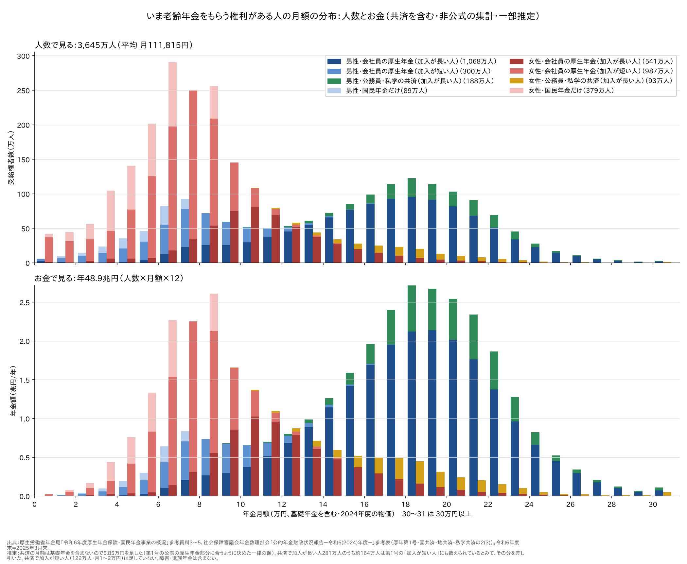

# いま、年金はいくらもらえているか — 金額と人数（共済を含む）

いま老齢年金をもらっている人は、月にいくら受け取っているのか。何人いるのか。
厚生労働省の「事業の概況」と、年金数理部会の「公的年金財政状況報告」の2つの公表資料から、
**会社員・公務員・自営業などをまとめて、1人が1回だけ数えられる分布**を作った（2025年3月末）。

> **非公式の集計です。** 元の数字は公表値ですが、2つの資料を足し合わせるところで推定を置いています
> （「4. 推定で置いたところ」）。

## まとめ

| | 人数 | 平均の月額（基礎年金を含む） |
|---|---|---|
| 会社員の厚生年金・加入が長い人 | 1,609万人 | 男性 17.0万円・女性 11.1万円 |
| 会社員の厚生年金・加入が短い人 | 1,287万人 | 男性 7.5万円・女性 6.5万円 |
| 公務員・私学の共済・加入が長い人 | 281万人 | 男性 19.7万円・女性 18.1万円（推定） |
| 国民年金だけの人 | 468万人 | 男性 5.4万円・女性 5.3万円 |
| **合計** | **3,645万人**（男性1,645万・女性1,999万） | **11.2万円**（男性 14.9万円・女性 8.1万円） |

- **人数で見ると、真ん中の人は月9.3万円**（男性16.1万円・女性7.5万円）
- **お金で見ると、真ん中は月15.1万円**。年金のお金の半分は、月15万円以上の人に払われている
- 男性の山は**18〜19万円**、女性の山は**6〜7万円**。男女で山の位置がまるで違う



上の段が人数、下の段がお金（人数×月額×12）。青が男性、赤が女性で、色の濃さで年金の種類を分けた。
緑（男性）と黄（女性）が公務員・私学の共済。

---

## 1. 人数とお金の全体

公的年金の年金総額は **58.3兆円**、重ならずに数えた受給権者は **3,941万人**（どちらも2025年3月末、
障害・遺族年金を含む）。このうち、老齢年金の月額の分布が分かる部分を足し合わせたのが上の図で、
**3,645万人・年48.9兆円**になる。

| 中身 | 年額 | この記事の図 |
|---|---|---|
| 会社員の厚生年金（加入が長い人）＋基礎年金 | 29.0兆円 | ○ |
| 会社員の厚生年金（加入が短い人）＋基礎年金 | 10.5兆円 | ○（共済とのだぶりを引いた後） |
| 公務員・私学の共済（加入が長い人）＋基礎年金 | 6.5兆円 | ○（基礎年金は推定） |
| 国民年金だけの人 | 3.0兆円 | ○ |
| 障害年金・遺族年金、共済で加入が短い人の共済の分など | 残り | ✕ |

「加入が長い人」と「加入が短い人」は、厚労省の統計の「老齢年金」（旧法の老齢年金に相当）と
「通算老齢年金・25年未満」のこと。加入が短い人の多くは、若いころに少し会社勤めをした女性
（1,287万人のうち987万人が女性）。

## 2. 月額ごとに見ると

| 月額 | 男性 | 女性 | 計（人数） | 計（お金） |
|---|---|---|---|---|
| 7万円未満 | 13% | 44% | 30% | 13% |
| 10万円未満 | 27% | **77%** | 54% | 31% |
| 15万円未満 | 44% | 93% | 71% | 49% |
| 20万円未満 | 77% | 98% | 89% | 77% |
| 25万円未満 | 97% | 100% | 99% | 97% |

- **女性の4分の3は月10万円未満**。男性の4分の3は20万円未満
- 女性の山（6〜9万円）は、国民年金だけの人と、加入が短い会社員の人でできている
- 男性の山（17〜20万円）は、加入が長い会社員の人。その右側に公務員の人が乗る
- お金で見ると男性の山が大きく盛り上がる。月額の高い人ほど重みが大きいため

## 3. 基礎年金の満額とのくらべ

2026年度の老齢基礎年金の満額は**月70,608円**（1人分）。国民年金だけの人の平均（約5.4万円）は、
満額に1.6万円ほど届いていない。保険料を納めていない月や免除の月があると、その分だけ減る。

厚労省の概況にある主な平均（2025年3月末、基礎年金を含む）：

| | 平均の月額 |
|---|---|
| 会社員の厚生年金（加入が長い人） | 150,289円（男性 169,967円・女性 111,413円） |
| 　うち65歳以上 | 男性 173,033円・女性 114,797円 |
| 　2024年度に新しく受け取り始めた人 | 97,967円（64歳までの報酬比例だけの人が多く混じる） |
| 国民年金（老齢基礎年金など） | 59,310円 |
| 　国民年金だけの人（共済もない人） | 54,412円 |

## 4. 推定で置いたところ

2つの資料は、数え方が少しずつ違う。人が重ならないように足すため、次の推定を置いた。

| 推定 | 内容 | 結果への影響 |
|---|---|---|
| 共済の月額に基礎年金を足す | 共済の分布は**基礎年金を含まない**ので、全員に **5.85万円**を足した。5.85万円は、会社員（加入が長い人）の月額から一律に引いたとき、公表の「厚生年金部分の総額」に合う額 | 共済の人の位置が±1万円ほどずれうる |
| 会社員と公務員の両方の期間がある人 | 共済で加入が長い人281万人のうち、会社員の厚生年金を持たない人は最大117万人（国民年金の「基礎のみ」と「基礎のみ共済なし」の差）。残りの**約164万人**は会社員の「加入が短い人」にも数えられているとみて、その人数を加入が短い人から割合で引いた | だぶりの数え方しだいで、加入が短い人が±100万人ほど動きうる |
| 共済で加入が短い人（122万人、月1〜2万円） | ほかの年金ですでに数えられているとみて、足さない。その人の共済の分（月1〜2万円）は月額に入っていない | 少し左（低い方）に寄る |
| 開いた区分 | 国民年金だけの「7万円以上」などは、公表の平均から逆算した区分に置いた。30万円以上は30〜33万円とした | 小さい |
| 64歳までの人 | 報酬比例だけを受け取っている64歳以下（約77万人）がそのまま入っている | その人たちは少し左に出る |

数え方の単位にも注意してほしい。

- 「もらう権利がある人」（受給権者）で数えているので、働いていて全額止まっている人も入る
- **1人分**の月額である。夫婦なら2人分を足す
- 2025年3月末の額で、そのあと2025年度に1.9%、2026年度に1.9〜2.0%上がっている

## 5. 再現

```sh
python3 勉強/応用編/いまの年金の分布.py bunpu    # この記事の表（計算プログラムの出力は要らない）
python3 勉強/応用編/いまの年金の分布.py graph    # 図（損得の図も作るので、得する人の割合.py の準備が要る）
```

財政状況報告の参考表（Excel 4本）は、初めて動かしたときに `.cache/zaisei_jokyo_r6/` へダウンロードし、
SHA256 を照合する。事業の概況は PDF なので、使う表の数字をスクリプトに書き写してある。

この分布に、国庫負担を廃止して国民全員に一律給付する案の損得を当てはめたのが
[いまの受給者で損する人・得する人](厚生年金の国庫負担を廃止して国民全員に一律給付したら_いまの受給者.md)。

## 出典

- 厚生労働省年金局「令和6年度 厚生年金保険・国民年金事業の概況」（令和7年12月）
  <https://www.mhlw.go.jp/content/001617995.pdf>
  - 図2（受給者数）、表2（年金総額）、表6・9・12・13・20・25（平均年金月額）、表10（厚生年金部分の総額）、
    参考資料3〜5（年金月額の階級別の受給権者数）
- 社会保障審議会年金数理部会「公的年金財政状況報告－令和6(2024)年度－」
  <https://www.mhlw.go.jp/stf/shingi2/0000198528_00017.html>
  - 参考表「令和6年度財政状況」の 2(3) 老齢・退職年金受給権者年金月額の分布：
    [厚生年金保険（第1号）](https://www.mhlw.go.jp/content/12501000/001720343.xlsx)・
    [国家公務員共済組合](https://www.mhlw.go.jp/content/12501000/001720344.xlsx)・
    [地方公務員共済組合](https://www.mhlw.go.jp/content/12501000/001720345.xlsx)・
    [私立学校教職員共済制度](https://www.mhlw.go.jp/content/12501000/001720346.xlsx)
- 厚生労働省「厚生労働省関係の主な制度変更（令和8年4月）について」（2026年度の基礎年金の満額）
  <https://www.mhlw.go.jp/stf/newpage_71570.html>
