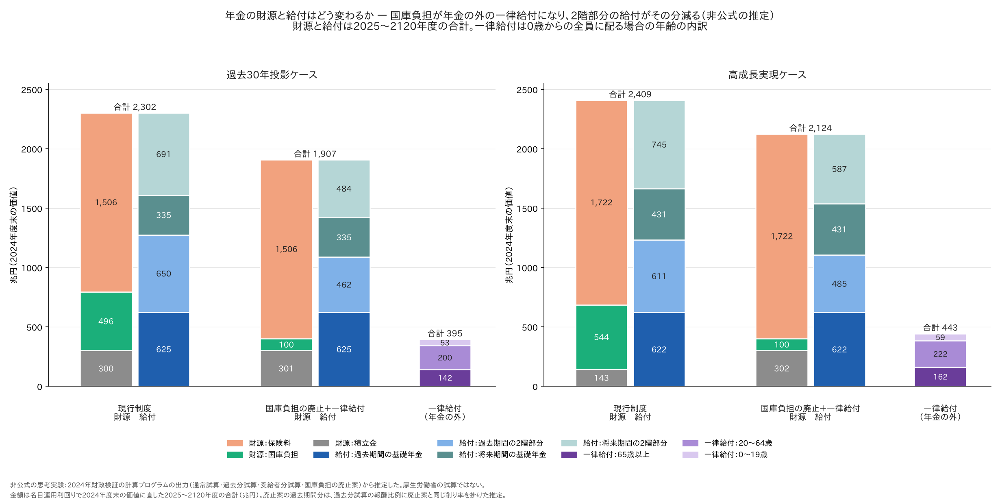
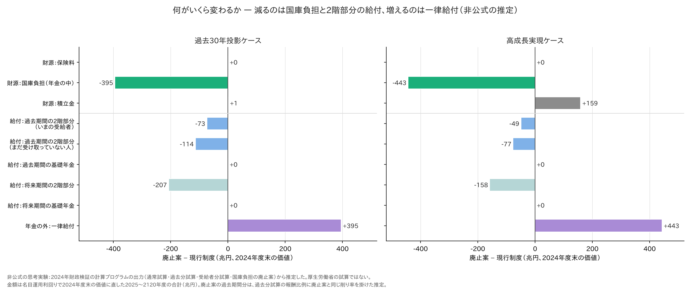
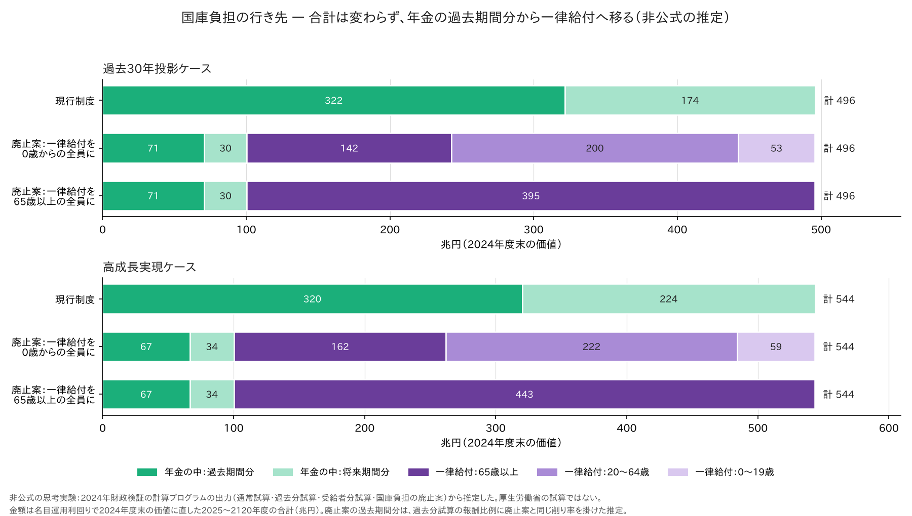
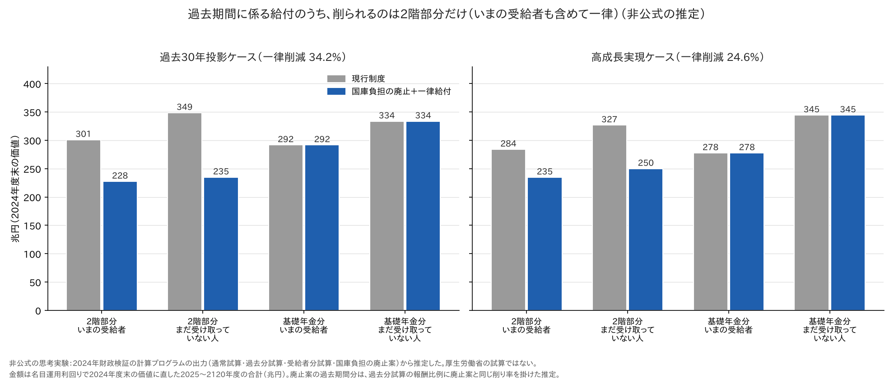
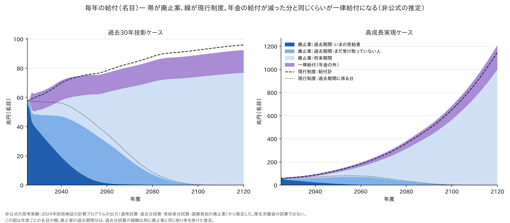
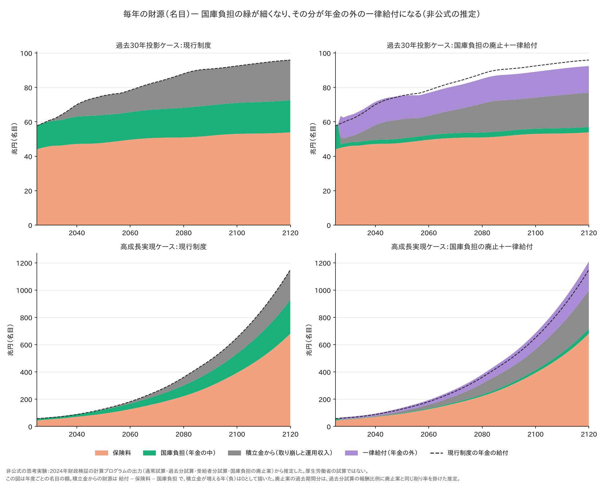

# 厚生年金の国庫負担を廃止して一律給付にしたら、年金の財源と給付はどう変わるか — バランスシートで並べる

- この記事（GitHub）：<https://github.com/p72/nenkin-zaisei-kensyo-2024/blob/main/%E5%8B%89%E5%BC%B7/%E5%BF%9C%E7%94%A8%E7%B7%A8/%E5%8E%9A%E7%94%9F%E5%B9%B4%E9%87%91%E3%81%AE%E5%9B%BD%E5%BA%AB%E8%B2%A0%E6%8B%85%E3%82%92%E5%BB%83%E6%AD%A2%E3%81%97%E3%81%A6%E4%B8%80%E5%BE%8B%E7%B5%A6%E4%BB%98%E3%81%AB%E3%81%97%E3%81%9F%E3%82%89_%E3%83%90%E3%83%A9%E3%83%B3%E3%82%B9%E3%82%B7%E3%83%BC%E3%83%88.md>
- この記事（Web・GitHub Pages）：<https://p72.github.io/nenkin-zaisei-kensyo-2024/%E5%8B%89%E5%BC%B7/%E5%BF%9C%E7%94%A8%E7%B7%A8/%E5%8E%9A%E7%94%9F%E5%B9%B4%E9%87%91%E3%81%AE%E5%9B%BD%E5%BA%AB%E8%B2%A0%E6%8B%85%E3%82%92%E5%BB%83%E6%AD%A2%E3%81%97%E3%81%A6%E4%B8%80%E5%BE%8B%E7%B5%A6%E4%BB%98%E3%81%AB%E3%81%97%E3%81%9F%E3%82%89_%E3%83%90%E3%83%A9%E3%83%B3%E3%82%B9%E3%82%B7%E3%83%BC%E3%83%88.html>
- 再現スクリプト：[一律給付のバランスシート.py](https://github.com/p72/nenkin-zaisei-kensyo-2024/blob/main/%E5%8B%89%E5%BC%B7/%E5%BF%9C%E7%94%A8%E7%B7%A8/%E4%B8%80%E5%BE%8B%E7%B5%A6%E4%BB%98%E3%81%AE%E3%83%90%E3%83%A9%E3%83%B3%E3%82%B9%E3%82%B7%E3%83%BC%E3%83%88.py)
- リポジトリ：<https://github.com/p72/nenkin-zaisei-kensyo-2024>

[過去期間に係る給付と二重の負担](過去期間の給付と二重の負担.md) で再現した「年金のバランスシート」
（2025〜2120年度の財源と給付を、2024年度末の価値に直して並べたもの）を、
**厚生年金の国庫負担を廃止して、浮いた財源を一律給付にする案**でも作り、**財源と給付がどう変わるか**を並べた。

一律給付を [65歳以上の全員に配る案](厚生年金の国庫負担を廃止して一律給付にしたら.md) と、
[0歳からの全員に配る案](厚生年金の国庫負担を廃止して国民全員に一律給付したら.md) のどちらでも、**年金の側の財源と給付は同じ**になる
（年金の側の計算は同じで、違うのは一律給付を誰が受け取るかだけ）。

> **非公式の思考実験です。** 厚生労働省の試算ではありません。計算プログラムの債務の試算と、国庫負担の廃止のレバーは
> 同時に使えないので、廃止案の給付を過去期間・将来期間に分けるところは推定です（2.）。

## まとめ（過去30年投影ケース、兆円、2024年度末の価値）

| 項目 | 現行制度 | 国庫負担の廃止＋一律給付 | 差 |
|---|---|---|---|
| **財源（年金の中）** | **2,302** | **1,907** | **−394** |
| 　保険料 | 1,506 | 1,506 | ±0 |
| 　国庫負担 | 496 | 100 | −395 |
| 　積立金（取り崩しと運用収入） | 300 | 301 | ＋1 |
| **給付（年金の中）** | **2,302** | **1,907** | **−394** |
| 　過去期間（2024年度までの加入分）：2階部分 | 650 | 462 | −187 |
| 　過去期間：基礎年金 | 625 | 625 | ±0 |
| 　将来期間（2025年度からの加入分）：2階部分 | 691 | 484 | −207 |
| 　将来期間：基礎年金 | 335 | 335 | ±0 |
| **年金の外：一律給付**（2027〜2120年度） | ― | **395** | ＋395 |
| 国の支出（国庫負担 ＋ 一律給付） | 496 | 496 | ±0 |

- **財源では、国庫負担だけが減る**（496 → 100兆円）。保険料と積立金は変わらない
- **給付では、2階部分（報酬比例）だけが減る**（過去期間 −187、将来期間 −207）。基礎年金は変わらない
- 減った国庫負担とほぼ同じ額（395兆円）が、**年金の外の一律給付**になる。国の支出の合計（496兆円）は変わらない
- 一律給付を0歳からの全員に配ると、65歳以上に142兆円、20〜64歳に200兆円、0〜19歳に53兆円が行く。
  65歳以上の全員に配れば、395兆円がすべて65歳以上に行く



## 1. 廃止案の中身

元の記事（[65歳以上に配る案](厚生年金の国庫負担を廃止して一律給付にしたら.md)）と同じ。

| 項目 | 内容 |
|---|---|
| 国庫負担 | 2027年度から、被用者年金4制度（厚生年金・共済）の国庫負担を収入に入れない。国民年金・基礎年金の国庫負担はそのまま |
| 均衡のさせ方 | 報酬比例の給付を、**すでに受け取っている人も含めて一律に**削って、2120年度に均衡させる。過去30年投影で34.2%減、高成長実現で24.6%減 |
| 基礎年金 | 変わらない（基礎年金拠出金は今までどおり払う。国庫負担の1/2の分も、厚生年金の保険料と積立金で払う） |
| 一律給付 | 国が払わずに済んだ額を、年金の外で配る。65歳以上の全員に配ると2027年度に月2.7万円、0歳からの全員なら月8,200円 |
| 経済前提 | 過去30年投影ケース（名目運用利回り およそ3.0%）と高成長実現ケース。人口は中位推計 |

## 2. 計算のしかた

財源と給付の合計は、通常試算（現行制度）と廃止案（予備番号701）の計算プログラムの出力から、そのまま出る。
割り引き方（名目運用利回り、年度の真ん中で払うとみなす）・「福祉」欄の扱いは
[過去期間に係る給付と二重の負担](過去期間の給付と二重の負担.md) と同じ。廃止案でも、財源の合計（1,908兆円）と給付の合計（1,907兆円）が一致する。

給付を過去期間・将来期間に分けるところだけは推定である。計算プログラムの「過去分試算」（加入を2024年度で打ち切る）は、
国庫負担の廃止のレバーと同時に流せない（`run_pipeline.sh` が止める）ので、次のようにした。

1. 通常試算と廃止案の独自給付の差は、**報酬比例だけ**を削った分である（パッチは報酬比例の調整率だけを m 倍する）。
   年度ごとの実効の削り率を e(y) ＝ 1 −（通常試算の独自給付 − 廃止案の独自給付）÷ 通常試算の報酬比例 で求めた。
   2028年度以降は m（0.6583）にぴったり一致し、2027年度だけ0.7147（年度の途中から効くため）
2. 過去分試算・受給者分試算の**報酬比例**（年齢別出力の「1比例」）に、同じ e(y) を掛けた。
   削減はすでに受け取っている人も含めて全員に同じ率でかかるので、過去期間分にも同じ率でかかる
3. 基礎年金と国民年金の独自給付は変えない
4. 国庫負担の過去期間分は、国民年金の国庫負担と、厚生年金の国庫負担のうち2026年度まで

## 3. 何がいくら変わるか



| 廃止案 − 現行制度（兆円） | 過去30年投影 | 高成長実現 |
|---|---|---|
| 財源：保険料 | ±0 | ±0 |
| 財源：国庫負担（年金の中） | −395 | −443 |
| 財源：積立金 | ＋1 | ＋159 |
| 給付：過去期間の2階部分（いまの受給者） | −73 | −49 |
| 給付：過去期間の2階部分（まだ受け取っていない人） | −114 | −77 |
| 給付：過去期間の基礎年金 | ±0 | ±0 |
| 給付：将来期間の2階部分 | −207 | −158 |
| 給付：将来期間の基礎年金 | ±0 | ±0 |
| 年金の外：一律給付 | ＋395 | ＋443 |

- 年金の中では、**財源の国庫負担の減り**と**給付の2階部分の減り**がほぼつり合う（過去30年投影で −395 と −394）
- 高成長実現ケースでは、現行制度が2120年度に残す積立金（現在価値164兆円）を廃止案では使い切るので、
  積立金からの財源が159兆円増え、給付の減りは284兆円にとどまる
- 2階部分の減りは、過去期間分（すでに加入した期間の分）と将来期間分にほぼ半々で、いまの受給者の分も含む

## 4. 国庫負担の行き先



| 兆円（2024年度末の価値） | 過去30年投影 | 高成長実現 |
|---|---|---|
| 現行制度：年金の中（過去期間分 ＋ 将来期間分） | 496（322 ＋ 174） | 544（320 ＋ 224） |
| 廃止案：年金の中（国民年金・基礎年金の国庫負担など） | 100（71 ＋ 30） | 100（67 ＋ 34） |
| 廃止案：一律給付 | 395 | 443 |
| 　0歳からの全員に配る場合：65歳以上 ／ 20〜64歳 ／ 0〜19歳 | 142 ／ 200 ／ 53 | 162 ／ 222 ／ 59 |
| 　65歳以上の全員に配る場合：65歳以上 | 395 | 443 |

- 国の支出の合計は変わらず、**行き先が変わる**だけ
- 現行制度では、国庫負担の3分の2（322兆円）が過去期間分の給付（すでに加入した期間の年金）に、
  残り（174兆円）が将来期間分の給付に入っている。廃止案ではその大部分が一律給付に回る
- 0歳からの全員に配ると、65歳以上に行くのは142兆円で、残りの253兆円は65歳未満に行く

## 5. 削られる給付は誰のものか



| 兆円（過去30年投影） | 現行制度 | 廃止案 | 差 |
|---|---|---|---|
| 過去期間の2階部分：いまの受給者 | 301 | 228 | −73 |
| 過去期間の2階部分：まだ受け取っていない人 | 349 | 235 | −114 |
| 過去期間の基礎年金：いまの受給者 | 292 | 292 | ±0 |
| 過去期間の基礎年金：まだ受け取っていない人 | 334 | 334 | ±0 |
| 将来期間の2階部分 | 691 | 484 | −207 |
| 将来期間の基礎年金 | 335 | 335 | ±0 |

- 削られるのは**2階部分（報酬比例）だけ**。いまの受給者の分も含めて一律

## 6. 年度ごとの給付と財源



- 帯が廃止案（年金の給付と一律給付）、線が現行制度の年金の給付
- 過去30年投影では、年金の給付が減った分とほぼ同じ額が一律給付になり、合計は現行制度の線の近くを通る
- 2027年度は、報酬比例の削減が年度の途中から効くので、合計が一時的に現行制度より上に出る



- 現行制度では、毎年の国庫負担（緑）が年金の給付の2割ほどを支えている
- 廃止案では緑が細くなり（国民年金・基礎年金の国庫負担だけが残る）、その分が年金の外の一律給付（紫）になる
- 保険料（オレンジ）は変わらない。積立金からの財源（灰色）は、過去30年投影では現在価値の合計はほぼ同じで、取り崩しが少し早く始まる。高成長実現では廃止案のほうが多い（2120年度に残していた積立金も使う）

## 7. 高成長実現ケース

| 兆円（2024年度末の価値） | 現行制度 | 廃止案 | 差 |
|---|---|---|---|
| 財源：保険料 | 1,722 | 1,722 | ±0 |
| 財源：国庫負担 | 544 | 100 | −443 |
| 財源：積立金 | 143 | 302 | ＋159 |
| 給付：過去期間（2階 ＋ 基礎） | 1,233（611 ＋ 622） | 1,107（485 ＋ 622） | −126 |
| 給付：将来期間（2階 ＋ 基礎） | 1,176（745 ＋ 431） | 1,017（587 ＋ 431） | −158 |
| 給付の合計 | 2,409 | 2,124 | −284 |
| 一律給付（年金の外） | ― | 443 | ＋443 |

## 8. 読むときの注意

| 注意 | 内容 |
|---|---|
| 推定 | 廃止案の給付を過去期間・将来期間に分けるところは、過去分試算の報酬比例に廃止案と同じ削り率を掛けた推定。財源と給付の合計は計算プログラムの出力そのもの |
| 一律給付は年金の外 | 一律給付は加入期間にもとづく給付ではないので、過去期間・将来期間には分けない |
| 年齢の内訳 | 0歳からの全員に配る場合の年齢の内訳は、将来推計人口（外国人を含む）の年度ごとの割合で分けた |
| 割引率 | 名目運用利回りで割り引いた。割引率を変えると金額は大きく動く |
| 損得 | このバランスシートは制度全体の合計。人ごとの損得は [世代ごとの損得](厚生年金の国庫負担を廃止して一律給付にしたら_世代ごとの損得.md) や [標準報酬別の損得](厚生年金の国庫負担を廃止して国民全員に一律給付したら_標準報酬別の損得.md) を見ること |

## 9. 再現

```sh
# 通常試算・過去分試算・受給者分試算（過去期間の給付と二重の負担 と同じ）
検証/実行/run_pipeline.sh 3003 1 1 0 2
SAIMU=1 STEPS=2345 SKIP_BUILD=1 検証/実行/run_pipeline.sh 3003 1 1 0 2
SAIMU=2 STEPS=2345 SKIP_BUILD=1 検証/実行/run_pipeline.sh 3003 1 1 0 2
# 国庫負担の廃止案（予備番号701・702）
python3 勉強/応用編/国庫負担の廃止.py run 3003
# 高成長実現（3001）も同じように（run_pipeline.sh は人口・労働力率の引数なし）
python3 勉強/応用編/一律給付のバランスシート.py    # 表と図（勉強/応用編/図/一律給付_バランスシート_*.png）
```

## 関連

- [過去期間に係る給付と二重の負担](過去期間の給付と二重の負担.md)（現行制度のバランスシートの再現）
- [厚生年金の国庫負担を廃止して、65歳以上に一律給付したら](厚生年金の国庫負担を廃止して一律給付にしたら.md)
- [厚生年金の国庫負担を廃止して、国民全員に一律給付したら](厚生年金の国庫負担を廃止して国民全員に一律給付したら.md)
- [世代ごとの損得](厚生年金の国庫負担を廃止して一律給付にしたら_世代ごとの損得.md)
