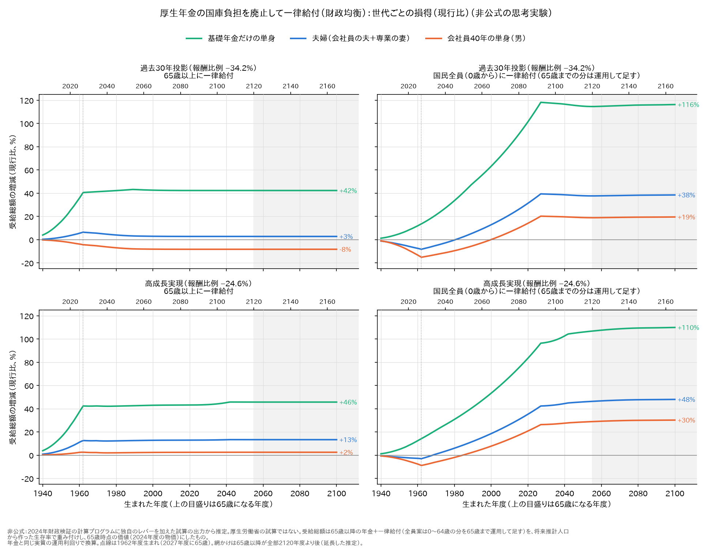
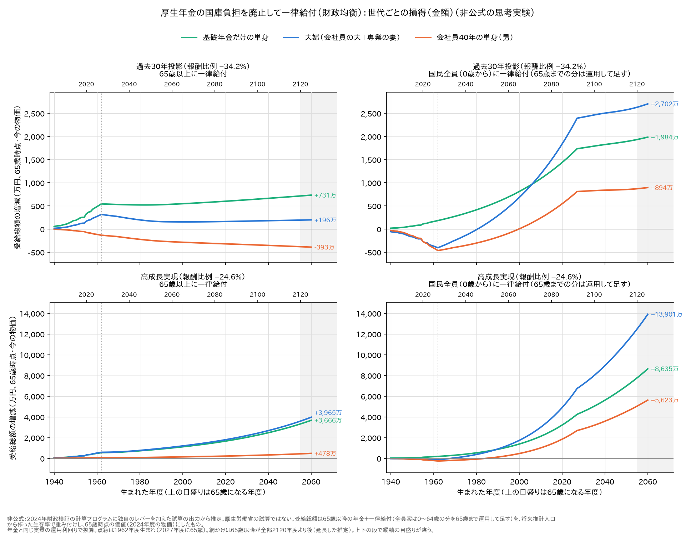
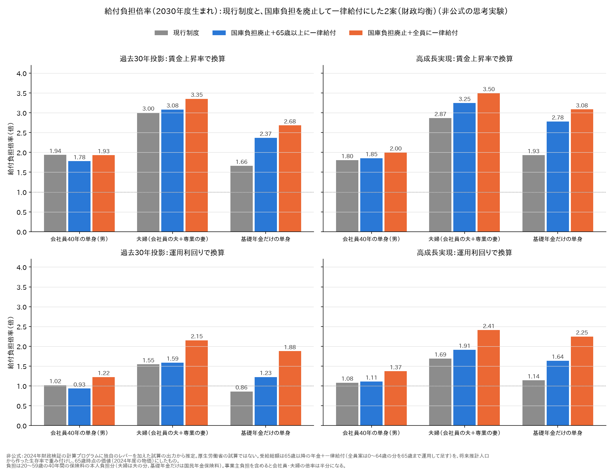
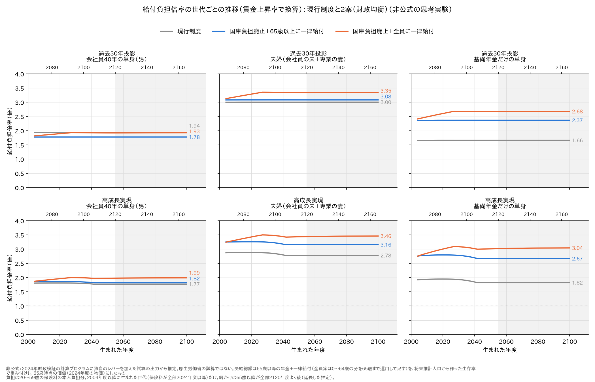
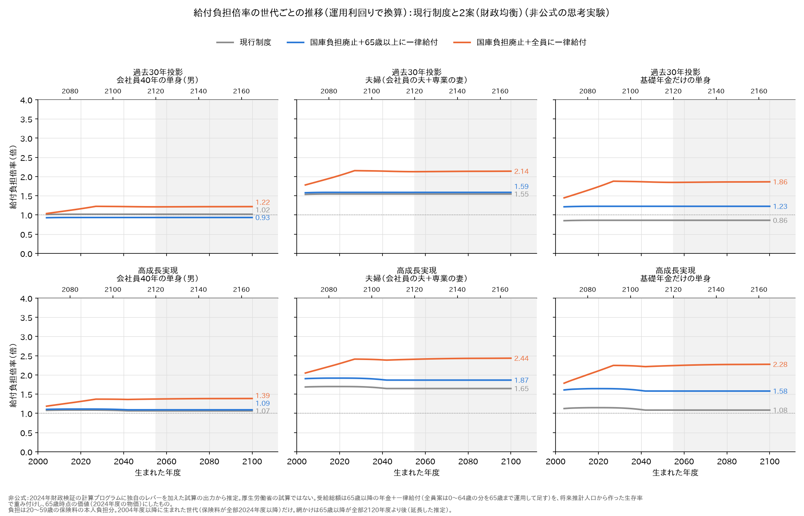

# 厚生年金の国庫負担を廃止して一律給付にしたら（財政均衡） — 世代ごとの損得と給付負担倍率

[65歳以上に一律給付](厚生年金の国庫負担を廃止して一律給付にしたら.md)と[国民全員に一律給付](厚生年金の国庫負担を廃止して国民全員に一律給付したら.md)の
2案について、**生まれた年度ごとの損得**を現行制度と比べた。どちらの案も、厚生年金への国庫負担（年12兆円ほど）をなくし、
報酬比例を一律に削って2120年度に均衡させ（過去30年投影で34.2%減、高成長実現で24.6%減）、浮いた財源を一律給付として配る。

**結論**
- **保険料も税も現行と同じ**なので、世代ごとの損得は「受け取る額の差」で決まる。
- **65歳以上に配る案は、世代に中立**。2000年以降に生まれた世代では、損得はほぼ一定になる。損得を分けるのは世代ではなく、報酬比例の多い少ない。
  過去30年投影では、会社員の単身は約8%の損、夫婦は約3%の得、基礎年金だけの人は約42%の得。
- **全員に配る案は、世代で大きく傾く**。実施の年（2027年度）に65歳前後の世代がいちばん損をする（会社員の単身で約15%の損）。
  若い世代ほど得になり、0歳から受け取る世代では会社員の単身でも得になる（受け取った給付を全部、年金と同じ利回りで運用し続ける前提。賃金上昇率で換算すると、会社員の単身はほぼ損得なし）。
- 若い世代（2004年度以降生まれ）の**給付負担倍率**を出した。賃金上昇率で換算した現行制度の倍率は、過去30年投影で、会社員の単身1.94倍、夫婦3.00倍、基礎年金だけの人1.66倍。
  どちらの案でも、**基礎年金だけの人の倍率が大きく上がり**、会社員の単身との順番が入れ替わる。
- 年金と同じ運用利回りで換算すると、倍率は1倍前後まで下がる。どちらの換算でも、3つの制度の順番は同じ。

以下は、厚生労働省の試算ではない**非公式の思考実験**で、数字は計算プログラムの出力から作った**推定**である。

---

## 1. 何を計算したか

### 3つの世帯

| 世帯 | 受け取るもの | 払うもの（倍率の分母） |
|---|---|---|
| 会社員40年の単身（男） | 報酬比例（平均的な賃金で40年）＋基礎年金（満額）＋一律給付 | 厚生年金保険料の本人負担分 |
| 夫婦（会社員の夫＋同い年の専業の妻） | 夫の分＋妻の基礎年金＋2人分の一律給付。夫が先に亡くなれば妻に遺族厚生年金（報酬比例の3/4） | 夫の厚生年金保険料の本人負担分（妻は第3号） |
| 基礎年金だけの単身 | 基礎年金（満額）＋一律給付 | 国民年金保険料 |

### 受け取る額（受給総額）
- 65歳から99歳までに受け取る年金と一律給付を、**生きている確率で重み付け**して足した。生存率は、計算プログラムの①（被保険者推計）が使う将来推計人口（男・女・男女計）の比から作った
- 全員に配る案は、0〜64歳に受け取る一律給付も、本人の名義として数えた（子どもの分は実際には親が受け取る）。65歳まで運用して足す
- 65歳時点の価値に換算し、2024年度の物価に割り戻した（万円）

### 払う額（保険料）
- 20〜59歳の40年間の保険料を、65歳まで積み上げた。途中で亡くなることは考えない
- 会社員の月給（ボーナス込みの標準報酬）は、⑤のモデル年金の報酬比例から逆算した（どの年度も手取りの1.15倍。2024年度で42.6万円）
- 2023年度以前の保険料の実績は手元に無いので、**倍率は、20〜59歳が全部2024年度以降になる2004年度以降生まれの世代だけ**出した

### 換算のしかた（2通り）
- **賃金上昇率で換算**：お金の価値を、その時々の賃金の水準で比べる。実質の賃金上昇率は過去30年投影で0.5%、高成長実現で2.0%（長期）
- **運用利回りで換算**：保険料を自分で運用した場合と比べる、厳しい物差し。年金と同じ実質の運用利回り（過去30年投影2.2%、高成長実現3.4%）を使う

受給総額の変化（2.）の図と表は、運用利回りで換算したもの。

## 2. 受給総額の変化（世代ごとの損得）





### 過去30年投影（運用利回りで換算、万円）

| 生まれた年度（65歳になる年度） | 現行の受給総額<br>単身／夫婦／基礎だけ | 65歳以上案<br>単身／夫婦／基礎だけ | 全員案<br>単身／夫婦／基礎だけ |
|---|---|---|---|
| 1940（2005） | 2,935／4,726／1,347 | −8（−0.3%）／＋14（＋0.3%）／＋53（＋3.9%） | −33（−1.1%）／−59（−1.2%）／＋16（＋1.2%） |
| 1950（2015） | 2,635／4,247／1,193 | −38（−1.5%）／＋84（＋2.0%）／＋186（＋15.6%） | −143（−5.4%）／−167（−3.9%）／＋60（＋5.0%） |
| 1959（2024） | 3,096／4,962／1,358 | −111（−3.6%）／＋249（＋5.0%）／＋454（＋33.4%） | −386（−12.5%）／−357（−7.2%）／＋151（＋11.1%） |
| 1962（2027） | 3,079／4,915／1,335 | −135（−4.4%）／＋313（＋6.4%）／＋541（＋40.6%） | −467（−15.2%）／−406（−8.3%）／＋181（＋13.6%） |
| 1970（2035） | 3,097／4,873／1,281 | −168（−5.4%）／＋265（＋5.4%）／＋528（＋41.3%） | −397（−12.8%）／−245（−5.0%）／＋273（＋21.3%） |
| 1980（2045） | 3,190／4,924／1,230 | −224（−7.0%）／＋196（＋4.0%）／＋519（＋42.2%） | −305（−9.6%）／−16（−0.3%）／＋413（＋33.6%） |
| 1995（2060） | 3,406／5,173／1,248 | −277（−8.1%）／＋154（＋3.0%）／＋534（＋42.8%） | −93（−2.7%）／＋471（＋9.1%）／＋693（＋55.5%） |
| 2010（2075） | 3,680／5,583／1,347 | −305（−8.3%）／＋155（＋2.8%）／＋570（＋42.3%） | ＋238（＋6.5%）／＋1,187（＋21.3%）／＋1,087（＋80.7%） |
| 2030（2095） | 4,066／6,168／1,489 | −338（−8.3%）／＋170（＋2.8%）／＋630（＋42.3%） | ＋816（＋20.1%）／＋2,419（＋39.2%）／＋1,754（＋117.8%） |

### 高成長実現（運用利回りで換算、万円）

| 生まれた年度（65歳になる年度） | 現行の受給総額<br>単身／夫婦／基礎だけ | 65歳以上案<br>単身／夫婦／基礎だけ | 全員案<br>単身／夫婦／基礎だけ |
|---|---|---|---|
| 1940（2005） | 2,922／4,694／1,339 | ＋4（＋0.2%）／＋39（＋0.8%）／＋51（＋3.8%） | −19（−0.7%）／−31（−0.7%）／＋16（＋1.2%） |
| 1950（2015） | 2,560／4,097／1,156 | ＋20（＋0.8%）／＋167（＋4.1%）／＋178（＋15.4%） | −80（−3.1%）／−73（−1.8%）／＋57（＋5.0%） |
| 1959（2024） | 2,868／4,579／1,280 | ＋62（＋2.2%）／＋469（＋10.2%）／＋445（＋34.7%） | −205（−7.2%）／−123（−2.7%）／＋148（＋11.6%） |
| 1962（2027） | 2,907／4,628／1,288 | ＋74（＋2.5%）／＋582（＋12.6%）／＋545（＋42.3%） | −258（−8.9%）／−141（−3.0%）／＋183（＋14.2%） |
| 1970（2035） | 3,189／5,050／1,396 | ＋69（＋2.2%）／＋623（＋12.3%）／＋590（＋42.3%） | −188（−5.9%）／＋46（＋0.9%）／＋301（＋21.6%） |
| 1980（2045） | 3,951／6,224／1,719 | ＋79（＋2.0%）／＋764（＋12.3%）／＋725（＋42.2%） | −78（−2.0%）／＋373（＋6.0%）／＋529（＋30.8%） |
| 1995（2060） | 5,403／8,462／2,341 | ＋123（＋2.3%）／＋1,074（＋12.7%）／＋1,001（＋42.8%） | ＋272（＋5.0%）／＋1,274（＋15.1%）／＋1,102（＋47.1%） |
| 2010（2075） | 7,289／11,404／3,156 | ＋175（＋2.4%）／＋1,469（＋12.9%）／＋1,360（＋43.1%） | ＋1,006（＋13.8%）／＋2,998（＋26.3%）／＋2,125（＋67.3%） |
| 2030（2095） | 10,811／16,883／4,658 | ＋267（＋2.5%）／＋2,195（＋13.0%）／＋2,027（＋43.5%） | ＋2,856（＋26.4%）／＋7,178（＋42.5%）／＋4,519（＋97.0%） |

- **65歳以上に配る案（図の左）**：実施の年に65歳前後の世代を境に、あとの世代はほぼ同じ割合になる。どの世代も65歳から同じ条件で受け取るからである
- **全員に配る案（図の右）**：1962年度生まれ（2027年度に65歳）が谷になり、若くなるほど右肩上がりになる。65歳までの給付を受け取る年数が長くなるからである。
  2025年ごろより後に生まれた世代（0歳から全部受け取る）で頭打ちになる
- 金額では、高成長実現の若い世代ほど大きくなる。実質賃金が伸び、年金も一律給付も大きくなるためで、世代の比較には割合の図のほうが向く

### 2024年度に65歳以上の世代

表の1940〜1959年度生まれが、2024年度にすでに65歳以上の世代である。保険料は払い終わっていて、過去の実績が手元に無いので、受け取る額の変化だけを見ている。

- 年をとっている世代ほど、影響は小さい。残りの人生が短いからである
- 全員に配る案では、今の高齢者は会社員の単身でも夫婦でも損になる。65歳以上に配る案では、夫婦と基礎年金だけの人は得になる
- [移行措置](厚生年金の国庫負担を廃止して国民全員に一律給付したら.md)の①（最初は65歳以上に厚く配る）が守ろうとしているのは、この世代の全員案のマイナスである

## 3. 若い世代の給付負担倍率

**倍率 ＝ 受給総額 ÷ 払った保険料**（どちらも65歳時点の価値）。2030年度生まれの値（2004年度以降生まれでほぼ一定）。



### 過去30年投影

| 世帯 | 賃金上昇率で換算：現行 → 65歳以上案 → 全員案 | 運用利回りで換算：現行 → 65歳以上案 → 全員案 |
|---|---|---|
| 会社員40年の単身（男） | **1.94** → 1.78 → 1.93 | **1.02** → 0.93 → 1.22 |
| 夫婦（会社員の夫＋専業の妻） | **3.00** → 3.08 → 3.35 | **1.55** → 1.59 → 2.15 |
| 基礎年金だけの単身 | **1.66** → 2.37 → 2.68 | **0.86** → 1.23 → 1.88 |

### 高成長実現

| 世帯 | 賃金上昇率で換算：現行 → 65歳以上案 → 全員案 | 運用利回りで換算：現行 → 65歳以上案 → 全員案 |
|---|---|---|
| 会社員40年の単身（男） | **1.80** → 1.85 → 2.00 | **1.08** → 1.11 → 1.37 |
| 夫婦（会社員の夫＋専業の妻） | **2.87** → 3.25 → 3.50 | **1.69** → 1.91 → 2.41 |
| 基礎年金だけの単身 | **1.93** → 2.78 → 3.08 | **1.14** → 1.64 → 2.25 |

- **現行制度では、夫婦（妻が第3号）がいちばん高く、基礎年金だけの人がいちばん低い**（賃金上昇率で換算）
- どちらの案でも、**基礎年金だけの人の倍率が大きく上がる**。報酬比例を削られず、一律給付がまるごと上乗せになるからである
- **会社員の単身は、過去30年投影の65歳以上案でだけ下がる**（1.94 → 1.78）。ほかは横ばいか上がる
- **運用利回りで換算すると、倍率はぐっと低くなる**。「保険料を自分で運用した場合と比べてどうか」という厳しい物差しで、1倍前後になる。
  ただし、どちらの換算でも3つの制度の順番は同じである
- 事業主負担も保険料に含めると、会社員と夫婦の倍率はちょうど半分になる（基礎年金だけの人は変わらない）

### 世代ごとの推移





- 現行制度と65歳以上に配る案は、世代でほとんど変わらない
- 全員に配る案は、2025年ごろ生まれまで上がり、そこから先は一定になる
- 高成長実現で2040年ごろ生まれに段差があるのは、65歳以降が2120年度より後にかかり、延長した推定に切り替わるところである

## 4. 読むときの注意

- **これは改革による損得を測るもので、本当の意味の世代会計ではない。** 税の負担（国庫負担の財源を誰が払うか）は入れていない。
  この2案では国が集める税の総額は変わらないので、改革の損得の比較には影響しない
- **2023年度以前に保険料を払った世代の倍率は出していない。** 2024年の財政検証では、世代ごとの給付と負担の表は見当たらなかった
  （結果レポート第1〜7章と詳細結果等を確かめた範囲）
- 報酬比例は「65歳でもらい始めた額を、その後は実質で一定」とした。2023年度以前の年金額は2024年度の実質額で代用した
- 全員に配る案の若い世代の得は、一律給付を**全部、65歳まで運用し続ける**前提に大きく頼っている。使ってしまえば、得はずっと小さくなる
- 2120年度より先（図の網かけ）は、財政検証の外を延長した推定である。実質賃金の伸びは最終年度のまま、一律給付は手取りに対する割合を一定とした
- 生存率は人口の比から作ったので、出入国の分がわずかに混ざる。夫婦は同い年で、それぞれの生存は独立とした。99歳までで打ち切った
- 障害年金・遺族基礎年金・繰上げ・繰下げは入れていない

## 5. 再現

```sh
python3 勉強/応用編/国庫負担の廃止.py run 3003      # 予備番号701（未実行なら）。高成長実現は run 3001
python3 勉強/応用編/世代別の損得.py report            # 表
python3 勉強/応用編/世代別の損得.py graph             # 図（勉強/応用編/図/）
```

- 通常試算（予備番号000）の3001・3003と、`国庫負担の廃止.py run` の701が要る
- 年齢別の基礎年金は [全員に満額.py](全員に満額.py) の `mangaku()`（③の満額を年齢別に組み立て直したもの。[原本の不具合.md](../../検証/原本の不具合.md) J4）を使う

---

*計算：厚生労働省「令和6(2024)年財政検証」公表の計算プログラムを、有志のリポジトリでビルド・実行したもの。
国庫負担の廃止と一律給付は、計算プログラムに独自のレバーを加えた非公式の計算で、厚生労働省の試算ではない。
世代ごとの損得と給付負担倍率は、その出力から作った推定である。*
