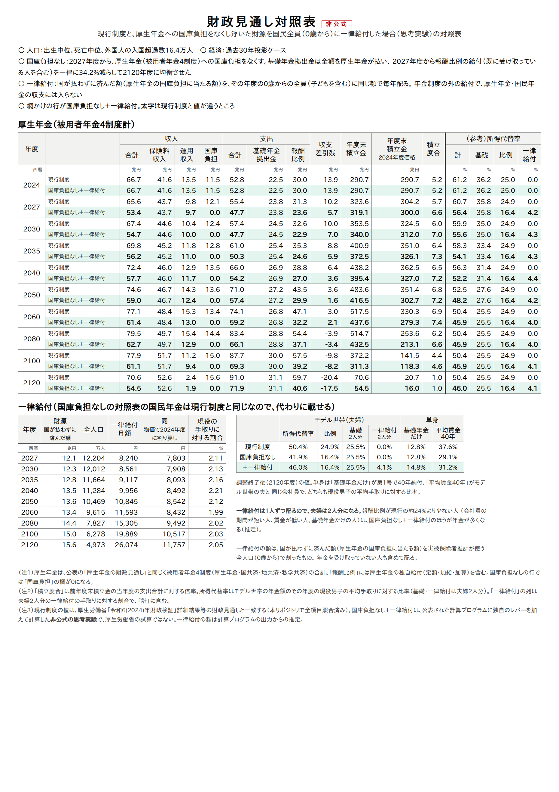
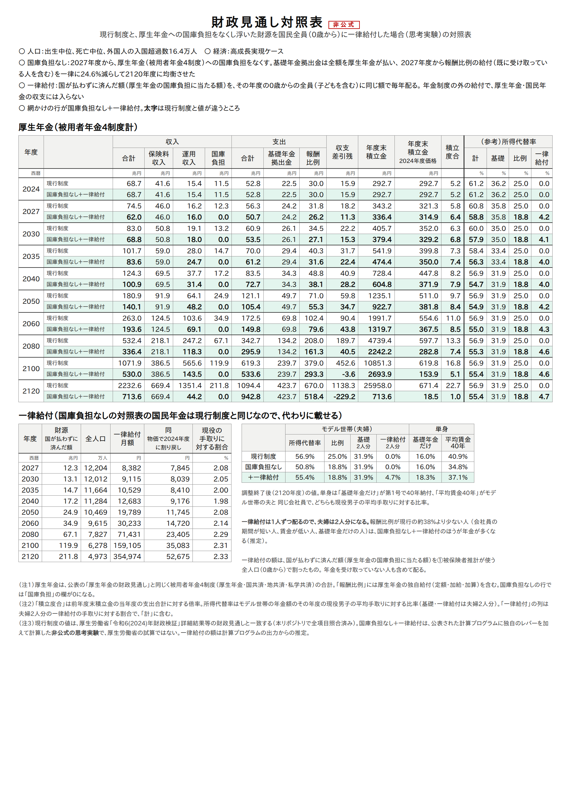

# 厚生年金の国庫負担を廃止して、国民全員に一律給付したら（財政均衡） — 財政検証の計算プログラムで確かめた

[厚生年金の国庫負担を廃止して一律給付にしたら.md](厚生年金の国庫負担を廃止して一律給付にしたら.md) の別案である。
厚生年金への国庫負担（年12兆円ほど）をなくすところまでは同じで、浮いた財源を**65歳以上ではなく、
0歳の子どもを含む国民全員に**同じ額で配ったらどうなるかを確かめた。

**結論：同じ12兆円を1億2千万人で分けるので、1人あたり月8,200円（2027年度）になる。65歳以上に配る案の
月2.7万円のおよそ3分の1である。現役の手取りに対しては1人2%ほどで、これはどの年度もあまり変わらない。
お金の7割は65歳未満に、そのうち1.8兆円は20歳未満に行く。**

**年金だけで見ると、ほとんどの人が今より減る。モデル世帯（夫婦）の所得代替率は現行制度の50.4%から
46.0%に下がる（過去30年投影）。65歳以上に配る案（52.0%）と違って、国庫負担をなくした穴を
一律給付では埋めきれない。年金の外を含めて得をするのは、子どものいる現役の世帯と、
会社員の期間が短い人・基礎年金だけの人である。**

**65歳までに受け取った一律給付を年金と同じ利回りで運用し、65歳から20年で取り崩すと、損得は世代で大きく変わる。
今の高齢者は会社員なら損だが、過去30年投影では2040年度に65歳になる夫婦で損得がつり合い、
0歳から受け取る世代は報酬比例が平均の2倍を超える人まで得になる（推定）。**

以下は**非公式の思考実験**で、厚生労働省の試算ではない。

生まれた年度ごとの損得と給付負担倍率は [世代ごとの損得](厚生年金の国庫負担を廃止して一律給付にしたら_世代ごとの損得.md)。
標準報酬月額ごとの損得は [標準報酬別の損得](厚生年金の国庫負担を廃止して国民全員に一律給付したら_標準報酬別の損得.md)、
何割の人が得をするかは [得をする人の割合](厚生年金の国庫負担を廃止して国民全員に一律給付したら_得する人の割合.md)。

---

## 1. 何を計算したか

年金の側は、元の文書（[厚生年金の国庫負担を廃止して一律給付にしたら.md](厚生年金の国庫負担を廃止して一律給付にしたら.md)）の
計算をそのまま使う。

- 2027年度から、被用者年金4制度（厚生年金・国共済・地共済・私学共済）の国庫負担を収入に入れない
- 基礎年金拠出金は今までどおり払う。国民年金（基礎年金の水準）には触らない
- 保険料率（18.3%）は変えない
- 報酬比例の年金を、すでに受け取っている人も含めて一律に削って、2120年度に均衡させる
  （過去30年投影で**34.2%減**、高成長実現で**24.6%減**）

違うのは、浮いた財源の配り方だけである。

- 国が払わずに済んだ額（厚生年金の国庫負担に当たる額）を、**その年度の0歳からの全員**に同じ額で毎年配る
- 年金制度の外の給付として考え、厚生年金・国民年金の収支には入れない。国の財政は、国庫負担をなくす前と同じ
- 人数は、計算プログラムの①被保険者推計が読む将来推計人口（出生中位・死亡中位・入国超過16.4万人）の
  全年齢の合計。外国人を含む日本に住む人全員である。この人口の15歳以上の合計は、①の出力と一致する

賃金・物価・人口などの前提は、公式の過去30年投影ケース・高成長実現ケースのまま動かしていない。

## 2. 1人あたりの月額

| 年度 | 過去30年投影：月額 | 同：今の物価で | 同：現役の手取りに対する割合 | 高成長実現：月額 | 同：今の物価で | 同：手取りに対する割合 |
|---|---|---|---|---|---|---|
| 2027 | **8,240円** | 7,803円 | 2.11% | **8,382円** | 7,845円 | 2.08% |
| 2040 | 9,956円 | 8,492円 | 2.21% | 12,683円 | 9,176円 | 1.98% |
| 2060 | 11,593円 | 8,432円 | 1.99% | 30,233円 | 14,720円 | 2.14% |
| 2100 | 19,889円 | 10,517円 | 2.03% | 159,105円 | 35,083円 | 2.31% |
| 2120 | 26,074円 | 11,757円 | 2.05% | 354,974円 | 52,675円 | 2.33% |

- 「今の物価で」は、物価で2024年度に割り戻した額
- 配る人数は2027年度の1億2,204万人から、2120年度には4,973万人に減る。財源（国庫負担）は賃金とともに伸びるので、
  1人あたりの額は手取りのおよそ2%で安定する
- 65歳以上に配る案では、1人あたり手取りの5〜7%だった。人数が約3.3倍（2027年度）になるので、1人あたりは約3分の1になる

### お金はどの年齢に行くか

| 年度 | 20歳未満 | 20〜64歳 | 65歳以上 |
|---|---|---|---|
| 2027 | 15.1%（1.8兆円） | 54.9%（6.6兆円） | 30.0%（3.6兆円） |
| 2060 | 13.0% | 49.1% | 37.9% |
| 2120 | 12.4% | 47.1% | 40.4% |

（人口の割合。金額は過去30年投影の2027年度）

65歳以上に配る案では12兆円の全部が高齢者に戻っていた。この案では、2027年度に高齢者に戻るのは3.6兆円だけで、
残りの8.5兆円は65歳未満に行く。**年金（高齢期）の財源だったお金を、子どもと現役にも配り直す**ことになる。

## 3. 所得代替率に組み込むと

2120年度（調整終了後）の値。一律給付は1人ずつ配るので、夫婦は2人分になる。単身は、
「基礎年金だけ」が第1号で40年納付した人、「平均賃金40年」がモデル世帯の夫と同じ会社員である。
どちらも現役男子の平均手取りに対する比率で表す。

| | 過去30年投影 | 高成長実現 |
|---|---|---|
| モデル世帯（夫婦）：現行 → 国庫負担なし → **＋全員に一律給付** | 50.4% → 41.9% → **46.0%** | 56.9% → 50.8% → **55.4%** |
| 　（参考）65歳以上に一律給付した場合 | 52.0% | 62.3% |
| 基礎年金だけの単身 | 12.8% → 12.8% → **14.8%** | 16.0% → 16.0% → **18.3%** |
| 　（参考）65歳以上に一律給付した場合 | 17.8% | 21.7% |
| 平均賃金40年の単身 | 37.6% → 29.1% → **31.2%** | 40.9% → 34.8% → **37.1%** |
| 　（参考）65歳以上に一律給付した場合 | 34.2% | 40.6% |

モデル世帯は、65歳以上に配る案では現行より上がった（50.4% → 52.0%）。全員に配る案では
現行より4.4ポイント下がる。報酬比例を削られた分（8.5ポイント）を、高齢者に戻る一律給付（2人分で4.1ポイント）が
半分ほどしか埋めない。

### 年金だけで見ると、誰が増えて誰が減るか

報酬比例を削られる額と、一律給付でもらう額がつり合う点を比べた（2120年度、推定）。

| 損得がつり合う報酬比例（モデル世帯の夫の現行の報酬比例に対する割合） | 過去30年投影 | 高成長実現 |
|---|---|---|
| 単身 | 約24% | 約38% |
| 夫婦（報酬比例は1人分） | 約48% | 約76% |
| （参考）65歳以上に配る案の単身 | 約60% | 約94% |

- **年金が増える人**：基礎年金だけの人、会社員の期間がごく短い人
- **年金が減る人**：上の割合より報酬比例が多い人。モデル世帯の夫と同じ会社員の夫婦は、どちらのケースでも減る

65歳以上に配る案に比べて、損得の境目がずっと下に来る。**高齢期だけを見ると、厚生年金の受給者の大部分が損をする。**

### 子どものいる現役の世帯から見ると

現役の世帯は、保険料は今のまま払い、一律給付を毎月受け取る。夫婦と子ども2人なら4人分で、
2027年度に月3万2,960円（過去30年投影）、現役男子の平均手取りの約8.4%に当たる。高齢になったときに
報酬比例が34.2%削られるのと引き換えに、子育ての時期にお金を受け取る形になる。

一生を通して見ると、配るお金の総額は65歳以上に配る案と同じである。違うのは**いつ、誰の手に渡るか**で、
65歳以上に配る案は長生きした人ほど多く、全員に配る案は子どもの数が多い世帯ほど多く受け取る。

## 4. 65歳までに受け取った給付も含めると（運用込み）

3.の所得代替率は、65歳からの年金と一律給付だけを見ている。全員に配る案では、65歳になるまでにも一律給付を
受け取る。それを貯めて運用し、65歳から取り崩した場合の損得を、65歳になる年度ごとに見た（推定）。

- 65歳までに受け取った一律給付（0〜64歳のうち2027年度以降の分）を、毎年、**年金と同じ運用利回り**
  （経済前提の実質の利回り。過去30年投影2.2%、高成長実現3.4%）で運用する
- 65歳から**20年で取り崩す**（元利均等）。その月額を、65歳時点の年金＋一律給付に足す
- 金額は物価で2024年度に割り戻した月額（万円）。「現行 → 年金＋一律給付＋取り崩し」の順。夫婦は2人とも一律給付を受け取る

### 過去30年投影（報酬比例 −34.2%）

| 65歳になる年度 | 65歳時点の残高（1人） | 夫婦 | 会社員40年の単身 | 基礎年金だけの単身 | 損得の境目（単身／夫婦） |
|---|---|---|---|---|---|
| 2027 | 0万円 | 22.4→20.8（**−1.6**） | 15.8→13.4（**−2.4**） | 6.6→7.4（**＋0.8**） | 25%／50% |
| 2040 | 146万円 | 21.6→21.6（**±0.0**） | 15.6→13.9（**−1.7**） | 6.0→7.6（**＋1.6**） | 49%／99% |
| 2060 | 485万円 | 21.4→24.5（**＋3.1**） | 16.0→15.7（**−0.2**） | 5.4→8.8（**＋3.4**） | 93%／186% |
| 2080 | 1,018万円 | 23.6→32.1（**＋8.5**） | 17.7→19.9（**＋2.2**） | 6.0→12.2（**＋6.2**） | 156%／313% |
| 2100 | 1,530万円 | 26.1→39.7（**＋13.6**） | 19.5→24.1（**＋4.6**） | 6.6→15.6（**＋9.0**） | 204%／409% |

### 高成長実現（報酬比例 −24.6%）

| 65歳になる年度 | 65歳時点の残高（1人） | 夫婦 | 会社員40年の単身 | 基礎年金だけの単身 | 損得の境目（単身／夫婦） |
|---|---|---|---|---|---|
| 2027 | 0万円 | 22.9→22.2（**−0.8**） | 16.2→14.6（**−1.5**） | 6.8→7.5（**＋0.8**） | 34%／68% |
| 2040 | 163万円 | 26.4→27.3（**＋0.9**） | 19.0→18.0（**−1.0**） | 7.4→9.3（**＋1.9**） | 65%／131% |
| 2060 | 712万円 | 39.2→46.2（**＋7.0**） | 28.2→29.6（**＋1.4**） | 11.0→16.6（**＋5.6**） | 132%／265% |
| 2080 | 2,016万円 | 58.3→80.1（**＋21.8**） | 41.9→49.7（**＋7.8**） | 16.4→30.4（**＋14.1**） | 223%／447% |
| 2100 | 4,124万円 | 86.6→132.2（**＋45.6**） | 62.3→80.4（**＋18.1**） | 24.3→51.8（**＋27.5**） | 294%／588% |

### 損得の境目の読み方

報酬比例の大きさを、**平均的な会社員40年（モデル世帯の夫）を100%**とした割合で表した。報酬比例がこの割合
**より少ない人は得、多い人は損**になる。夫婦の割合は夫の報酬比例で見たもので、一律給付は2人分もらえる。
基礎年金だけの人（報酬比例0%）は、どの年度・どのケースでも得になる。

- **2027年度に65歳になる人（今の高齢者）は、会社員なら損になる。** 65歳までに受け取る分が無く、
  境目は単身で25〜34%と低い
- **境目は世代とともに上がる。** 受け取る期間が長いほど、運用で大きく増えるからである。
  過去30年投影では、夫婦は2040年度に65歳になる世代で損得がつり合い、会社員の単身は2060年度でほぼつり合う
- **0歳から受け取る世代（2100年度ごろに65歳）は、報酬比例が平均の2〜6倍の人まで得になる**

### 注意

- 一律給付を**全部、年金と同じ利回りで運用し続けられる**前提である。年金の積立金は株式などに分散して
  長く運用しているので出せる利回りで、個人が同じ利回りを出し続けるのは楽観的である。子育て世帯が生活費に
  使えば、運用で増える分はずっと小さくなる
- 取り崩しを終えたあと（85歳より先）は運用の分が無くなり、減る側だけが残る。長生きするほど損に戻る
- 報酬比例は収入に比例して削られるとした。65歳以降の一律給付と年金は、65歳時点の月額で比べている

## 5. 移行措置は要るか

4.のとおり、この案は若い世代ほど有利になる。今の高齢者には移行措置が要ると考える。
ただし、若い世代の有利さは前提でかなり変わるので、分けて考える。
移行措置を入れた場合の試算は、**次の記事で行う**。

### 移行措置が要ると考える理由

1. **今の高齢者だけ、損しかない。** 2027年度に65歳以上の人は、報酬比例を34.2%削られるのに、
   65歳までの一律給付は受け取らない。若い世代は「先に受け取り、後で減る」が、今の高齢者は「後で減る」だけになる。
   生活を組み替える時間が無い人に、いちばんきつい形でかかる
2. **すでに受け取っている年金を一律に削るのは、実際にはかなり難しい。** 今の制度でも、マクロ経済スライドには
   名目下限があり、年金額を名目で下げない作りになっている。この記事の試算は「国庫負担の穴の大きさ」を測る
   物差しであり、そのまま制度にするなら経過措置なしでは成り立たない

### ただし、2つ割り引いて見る

- **若い世代の有利さは、運用の前提に大きく頼っている。** 4.の表は、一律給付を全部、年金と同じ利回りで
  運用し続ける前提である。運用しない（0%）場合、2060年度に65歳になる会社員の単身は、取り崩し分を足しても
  まだ月1.4万円の損で、有利さはずっと小さくなる。子育て世帯は給付を生活費に使うのが普通なので、
  実際の差はもっと小さいと考えられる（推定）
- **今の高齢者は、これまで国庫負担の入った年金を受け取ってきた世代でもある。** 払った保険料に対する給付の
  倍率は、上の世代ほど有利だといわれる。見方によっては、この案はその差を少し縮める面もある

### 移行措置の考え方（案）

財源は決まった額（厚生年金の国庫負担に当たる分）なので、**高齢者を守った分は、どこかの世代か時期に
しわ寄せが行く。** そこは避けられない。

| 案 | 中身 | しわ寄せ |
|---|---|---|
| ① 配分を段階的に移す | 最初の10〜20年は一律給付を65歳以上に厚く配り（65歳以上に配る案に近い形）、だんだん全員一律に近づける | 移行期間中、子ども・現役への給付が薄くなる |
| ② すでに受け取っている人の削減を軽くする | 既裁定者は報酬比例の削減を小さくする（または対象外にする）。新しく受け取る人から段階的に | 後の世代の削減率が34.2%より深くなる |
| ③ 国庫負担の削減をゆっくりにする | 国庫負担を一度にゼロにせず、10〜20年かけて減らす | 財源（一律給付）も少しずつしか出せない |
| ④ 低年金の人に下限を設ける | 報酬比例を削ったあとも、年金＋一律給付が一定額を下回らないようにする | 下限を守る分の費用が別に要る |

**①と④の組み合わせがよいと考える。**

- ①は、計算プログラムを流し直さずに試算できる。一律給付の配り方は年金の外の話なので、
  65歳以上に配る案と全員に配る案を年度ごとに混ぜる比率を変えるだけで済む
- ④は、いちばん困る人（年金の少ない高齢の単身）を直接守れる
- ②は理屈としていちばん素直だが、⑤（収支計算）のパッチに、既裁定と新規裁定で削減率を分ける仕組みを
  足す必要がある

次の記事では、①（たとえば「20年かけて、65歳以上に100%配る形から全員一律に移す」）を試算する。

## 6. 財政見通し対照表





厚生年金の表は、65歳以上に配る案と同じ（国庫負担の欄が0になり、報酬比例が減る）。違うのは
所得代替率の「一律給付」の列と、下の一律給付の表だけである。

## 7. 読むときの注意

- **非公式の思考実験である。** 公表された計算プログラムに独自のレバーを加えて計算した
- **年金の側の前提は元の文書と同じ。** 報酬比例の一律削減は今のルールではできない（名目下限がある）。
  「国庫負担の穴の大きさ」を測る物差しとして読む
- **「国民全員」は、計算プログラムが使う日本の総人口（外国人を含む）とした。** 日本国籍の人だけに配るなら、
  人数が少し減って1人あたりの額が少し増える
- **子どもの分は親が受け取ると考えた。** 世帯の例は、子どもの分も世帯の収入として数えている
- **一律給付は、毎年その年に浮いた分をその年に配る。** 積み立てはしない。税・所得制限・児童手当や生活保護との
  関係は入れていない。月額は計算プログラムの出力からの推定である
- **年金だけで比べると、ほとんどの人が損に見える。** 一律給付の7割は65歳未満に行くので、所得代替率
  （高齢期の年金）だけでは損得を言えない。生涯で見ると、どの年齢で受け取るかの組み替えになる

## 8. 再現

```sh
python3 勉強/応用編/国庫負担の廃止.py run 3003        # 過去30年投影（④⑤を2回流す）
python3 勉強/応用編/国庫負担の廃止.py run 3001        # 高成長実現
python3 勉強/応用編/国庫負担の廃止.py zenin            # 全員に一律給付した場合の月額と所得代替率
python3 勉強/応用編/国庫負担の廃止.py zenin-table 3003 3001  # その対照表（図/）
python3 勉強/応用編/国庫負担の廃止.py zenin-shogai         # 65歳までの給付を運用して取り崩した場合の損得（4.）
```

- `run` の前に、通常試算（予備番号000）を流しておく。過去30年投影は労働参加漸進なので
  `検証/実行/run_pipeline.sh 3003 1 1 0 2` で流す（労働力率が違うと所得代替率が合わない）
- 人数は `work/suuri/rev2024/wakuc/data/sinj/pop1-110.csv`（男）と `pop2-110.csv`（女）の全年齢の和

---

*計算：厚生労働省「令和6(2024)年財政検証」公表の計算プログラムを、有志のリポジトリで
ビルド・実行したもの。現行制度の財政見通しは公表値と全項目一致。国庫負担をなくした
シナリオと一律給付は非公式の思考実験。*
