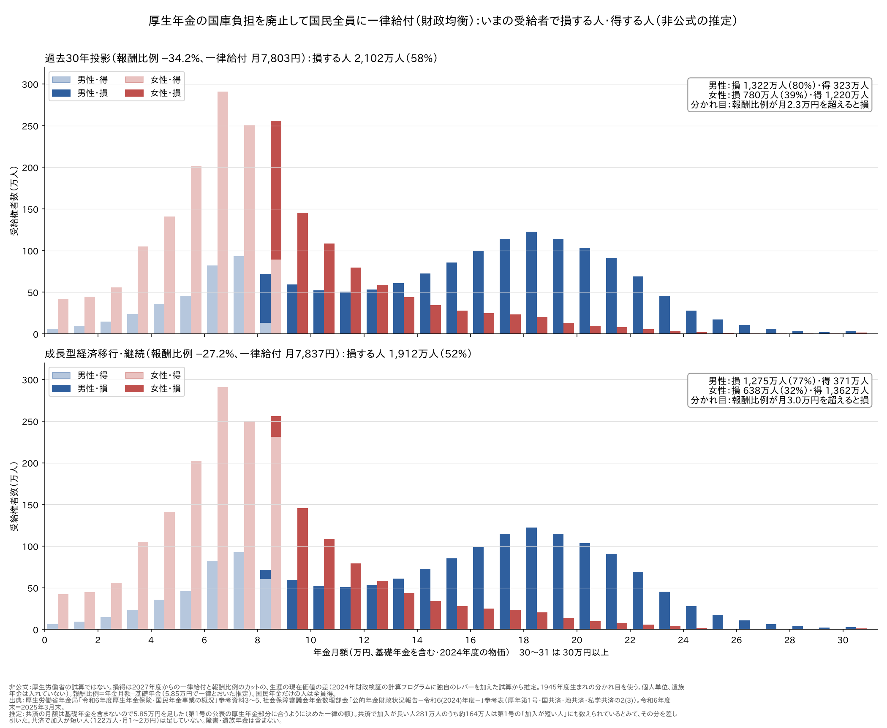
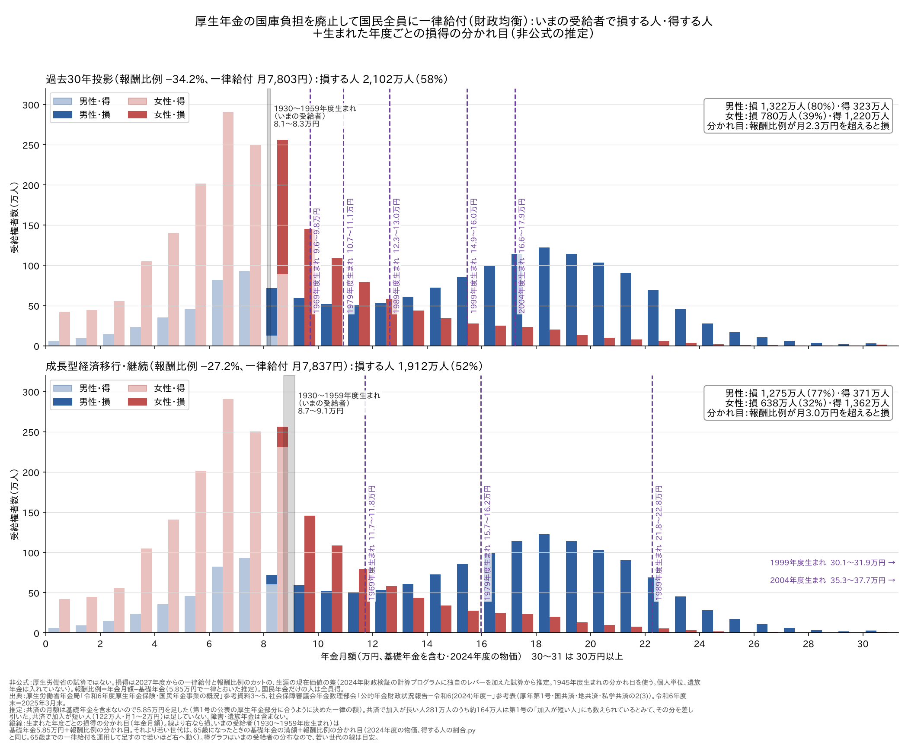
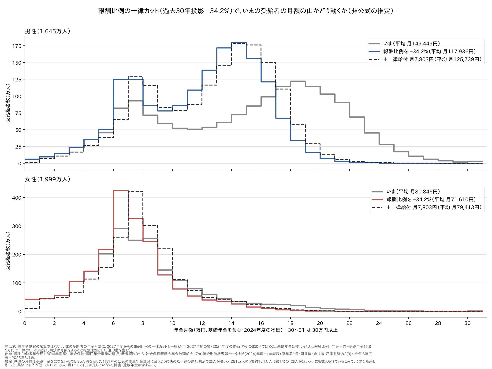

# 厚生年金の国庫負担を廃止して国民全員に一律給付したら、いまの受給者は — 損する人・得する人と、月額の山の動き

[得をする人の割合](厚生年金の国庫負担を廃止して国民全員に一律給付したら_得する人の割合.md) は、
厚労省の「年金額の分布推計」（65歳時点の**将来**の分布）で、これから65歳になる世代を見た。
ここでは、**いま年金をもらっている人**の実際の分布（[いま、年金はいくら払われているか](いまの年金の分布.md)、共済を含む3,645万人）に、
同じ案（予備番号701、財政均衡）の損得を当てはめた。

> **非公式の推定です。** 厚生労働省の試算ではありません。いまの受給者の基礎年金と報酬比例の分け方に
> 推定を置いています（「4. 推定で置いたところ」）。

## まとめ

| | 過去30年投影 | 成長型経済移行・継続 |
|---|---|---|
| 報酬比例の一律カット | −34.2% | −27.2% |
| 一律給付（2027年度、1人あたり） | 月7,803円 | 月7,837円 |
| **損をする人** | **2,102万人（58%）** | **1,912万人（52%）** |
| 　男性 | 1,322万人（80%） | 1,275万人（77%） |
| 　女性 | 780万人（39%） | 638万人（32%） |
| 損得の分かれ目（報酬比例の月額） | 2.3万円 | 3.0万円 |

- いまの受給者は、**報酬比例が月2.3万円（過去30年投影）／3.0万円（成長型）を超えると損**をする。
  生まれた年度（1930〜1959年度）でほとんど変わらない
- 損をするのは、会社員で加入が長い人の8〜9割と、公務員・私学の共済の人のほぼ全員。
  国民年金だけの人は全員が得をする
- 報酬比例のカットで、**男性の山は18〜19万円から14〜15万円へ動く**。女性の山はほとんど動かず、
  一律給付を足すと6〜7万円から7〜8万円へ少し右に動く。**男女の山が近づく**



---

## 1. 分かれ目はどこか

損得の定義は [世代別の損得](厚生年金の国庫負担を廃止して一律給付にしたら_世代ごとの損得.md) と同じで、
2027年度からの一律給付と報酬比例のカットを、生涯の現在価値（実質の運用利回りで割り引く）で比べる。

いまの受給者は、一律給付もカットも2027年度から**同じ期間だけ**続く。そのため、損得はほぼ
「毎月の一律給付」と「毎月のカット」の比べになり、分かれ目は **一律給付 ÷ カット率** に近い。

| | 過去30年投影 | 成長型経済移行・継続 |
|---|---|---|
| 報酬比例の分かれ目（1930〜1959年度生まれ） | 2.29〜2.41万円 | 2.89〜3.30万円 |
| 図に使った値（1945年度生まれ） | 男性2.34万円・女性2.35万円 | 男性3.00万円・女性3.03万円 |

月額で見るとこうなる（過去30年投影、2027年度）。

| 例 | 報酬比例のカット | 一律給付 | 差し引き |
|---|---|---|---|
| 会社員の男性 月17万円（報酬比例 約11万円） | −3.8万円 | +0.78万円 | **−3.0万円／月** |
| 会社員の女性 月11万円（報酬比例 約5万円） | −1.8万円 | +0.78万円 | **−1.0万円／月** |
| 加入が短い女性 月7万円（報酬比例 約1万円） | −0.4万円 | +0.78万円 | **+0.4万円／月** |
| 国民年金だけ 月5万円 | 0 | +0.78万円 | **+0.78万円／月** |

（報酬比例は、月額から基礎年金5.85万円を引いた推定。4. を参照）

### 生まれた年度ごとの分かれ目

同じ図に、生まれた年度ごとの分かれ目（年金月額）を縦線で足した。線より右なら損、左なら得。



| 生まれた年度 | 過去30年投影 | 成長型経済移行・継続 |
|---|---|---|
| 1930〜1959（いまの受給者） | 8.1〜8.3万円 | 8.7〜9.1万円 |
| 1969 | 9.6〜9.8万円 | 11.7〜11.8万円 |
| 1979 | 10.7〜11.1万円 | 15.7〜16.2万円 |
| 1989 | 12.3〜13.0万円 | 21.8〜22.8万円 |
| 1999 | 14.9〜16.0万円 | 30.1〜31.9万円 |
| 2004 | 16.6〜17.9万円 | 35.3〜37.7万円 |

（幅は女性〜男性。2024年度の物価）

- 若い世代ほど、65歳までに受け取る一律給付（運用して65歳まで積み上げる）が大きくなるので、分かれ目は右へ動く
- 成長型では、1989年度生まれの分かれ目（約22万円）が、いまの男性の山（18〜19万円）より右に来る。
  1999年度生まれ以降は、図の右端（30万円）より先になる
- いまの受給者の分かれ目は「基礎年金5.85万円＋報酬比例の分かれ目」、若い世代は「65歳になったときの基礎年金の満額＋報酬比例の分かれ目」
  （[得をする人の割合](厚生年金の国庫負担を廃止して国民全員に一律給付したら_得する人の割合.md) と同じ）で、基礎年金の置き方が違う
- 棒グラフは**いまの受給者**の分布である。若い世代が65歳になったときの分布はこれと違うので、若い世代の線は目安として見てほしい
  （若い世代の得をする人の割合は、65歳時点の分布推計を使った [得をする人の割合](厚生年金の国庫負担を廃止して国民全員に一律給付したら_得する人の割合.md) を参照）

## 2. 誰が損をするか

| グループ | 損をする人の割合：過去30年投影（男性／女性） | 成長型経済移行（男性／女性） |
|---|---|---|
| 会社員の厚生年金（加入が長い人） | 95%／84% | 94%／77% |
| 会社員の厚生年金（加入が短い人） | 39%／24% | 29%／13% |
| 公務員・私学の共済（加入が長い人） | 100%／100% | 100%／100% |
| 国民年金だけ | 0%／0% | 0%／0% |

- 図の濃い色が損、薄い色が得。月8〜9万円より上はほぼ全員が損、下は得になる
- 女性の8〜9万円の柱が途中で色が変わるのは、基礎年金を全員同じ額とおいた（4.）ため。
  実際には、基礎年金の多い人・少ない人が混ざっていて、もっとなだらかに入れ替わるはず

[得をする人の割合](厚生年金の国庫負担を廃止して国民全員に一律給付したら_得する人の割合.md) では、
1959年度生まれ（2024年度に65歳）で得をする人は過去30年投影で38%（男性18%・女性56%）だった。
いまの受給者全体で得をする人は42%（男性20%・女性61%）で、ほぼ同じ水準になる。

## 3. 月額の山はどう動くか



いまの受給者の月額に、報酬比例のカット（過去30年投影 −34.2%）と一律給付（月7,803円）をそのまま当てはめた。

| | いま | 報酬比例カット後 | ＋一律給付 | いちばん多い区分 |
|---|---|---|---|---|
| 男性の平均（過去30年投影） | 149,449円 | 117,936円 | **125,739円** | 18〜19万円 → 14〜15万円 |
| 女性の平均（過去30年投影） | 80,845円 | 71,610円 | **79,413円** | 6〜7万円 → 7〜8万円 |
| 男性の平均（成長型経済移行） | 149,449円 | 124,321円 | **132,158円** | 18〜19万円 → 15〜16万円 |
| 女性の平均（成長型経済移行） | 80,845円 | 73,481円 | **81,318円** | 6〜7万円 → 7〜8万円 |

- カットは報酬比例の大きい人ほど効くので、**男性の山は右のすそが削られて左へ詰まる**
- 女性は報酬比例が小さい人が多く、カットより一律給付のほうが大きい人が多い。女性の平均はほとんど変わらない
- この3,645万人の報酬比例のカットは**年8.4兆円**（成長型 6.7兆円）、この人たちが受け取る一律給付は**年3.4兆円**。
  差は、65歳未満の人たちの一律給付に回る（国民全員に配るため）

世代の中では報酬比例の大きい人から小さい人へ、世代の間では上の世代から下の世代へ、という
[得をする人の割合](厚生年金の国庫負担を廃止して国民全員に一律給付したら_得する人の割合.md) の2つの再分配が、
いまの受給者の分布では「男女の山が近づく」形で見える。

## 4. 推定で置いたところ

| 推定 | 内容 | 結果への影響 |
|---|---|---|
| 基礎年金の額 | 一人ひとりの基礎年金は分からないので、**全員5.85万円**とおき、残りを報酬比例とした。5.85万円は、公表の「厚生年金部分の総額」に合う額 | 基礎年金を満額（6.78万円）とおくと、損をする人は過去30年投影で51%（1,848万人）、成長型で47%（1,710万人）。**損をする人は5〜6割**と幅で見てほしい |
| 共済の旧3階 | 共済年金（2015年9月以前に受け取り始めた人）の月額には職域加算（旧3階）が入っているが、まるごと報酬比例としてカットした | 共済の人の損が少し大きめに出る |
| 分布の推定 | 共済の基礎年金、会社員と公務員の両方の期間がある人のだぶりなど | [いま、年金はいくら払われているか](いまの年金の分布.md) の5. |
| いまの額に当てはめる | 2025年3月末の月額に、2027年度のカットと一律給付をそのまま当てはめた（2024年度の物価） | 2年分のずれは小さいとみた |

そのほかは元の記事と同じ（個人単位、遺族年金は入れていない、一律カットは今のルールではできない、など。
[得をする人の割合](厚生年金の国庫負担を廃止して国民全員に一律給付したら_得する人の割合.md) の8.）。

## 5. 再現

```sh
# 得する人の割合.py の準備（./fetch.sh、通常試算と 701 の 3003・3002）をしておく
python3 勉強/応用編/いまの年金の分布.py report    # この記事の表
python3 勉強/応用編/いまの年金の分布.py graph     # この記事の図（図/いまの受給者の損得.png・図/いまの受給者の損得_世代別の分かれ目.png・図/いまの受給者_報酬比例カット.png）
```

## 出典

- 厚生労働省年金局「令和6年度 厚生年金保険・国民年金事業の概況」（令和7年12月）
  <https://www.mhlw.go.jp/content/001617995.pdf>
- 社会保障審議会年金数理部会「公的年金財政状況報告－令和6(2024)年度－」参考表 2(3)
  <https://www.mhlw.go.jp/stf/shingi2/0000198528_00017.html>
- カット率・一律給付・分かれ目：2024年財政検証の計算プログラムに、国庫負担の廃止と報酬比例の一律カットを加えた試算（予備番号701）
