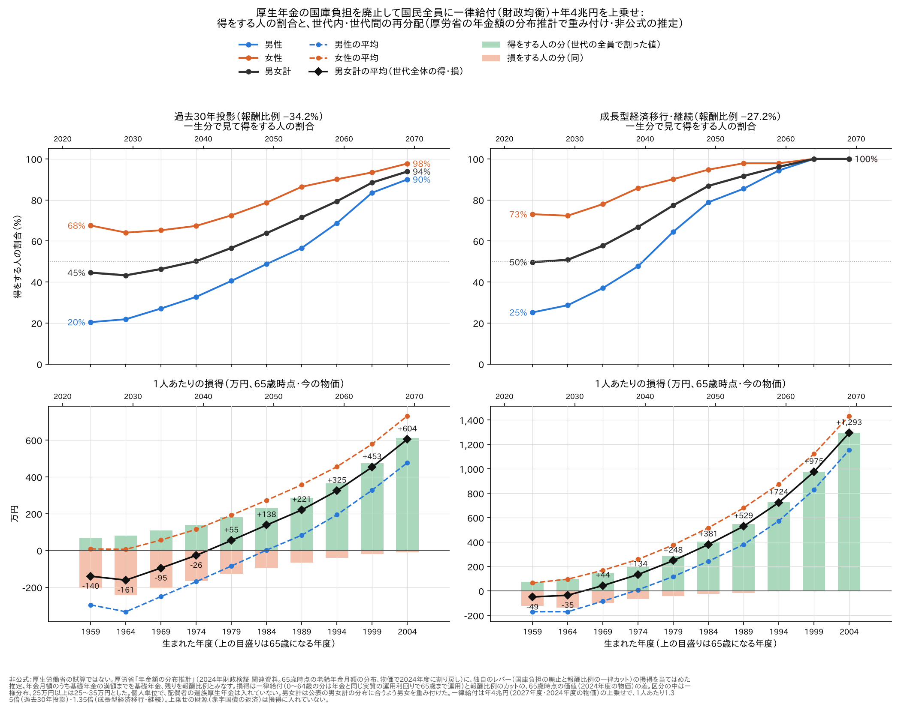
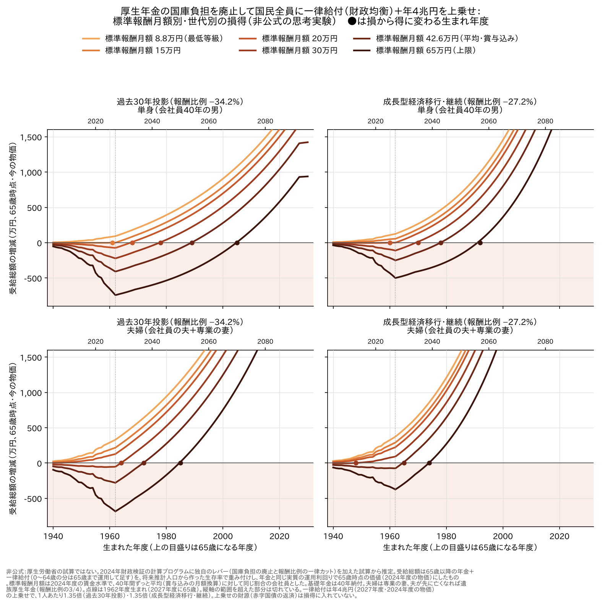

# 厚生年金の国庫負担を廃止して国民全員に一律給付（財政均衡）に、年4兆円を上乗せしたら — 損得

[得をする人の割合](厚生年金の国庫負担を廃止して国民全員に一律給付したら_得する人の割合.md) と
[標準報酬月額別の損得](厚生年金の国庫負担を廃止して国民全員に一律給付したら_標準報酬別の損得.md) の続き。
国庫負担をやめて浮いた財源で配る一律給付に、**別の財源（赤字国債）で年4兆円を上乗せ**したら、損得がどう変わるかを見た。

> **非公式の推定です。** 厚生労働省の試算ではありません。上乗せの財源（国債の返済）は、この記事の損得には入れていません。

## まとめ

| | 過去30年投影 | 成長型経済移行・継続 |
|---|---|---|
| 1人あたりの一律給付 | **1.35倍**（2027年度 月7,803円 → 10,535円） | **1.35倍**（月7,837円 → 10,568円） |
| 今の高齢者（1959年度生まれ）で得をする人 | 38% → **45%** | 45% → **50%** |
| 世代全体で得に変わる世代 | 1989年度 → **1979年度生まれ** | 1974年度 → **1969年度生まれ** |
| 平均的な会社員の単身が得に変わる世代 | 2000年度 → **1989年度生まれ** | 1987年度 → **1978年度生まれ** |
| 2004年度生まれで得をする人 | 76% → **94%** | ほぼ全員 → 全員 |

- 上乗せは全員に同じ額で配るので、**得をする人が増え、損の境目が上（収入の多い人・年上の世代）へ動く**
- それでも**今の高齢の会社員男性は損のまま**（1959年度生まれの男性の平均：−296万円・−170万円）
- 女性の平均は、どの世代もほぼプラスになる





図の読み方は [得をする人の割合](厚生年金の国庫負担を廃止して国民全員に一律給付したら_得する人の割合.md) の1.と同じ。

---

## 1. 何を足したか

| | 内容 |
|---|---|
| 元の案 | 2027年度から厚生年金（被用者年金4制度）の国庫負担をやめ、報酬比例を全員一律に削って財政を均衡させ（過去30年投影34.2%、成長型27.2%）、浮いた額を0歳からの全員に配る |
| 上乗せ | 2027年度に **4兆円**（2024年度の物価）を、同じように0歳からの全員に配る |
| 上乗せの動かし方 | そのあとは、元の一律給付の総額と同じ割合で動かす。つまり**1人あたりの一律給付を、どの年度も同じ倍率（約1.35倍）にする** |
| 変えないもの | 年金の側（報酬比例のカット）、保険料、税、基礎年金 |

倍率は「1 ＋ 4兆円 ÷ 2027年度の一律給付の総額（どちらも約11.4兆円）」で、過去30年投影1.350倍、成長型1.349倍。

## 2. 1人あたりの一律給付（月額・2024年度の物価）

| 年度 | 過去30年投影 | 手取りに対して | 成長型経済移行 | 手取りに対して |
|---|---|---|---|---|
| 2027 | 7,803円 → **10,535円** | 2.1% → 2.9% | 7,837円 → **10,568円** | 2.1% → 2.8% |
| 2040 | 8,492円 → 11,464円 | 2.2% → 3.0% | 9,172円 → 12,369円 | 2.1% → 2.8% |
| 2060 | 8,432円 → 11,383円 | 2.0% → 2.7% | 13,103円 → 17,669円 | 2.2% → 3.0% |
| 2100 | 10,517円 → 14,199円 | 2.0% → 2.7% | 25,638円 → 34,573円 | 2.4% → 3.3% |

夫婦と子ども2人なら、2027年度に月約4.2万円（過去30年投影）。

モデル世帯（夫婦）の所得代替率（2120年度、一律給付2人分を足した概算）：

| | 今の制度 | 国庫負担なし＋一律給付 | ＋上乗せ |
|---|---|---|---|
| 過去30年投影 | 50.4% | 46.0% | **約47.4%** |
| 成長型経済移行 | 57.6% | 約55.7% | **約57.4%** |

## 3. 得をする人の割合と、1人あたりの損得

一生分の損得（65歳時点の価値、2024年度の物価、万円）。「上乗せなし → あり」。

### 過去30年投影

| 生まれた年度 | 得をする人（男女計） | 男性 | 女性 | 男女計の平均 | 男性の平均 | 女性の平均 |
|---|---|---|---|---|---|---|
| 1959 | 38% → **45%** | 18 → 20% | 56 → 68% | −193 → **−140** | −343 → −296 | −49 → +9 |
| 1964 | 36% → **43%** | 19 → 22% | 53 → 64% | −232 → **−161** | −398 → −333 | −70 → +6 |
| 1969 | 39% → **46%** | 21 → 27% | 56 → 65% | −186 → **−95** | −336 → −250 | −40 → +57 |
| 1974 | 41% → **50%** | 23 → 33% | 58 → 67% | −140 → **−26** | −278 → −169 | −4 → +115 |
| 1979 | 45% → **57%** | 28 → 41% | 61 → 72% | −85 → **+55** | −218 → −84 | +47 → +192 |
| 1984 | 49% → **64%** | 33 → 49% | 64 → 79% | −29 → **+138** | −160 → +2 | +100 → +273 |
| 1989 | 53% → **71%** | 38 → 57% | 68 → 86% | +21 → **+221** | −110 → +83 | +153 → +358 |
| 1994 | 59% → **79%** | 45 → 69% | 74 → 90% | +90 → **+325** | −35 → +194 | +215 → +456 |
| 1999 | 69% → **88%** | 54 → 84% | 84 → 93% | +179 → **+453** | +59 → +328 | +298 → +579 |
| 2004 | 76% → **94%** | 65 → 90% | 87 → 98% | +285 → **+604** | +164 → +477 | +406 → +732 |

### 成長型経済移行・継続

| 生まれた年度 | 得をする人（男女計） | 男性 | 女性 | 男女計の平均 | 男性の平均 | 女性の平均 |
|---|---|---|---|---|---|---|
| 1959 | 45% → **50%** | 20 → 25% | 68 → 73% | −101 → **−49** | −216 → −170 | +9 → +66 |
| 1964 | 44% → **51%** | 23 → 29% | 65 → 72% | −107 → **−35** | −237 → −170 | +18 → +96 |
| 1969 | 48% → **58%** | 29 → 37% | 67 → 78% | −53 → **+44** | −174 → −84 | +66 → +169 |
| 1974 | 53% → **67%** | 34 → 48% | 72 → 86% | +6 → **+134** | −113 → +9 | +123 → +258 |
| 1979 | 61% → **77%** | 42 → 64% | 79 → 90% | +81 → **+248** | −41 → +118 | +203 → +377 |
| 1984 | 69% → **87%** | 54 → 79% | 84 → 95% | +168 → **+381** | +38 → +243 | +297 → +517 |
| 1989 | 77% → **92%** | 65 → 85% | 90 → 98% | +262 → **+529** | +120 → +380 | +403 → +679 |
| 1994 | 85% → **96%** | 75 → 94% | 95 → 98% | +390 → **+724** | +249 → +573 | +531 → +874 |
| 1999 | 91% → **100%** | 87 → 100% | 95 → 100% | +563 → **+975** | +427 → +829 | +699 → +1,122 |
| 2004 | 100% → **100%** | 100 → 100% | 100 → 100% | +787 → **+1,293** | +658 → +1,154 | +916 → +1,433 |

**読み取れること**

| | 中身 |
|---|---|
| 世代全体の損得 | プラスに変わる世代が、過去30年投影で10年、成長型で5年早まる |
| 男性 | 平均がプラスに変わるのは、過去30年投影で1984年度生まれ（なしでは1999年度）、成長型で1974年度生まれ（同1984年度） |
| 女性 | 平均は、過去30年投影でも1959年度生まれからほぼプラスになる |
| 今の高齢の男性 | 上乗せがあっても、1人あたり −170万〜−296万円の損が残る |

## 4. 標準報酬月額別（仮想の会社員）

40年間ずっと同じ標準報酬の会社員で見た、損から得に変わる生まれ年度と、1962年度生まれ（2027年度に65歳）の損得（万円）。

### 過去30年投影

| 標準報酬月額 | 単身：得に変わる生年度 | 単身：1962年度生まれ | 夫婦：得に変わる生年度 | 夫婦：1962年度生まれ |
|---|---|---|---|---|
| 8.8万円（最低等級） | どの世代も得 | +35 → +93 | どの世代も得 | +203 → +330 |
| 15万円 | 1968 → **ほぼどの世代も** | −57 → ±0 | どの世代も得 | +91 → +218 |
| 20万円 | 1975 → **1968** | −132 → −74 | 1962 → **どの世代も得** | +1 → +128 |
| 30万円 | 1988 → **1978** | −280 → −222 | 1971 → **1964** | −180 → −53 |
| 42.6万円（平均・賞与込み） | 2000 → **1989** | −467 → −409 | 1981 → **1972** | −406 → −280 |
| 65万円（上限） | 2018 → **2005** | −800 → −743 | 1996 → **1985** | −812 → −685 |

### 成長型経済移行・継続

| 標準報酬月額 | 単身：得に変わる生年度 | 単身：1962年度生まれ | 夫婦：得に変わる生年度 | 夫婦：1962年度生まれ |
|---|---|---|---|---|
| 8.8万円（最低等級） | どの世代も得 | +68 → +125 | どの世代も得 | +247 → +373 |
| 15万円 | 1963 → **どの世代も得** | −1 → +56 | どの世代も得 | +164 → +291 |
| 20万円 | 1968 → **1960** | −57 → +1 | 1942 → **どの世代も得** | +98 → +224 |
| 30万円 | 1977 → **1970** | −168 → −110 | 1964 → **1948** | −35 → +91 |
| 42.6万円（平均・賞与込み） | 1987 → **1978** | −308 → −250 | 1971 → **1965** | −202 → −76 |
| 65万円（上限） | 2002 → **1992** | −557 → −500 | 1983 → **1974** | −501 → −374 |

（年度は生まれた年度。「上乗せなし → あり」）

## 5. 読むときの注意

| 注意 | 中身 |
|---|---|
| **上乗せの財源は損得に入れていない** | 上乗せの4兆円は赤字国債でまかなう前提で、その返済の負担（誰がいつ払うか）はこの記事の損得に入れていない。財源の議論は別に要る |
| 上乗せの動かし方 | 上乗せを一律給付の総額と同じ割合で動かした（1人あたりの倍率を一定）。名目で4兆円に据え置くと、上乗せの効果は年とともに小さくなる |
| そのほかは元の記事と同じ | 基礎年金を満額とみなす、個人単位、一律給付を全部年金と同じ利回りで運用し続ける前提、一律カットは今のルールではできない、など（[得をする人の割合](厚生年金の国庫負担を廃止して国民全員に一律給付したら_得する人の割合.md) の8.） |

## 6. 再現

```sh
# 得する人の割合.py・標準報酬別の損得.py の準備（./fetch.sh、通常試算と 701 の 3003・3002）をしておく
python3 勉強/応用編/一律給付の上乗せ.py report    # この記事の表
python3 勉強/応用編/一律給付の上乗せ.py graph     # この記事の図（図/得する人の割合_上乗せ4兆円.png・図/標準報酬別の損得_上乗せ4兆円.png）
```

計算は `得する人の割合.py`・`標準報酬別の損得.py` と同じで、1人あたりの一律給付だけを倍率倍にしている。

## 出典

- 厚生労働省「令和6(2024)年財政検証 関連資料 年金額の分布推計」：詳細結果等3（<https://www.mhlw.go.jp/content/001270447.zip>）
- 計算プログラム：厚生労働省「令和6(2024)年財政検証」詳細結果等4（資料001365945）

---

*計算：厚生労働省「令和6(2024)年財政検証」公表の計算プログラムを、有志のリポジトリでビルド・実行したもの。
現行制度の財政見通しは公表値と全項目一致。国庫負担をなくしたシナリオ、一律給付と上乗せ、分布推計の表への当てはめは非公式の推定。*
