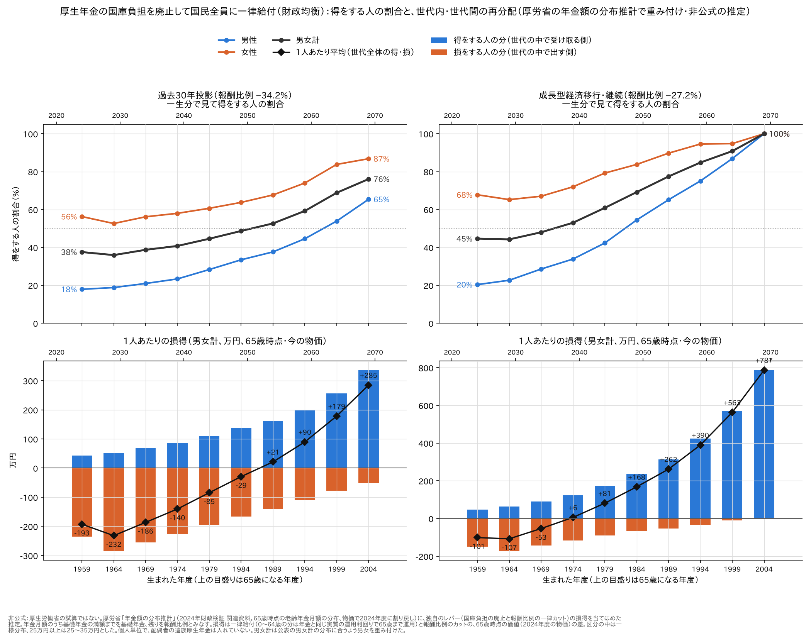

# 厚生年金の国庫負担を廃止して国民全員に一律給付したら、何割の人が得をするか（財政均衡） — 年金額の分布推計で重み付け

[標準報酬月額別の損得](厚生年金の国庫負担を廃止して国民全員に一律給付したら_標準報酬別の損得.md) の続きである。
前の記事は「40年ずっと同じ標準報酬の会社員」という仮想の人で損得を出した。ここでは、厚生労働省が実際の加入記録から
推計した**65歳時点の年金額の分布**（年金額の分布推計）を使い、**生まれた年度ごとに何割の人が得をするか**と、
**お金が世代の中で動くのか、世代と世代の間で動くのか**を見た。

**結論：この案は、世代の中の再分配と、世代と世代の間の移転を同時に起こす。**

- **今の高齢者（1959年度生まれ）で得をするのは4割前後。** 過去30年投影で38%、成長型経済移行で45%。
  男性は2割、女性は6〜7割。女性は厚生年金の期間が短い人が多く、報酬比例のカットより一律給付のほうが大きくなりやすい
- **若い世代ほど得をする人が増える。** 過去30年投影でも1989年度生まれで過半数、2004年度生まれで76%。
  成長型経済移行では1974年度生まれで過半数、1999年度生まれで91%
- **世代の中では**、報酬比例の大きい人（多くは男性・会社員の期間が長い人）から、小さい人（女性・自営業や専業主婦の期間が長い人）へお金が動く
- **世代と世代の間では**、上の世代から下の世代へお金が動く。1人あたり平均の損得は、過去30年投影で1984年度生まれまで、
  成長型経済移行で1969年度生まれまでマイナスで、それより若い世代はプラスになる

以下は**非公式の推定**で、厚生労働省の試算ではない。若い世代の得は、一律給付を全部、年金と同じ利回りで
運用し続ける前提に大きく頼っている（6.）。



---

## 1. 何を計算したか

**案の中身**は元の記事と同じである。2027年度から被用者年金4制度の国庫負担をなくし、報酬比例を全員一律に削って
2120年度に財政を均衡させ（過去30年投影で34.2%、成長型経済移行で27.2%）、国が払わずに済んだ額を0歳からの全員に
同じ額で毎年配る。保険料と税は今のまま。

**人の分布**は、厚生労働省「年金額の分布推計」（2024年財政検証の関連資料）の「老齢年金の年金月額分布（現行制度）」を使った。

- 1959〜2004年度生まれ（5年おき）× 男女の、**65歳時点の老齢年金月額**の分布。7区分（5万円未満、5〜7万、7〜10万、10〜15万、15〜20万、20〜25万、25万円以上）
- 金額は物価で2024年度に割り戻した実質額
- 厚生労働省は、2021年度末時点の個人の被保険者記録（5分の1抽出）から一人ずつ推計している。
  このリポジトリでは、その出発点の個人の記録が公開されていないので、分布推計そのものは再現できない（[出力カタログ](../../検証/出力カタログ.md)）。ここでは公表された結果の表を使う
- 分布推計が出ているのは**成長型経済移行・継続**と**過去30年投影**の2つなので、この2つで計算した

**損得の出し方**

1. 一人ひとりの年金月額のうち、**基礎年金の満額（その世代の65歳時点）までを基礎年金、残りを報酬比例**とみなす
2. 損得（65歳時点の価値、2024年度の物価）＝ 一律給付 − 報酬比例のカット
   - 一律給付：65歳以降に受け取る分に、0〜64歳に受け取った分を年金と同じ実質の運用利回り（過去30年投影2.2%、成長型3.2%）で65歳まで運用して足す
   - 報酬比例のカット：報酬比例 × カット率を、生存率で重み付けして65歳時点の価値にする（男女別の生存率）
3. 区分の中は一様に分布しているとし、25万円以上の区分は25〜35万円とおいた
4. 男女計は、公表の男女計の分布に合うように男女を重み付けた（ほぼ半々になる）

計算の部品（生存率・一律給付・カット率）は、[世代ごとの損得](厚生年金の国庫負担を廃止して一律給付にしたら_世代ごとの損得.md)・
[標準報酬月額別の損得](厚生年金の国庫負担を廃止して国民全員に一律給付したら_標準報酬別の損得.md) と同じである。

## 2. 損得の分かれ目

一律給付とカットの価値がつり合う年金月額（65歳時点）。**これより年金月額が低い人は得、高い人は損**をする。

| 生まれた年度（65歳になる年度） | 過去30年投影（男／女） | 成長型経済移行（男／女） |
|---|---|---|
| 1959（2024） | 9.2万円／9.2万円 | 10.0万円／10.1万円 |
| 1969（2034） | 9.8万円／9.6万円 | 11.8万円／11.7万円 |
| 1979（2044） | 11.1万円／10.7万円 | 16.2万円／15.7万円 |
| 1989（2054） | 13.0万円／12.3万円 | 22.8万円／21.8万円 |
| 1999（2064） | 16.0万円／14.9万円 | 31.9万円／30.1万円 |
| 2004（2069） | 17.9万円／16.6万円 | 37.7万円／35.3万円 |

若い世代ほど、0〜64歳に受け取る一律給付が多く、運用で大きく増えるので、分かれ目が上がる。

## 3. 得をする人の割合

| 生まれた年度 | 過去30年投影：男女計 | 男性 | 女性 | 成長型経済移行：男女計 | 男性 | 女性 |
|---|---|---|---|---|---|---|
| 1959 | **38%** | 18% | 56% | **45%** | 20% | 68% |
| 1964 | 36% | 19% | 53% | 44% | 23% | 65% |
| 1969 | 39% | 21% | 56% | 48% | 29% | 67% |
| 1974 | 41% | 23% | 58% | **53%** | 34% | 72% |
| 1979 | 45% | 28% | 61% | 61% | 42% | 79% |
| 1984 | 49% | 33% | 64% | 69% | 54% | 84% |
| 1989 | **53%** | 38% | 68% | 77% | 65% | 90% |
| 1994 | 59% | 45% | 74% | 85% | 75% | 95% |
| 1999 | 69% | 54% | 84% | 91% | 87% | 95% |
| 2004 | **76%** | 65% | 87% | 100%（※） | 100% | 100% |

※成長型経済移行の2004年度生まれは、分かれ目（男37.7万円、女35.3万円）がいちばん上の区分（25万円以上）を25〜35万円とおいた範囲より上に来るので、この置き方では全員が得になる。上の区分の中身が分からないので、粗い値である。

- 今の高齢者でも、**女性の過半数**は得をする。男性で得をするのは2割
- 過去30年投影では、2004年度生まれでも男性の35%が損をする。厚生年金に長く入り、報酬比例が大きい人たちである

## 4. 世代の中の再分配と、世代と世代の間の移転

1人あたりの損得（男女計、万円、65歳時点の価値）を、得をする人の分と損をする人の分に分けた。
**1人あたり平均**がその世代全体の得・損、**得をする人の分と損をする人の分**が世代の中でのお金の動きである。

### 過去30年投影

| 生まれた年度 | 1人あたり平均 | うち得をする人の分 | うち損をする人の分 | 男性の平均 | 女性の平均 |
|---|---|---|---|---|---|
| 1959 | **−193** | +43 | −236 | −343 | −49 |
| 1964 | −232 | +53 | −285 | −398 | −70 |
| 1969 | −186 | +69 | −256 | −336 | −40 |
| 1974 | −140 | +87 | −227 | −278 | −4 |
| 1979 | −85 | +111 | −195 | −218 | +47 |
| 1984 | −29 | +137 | −167 | −160 | +100 |
| 1989 | **+21** | +162 | −141 | −110 | +153 |
| 1994 | +90 | +199 | −109 | −35 | +215 |
| 1999 | +179 | +257 | −78 | +59 | +298 |
| 2004 | **+285** | +336 | −52 | +164 | +406 |

### 成長型経済移行・継続

| 生まれた年度 | 1人あたり平均 | うち得をする人の分 | うち損をする人の分 | 男性の平均 | 女性の平均 |
|---|---|---|---|---|---|
| 1959 | **−101** | +48 | −149 | −216 | +9 |
| 1964 | −107 | +65 | −172 | −237 | +18 |
| 1969 | −53 | +90 | −143 | −174 | +66 |
| 1974 | **+6** | +122 | −116 | −113 | +123 |
| 1979 | +81 | +172 | −91 | −41 | +203 |
| 1984 | +168 | +236 | −68 | +38 | +297 |
| 1989 | +262 | +314 | −52 | +120 | +403 |
| 1994 | +390 | +424 | −34 | +249 | +531 |
| 1999 | +563 | +572 | −9 | +427 | +699 |
| 2004 | **+787** | +787 | 0 | +658 | +916 |

世代ごとに見ると、お金の動き方は4つに分けられる（成長型経済移行の場合。2026年度の年齢はおよそ）。

| 世代 | お金の動き |
|---|---|
| 1969年度生まれより上（50代後半より上） | 世代の中で損得が分かれ（男性→女性、報酬比例の多い人→少ない人）、**世代全体でも損**をして、若い世代へ移す側になる |
| 1974年度生まれ前後（50代前半） | 世代全体ではほぼ±0。**世代の中の再分配だけ**にいちばん近い |
| 1979〜1994年度生まれ（30代〜40代） | 世代全体では得（上の世代から受け取る側）。世代の中では、損をする人もまだ残る |
| 1999年度生まれより下（20代後半より下） | ほぼ全員が得。世代の中の違いは得の大きさだけになる |

過去30年投影では、世代全体の損得がプラスに変わるのが1989年度生まれ（30代後半）と遅く、2004年度生まれでも損をする人が残る。
世代の中の再分配は、どの世代でも続く。

## 5. この案の再分配の性格

- **世代の中**では、報酬比例（＝現役のときの報酬と期間）に比例してカットし、全員に同じ額を配るので、
  報酬比例の大きい人から小さい人へお金が動く。今の基礎年金も、報酬に比例する厚生年金保険料から定額の給付を
  支えているので世代の中の再分配をしているが、この案はそれを強める
- **世代と世代の間**では、お金を受け取る時期が「老後」から「子ども・現役のとき」へ前倒しされる。
  若い世代は早く受け取る分だけ得をし、早く受け取れないまま報酬比例を削られる今の高齢者・中高年が損をする。
  賦課方式の年金では、ふつうは上の世代ほど給付と負担の倍率が高い。この案はその向きを逆に動かす
- **新しい税は要らない。** 財源は、今も厚生年金に入っている国庫負担を付け替えるだけで、国の財政は国庫負担をなくす前と変わらない

## 6. 読むときの注意

- **非公式の推定である。** 公表された計算プログラムに独自のレバーを加えた試算の結果を、厚生労働省の分布推計の公表表に当てはめた
- **基礎年金を満額とみなした。** 未納・免除で基礎年金が満額より少なく、報酬比例もある人は、報酬比例を小さく見積もっているので、
  得をする人の割合は少し多めに出ている可能性がある
- **個人単位である。** 夫が亡くなったあとに妻が受け取る遺族厚生年金のカットは入れていない（女性の得が少し多めに出る方向）
- **一律給付を全部、年金と同じ実質の利回り（2.2%・3.2%）で運用し続ける前提である。** 生活費や子育てに使えば、
  若い世代の得はずっと小さくなる。賃金上昇率で換算すると、得はもっと小さい（[世代ごとの損得](厚生年金の国庫負担を廃止して一律給付にしたら_世代ごとの損得.md)）
- **一律カットは今のルールではできない。** 名目下限があるので、すでに受け取っている人の年金を名目で3割下げることはできない
- 区分が7つしかなく、25万円以上の区分の中身が分からない。成長型経済移行の若い世代の割合は、この置き方に左右される
- 分布推計は現行制度（適用拡大などを入れない場合）の分布を使った。分布推計の対象は1959年度生まれからなので、それより上の今の受給者は入っていない
- 世代全体の平均は、男女をほぼ半々で重み付けた値で、世代の人数（コホートの大きさ）は掛けていない

## 7. 再現

```sh
./fetch.sh                                         # papers/001270447/（年金額の分布推計.xlsx）を取得
検証/実行/run_pipeline.sh 3003 1 1 0 2
検証/実行/run_pipeline.sh 3002
python3 勉強/応用編/国庫負担の廃止.py run 3003
python3 勉強/応用編/国庫負担の廃止.py run 3002
python3 勉強/応用編/得する人の割合.py report      # この記事の表
python3 勉強/応用編/得する人の割合.py graph       # この記事の図（図/得する人の割合.png）
```

## 出典

- 厚生労働省「令和6(2024)年財政検証 関連資料 年金額の分布推計」：詳細結果等3（<https://www.mhlw.go.jp/content/001270447.zip>）の
  `財政検証関連資料/05年金額の分布推計/年金額の分布推計.xlsx`、シート「老齢年金の年金月額分布（現行制度）」
- 分布推計の方法（2021年度末の個人の被保険者記録の5分の1抽出から推計）：
  厚生労働省 <https://www.mhlw.go.jp/content/001270498.pdf>、
  財政検証結果レポート第5章 <https://www.mhlw.go.jp/stf/seisakunitsuite/bunya/nenkin/nenkin/zaisei-kensyo/R6suuri_report.html>
- 計算プログラム：厚生労働省「令和6(2024)年財政検証」詳細結果等4（資料001365945）

---

*計算：厚生労働省「令和6(2024)年財政検証」公表の計算プログラムを、有志のリポジトリでビルド・実行したもの。
現行制度の財政見通しは公表値と全項目一致。国庫負担をなくしたシナリオ、一律給付と、分布推計の表への当てはめは非公式の推定。*
