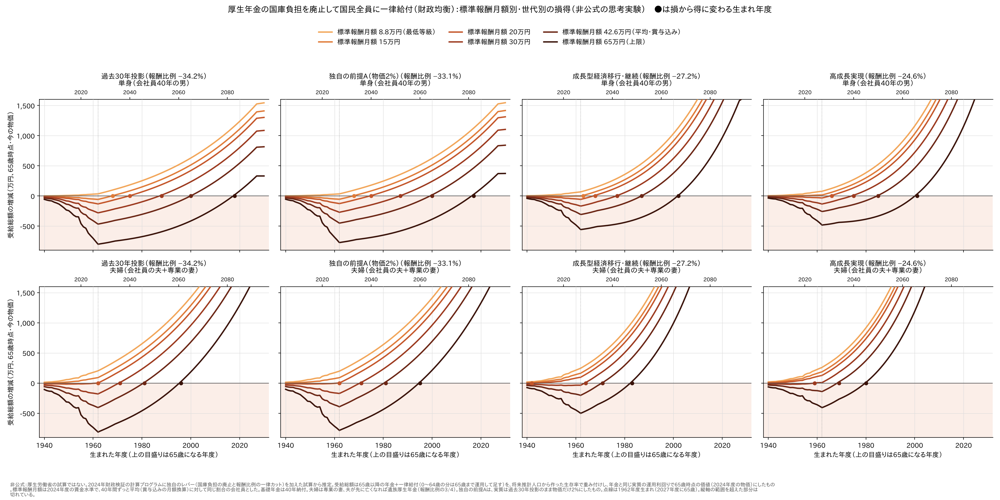

# 厚生年金の国庫負担を廃止して国民全員に一律給付したら、誰が得して誰が損するか（財政均衡） — 標準報酬月額別・世代別

[厚生年金の国庫負担を廃止して国民全員に一律給付したら.md](厚生年金の国庫負担を廃止して国民全員に一律給付したら.md) の続きである。
厚生年金への国庫負担（年12兆円ほど）をやめ、報酬比例を全員一律に削って財政を均衡させ、浮いた財源を0歳からの全員に
同じ額で配る。この案で**誰が得して誰が損するか**を、会社員の**標準報酬月額**と**生まれた年度**ごとに見た。
経済前提は、公式の3ケースに、最近の実績に合わせた独自の前提を1つ足して4つ並べた。

**結論：損得を分けるのは、標準報酬月額（＝報酬比例の大きさ）と、生まれた年度（＝若いうちに受け取る一律給付の多さ）の2つである。**

- **今の高齢者（2027年度に65歳になる1962年度生まれ）は、平均的な会社員なら損をする。**
  単身で −258万〜−467万円、夫婦で −141万〜−406万円（一生分の受給総額、65歳時点の価値）
- **標準報酬月額が低い人は、今の高齢者でも得をする。** 単身なら8.8万円（最低等級）、夫婦なら夫が15万円くらいまでは、
  どの経済前提でも得になる
- **若い世代ほど得になる。** 平均的な会社員の単身が得に変わるのは、過去30年投影・独自の前提Aで**2000年度生まれ**から、
  成長型経済移行で1987年度、高成長実現で1985年度生まれから。夫婦はそれぞれ1981年度・1971年度・1969年度生まれから
- **物価を2%にしても（独自の前提A）、損得はほとんど変わらない。** 損得を決めるのは実質の伸び（賃金・運用利回り）である

以下は**非公式の思考実験**で、厚生労働省の試算ではない。若い世代の得は、受け取った一律給付を全部、
年金と同じ利回りで運用し続ける前提に大きく頼っている（7.）。

実際の年金額の分布で重み付けした「何割の人が得をするか」は [得をする人の割合](厚生年金の国庫負担を廃止して国民全員に一律給付したら_得する人の割合.md)。一律給付に別の財源で年4兆円を足した場合は [一律給付に年4兆円を上乗せしたら](厚生年金の国庫負担を廃止して国民全員に一律給付したら_上乗せ4兆円.md)。



---

## 1. 何を計算したか

年金の側は元の記事と同じである。

- 2027年度から、被用者年金4制度（厚生年金・国共済・地共済・私学共済）の国庫負担を収入に入れない
- 報酬比例の年金を、すでに受け取っている人も含めて**全員一律に、毎年同じ率で**削って、2120年度に均衡させる
- 国が払わずに済んだ額を、その年度の0歳からの全員に同じ額で毎年配る（一律給付）。保険料と税は今のまま

損得は、**一生に受け取る年金と一律給付の合計（受給総額）が、今の制度と比べてどれだけ増えるか減るか**で見る。

- 65歳以降に受け取る年金と一律給付を、その年まで生きている確率で重み付けし、年金と同じ実質の運用利回りで
  65歳時点の価値に割り戻して足す。金額は2024年度の物価で表す
- 0〜64歳に受け取る一律給付は、同じ利回りで65歳まで運用して足す
- たとえば「−258万円」は、**65歳のときに一括で受け取る（払う）としたら、258万円分の損に当たる**という意味である

世帯は2つ。

| 世帯 | 中身 |
|---|---|
| 単身 | 会社員40年の男性。基礎年金は40年納付 |
| 夫婦 | 会社員の夫＋専業の妻（第3号）。基礎年金は2人とも40年納付。夫が先に亡くなれば、妻に遺族厚生年金（報酬比例の3/4）。一律給付は2人分 |

標準報酬月額は、2024年度の賃金水準で置いた。**40年間ずっと、平均に対して同じ割合の会社員**とし、報酬比例は
「平均の人の報酬比例 × その割合」とした。平均は、モデル年金の報酬比例から逆算した**賞与込みの月額換算で約42.6万円**
（年収にして約511万円）。ほかの水準は賞与なしとした。

| 標準報酬月額 | 平均に対する割合 | 年収の目安 |
|---|---|---|
| 8.8万円（最低等級） | 21% | 約106万円 |
| 15万円 | 35% | 約180万円 |
| 20万円 | 47% | 約240万円 |
| 30万円 | 70% | 約360万円 |
| 42.6万円（平均・賞与込み） | 100% | 約511万円 |
| 65万円（上限） | 153% | 約780万円 |

## 2. 4つの経済前提

| | 過去30年投影（公式） | **独自の前提A** | 成長型経済移行・継続（公式） | 高成長実現（公式） |
|---|---|---|---|---|
| 物価上昇率（長期） | 0.8% | **2.0%**（2026年度から） | 2.0% | 2.0% |
| 実質賃金上昇率（長期） | 0.5% | 0.5% | 1.5% | 2.0% |
| 実質の運用利回り（物価に対する） | 2.2% | 2.2% | 3.2% | 3.4% |
| 人口・労働力 | 労働参加漸進 | 過去30年投影と同じ | 労働参加進展 | 労働参加進展 |
| 報酬比例の一律カット | **34.2%** | **33.1%** | **27.2%** | **24.6%** |
| 所得代替率（2120年度）：現行 → カット後 | 50.4% → 41.9% | 51.8% → 43.6% | 57.6% → 50.8% | 56.9% → 50.8% |

### 独自の前提Aを置いた理由

最近の数字は、**物価は高成長実現並みだが、実質の伸びは過去30年投影並みか、それより弱い**。

| 指標 | 最近の実績・見通し | 近いケース |
|---|---|---|
| 物価 | 2025年度 +2.6%（2022年度から4年続けて2%超え）。日銀の物価目標は2% | 高成長実現・成長型経済移行 |
| 実質賃金 | 2025年度 −0.5%（4年連続のマイナス）。名目は+2.5%、春闘は3年連続5%台 | 過去30年投影より下 |
| 実質GDP成長率 | 2025年度 +0.8%。内閣府の見込みは2026年度0.9%・2027年度1.1% | 過去30年投影〜成長型経済移行 |
| TFP上昇率 | 内閣府の見方で足元0.6%程度（高成長実現は1.4%） | 過去30年投影 |
| 実質の長期金利 | 30年国債3.95% − 物価2% ≒ 2.0%。GPIF の運用目標は名目賃金+1.9% | 過去30年投影 |

そこで、**実質（賃金・運用利回り・人口・労働力）は過去30年投影のまま、物価だけ2026年度から2.0%**にした。
2025年度は実績（物価 +2.6%、実質賃金 −0.5%）を入れた。運用利回りの2025年度の実績（GPIF の名目+16.47%）は
入れていない（入れると積立金が増え、少し良くなる方向）。公式のケースは前提どうしのつじつまを合わせて作っているが、
この前提は物価だけ別に置いたもので、**非公式の前提**である。

物価が2%あると、名目下限に引っかからずにマクロ経済スライドが毎年フルに効く。そのため今の制度のままでも
基礎年金の調整が2057年度→2050年度に早く終わり、所得代替率は50.4%→51.8%に上がる。

## 3. 月々の差し引き（平均的な会社員）

2024年度の物価で表した月額。報酬比例のカットは、この試算のとおり毎年同じ率である。

| | 過去30年投影 | 独自の前提A | 成長型経済移行 | 高成長実現 |
|---|---|---|---|---|
| **2027年度** 報酬比例 | 91,837円 → 60,453円（**−31,383円**） | 91,726円 → 61,367円（**−30,360円**） | 93,576円 → 68,078円（**−25,498円**） | 94,227円 → 71,037円（**−23,190円**） |
| 一律給付（1人） | +7,803円 | +7,783円 | +7,837円 | +7,845円 |
| 差し引き：単身 ／ 夫婦 | **−23,580円 ／ −15,777円** | **−22,576円 ／ −14,793円** | **−17,662円 ／ −9,825円** | **−15,346円 ／ −7,501円** |
| **2060年度** 報酬比例 | 105,602円 → 69,515円（−36,087円） | 105,475円 → 70,565円（−34,910円） | 146,294円 → 106,431円（−39,864円） | 172,092円 → 129,739円（−42,354円） |
| 一律給付（1人） | +8,432円 | +8,435円 | +13,103円 | +14,720円 |
| 差し引き：単身 ／ 夫婦 | −27,655円 ／ −19,224円 | −26,475円 ／ −18,041円 | −26,761円 ／ −13,658円 | −27,634円 ／ −12,914円 |

一律給付は、どの前提でも現役の手取りの約2%で安定する。65歳以上だけを見ると、平均的な会社員は単身でも夫婦でも
毎月減る。報酬比例が小さい人ほど減り方は小さく、平均の4分の1〜3分の1より報酬比例が少ない人は増える。

## 4. 一生分の損得：今の高齢者（1962年度生まれ）

2027年度にちょうど65歳になる世代で、65歳までに受け取る一律給付が無く、報酬比例だけがまるごと削られる。
**損がいちばん大きい世代**である（万円）。

| 標準報酬月額 | 単身：過去30年 ／ 前提A ／ 成長型 ／ 高成長 | 夫婦：過去30年 ／ 前提A ／ 成長型 ／ 高成長 |
|---|---|---|
| 8.8万円（最低等級） | **+35 ／ +34 ／ +68 ／ +78** | **+203 ／ +198 ／ +247 ／ +261** |
| 15万円 | −57 ／ −55 ／ −1 ／ +16 | **+91 ／ +89 ／ +164 ／ +187** |
| 20万円 | −132 ／ −127 ／ −57 ／ −33 | +1 ／ +2 ／ +98 ／ +127 |
| 30万円 | −280 ／ −270 ／ −168 ／ −133 | −180 ／ −173 ／ −35 ／ +9 |
| 42.6万円（平均） | **−467 ／ −451 ／ −308 ／ −258** | **−406 ／ −392 ／ −202 ／ −141** |
| 65万円（上限） | −800 ／ −774 ／ −557 ／ −482 | −812 ／ −784 ／ −501 ／ −407 |

- 損の大きさは、報酬比例の大きさにほぼ比例する。上限の人は平均の人の約1.7〜1.9倍の損になる
- 夫婦は一律給付が2人分になるので、単身よりずっと得をしやすい

## 5. 損から得に変わる世代

その生年度より後に生まれた人は、一生分で見て得になる。

| 標準報酬月額 | 単身：過去30年 ／ 前提A ／ 成長型 ／ 高成長 | 夫婦：過去30年 ／ 前提A ／ 成長型 ／ 高成長 |
|---|---|---|
| 8.8万円（最低等級） | どの世代も得 | どの世代も得 |
| 15万円 | 1968 ／ 1968 ／ 1963 ／ どの世代も得 | どの世代も得 |
| 20万円 | 1975 ／ 1975 ／ 1968 ／ 1966 | 1962 ／ 1962 ／ 1942 ／ どの世代も得 |
| 30万円 | 1988 ／ 1987 ／ 1977 ／ 1975 | 1971 ／ 1971 ／ 1964 ／ 1959 |
| 42.6万円（平均） | **2000 ／ 2000 ／ 1987 ／ 1985** | **1981 ／ 1981 ／ 1971 ／ 1969** |
| 65万円（上限） | 2018 ／ 2017 ／ 2002 ／ 2001 | 1996 ／ 1995 ／ 1983 ／ 1980 |

（年度は生まれた年度）

- **過去30年投影と独自の前提Aでは、平均的な会社員の単身は2000年度生まれまで損をする。** 今の20代半ばより上である
- 成長型経済移行・高成長実現では、損をする世代が13〜15年ほど短くなる。報酬比例のカットが小さく（27.2%・24.6%）、運用利回りが高い（3.2%・3.4%）ためである
- 若い世代ほど得になるのは、0歳から65歳まで受け取る一律給付が、運用で大きく増えるからである

## 6. 若い世代（2000年度・2010年度生まれ）

| 標準報酬月額 | 単身 2000年度生まれ：過去30年 ／ 前提A ／ 成長型 ／ 高成長 | 単身 2010年度生まれ：過去30年 ／ 前提A ／ 成長型 ／ 高成長 |
|---|---|---|
| 8.8万円 | +629 ／ +624 ／ +1,034 ／ +1,162 | +897 ／ +894 ／ +1,612 ／ +1,859 |
| 42.6万円（平均） | +2 ／ +18 ／ +379 ／ +463 | +238 ／ +256 ／ +851 ／ +1,006 |
| 65万円（上限） | −415 ／ −386 ／ −57 ／ −2 | −201 ／ −168 ／ +345 ／ +439 |

## 7. 読むときの注意

- **非公式の思考実験である。** 公表された計算プログラムに、独自のレバー（国庫負担の廃止と報酬比例の一律カット）を加えて計算した。
  独自の前提Aは、公式のケースではない
- **一律カットは今のルールではできない。** 名目下限があるので、すでに受け取っている人の年金を名目で3割下げることはできない。
  国庫負担の穴の大きさを測る物差しとして置いた
- **若い世代の得は、一律給付を全部、年金と同じ実質の利回り（2.2%・3.4%）で運用し続ける前提に頼っている。**
  生活費や子育てに使えば、運用で増える分はずっと小さくなる。賃金上昇率で換算すると、得はずっと小さい
  （[世代ごとの損得](厚生年金の国庫負担を廃止して一律給付にしたら_世代ごとの損得.md)の給付負担倍率）
- **保険料は今と同じなので、損得は受け取る額の差だけで決まる。** 一律給付の財源は、もともと年金に使われていた国庫負担である。
  若い世代の得の一部は、今の高齢者とこれから65歳になる会社員の損でまかなわれている
- 標準報酬月額は「40年ずっと平均に対して同じ割合」とした。等級が上がっていく人や、国民年金の期間がある人は、その間になる
- 受け取り始めたあとの報酬比例は実質で一定とした（既裁定の8割下支えなどは入れていない）。99歳まで受け取るとした
- 税・社会保険料・生活保護との関係は入れていない

## 8. 再現

```sh
# 通常試算（予備番号000）を4つ流す
検証/実行/run_pipeline.sh 3003 1 1 0 2
検証/実行/run_pipeline.sh 3002
検証/実行/run_pipeline.sh 3001
python3 勉強/応用編/標準報酬別の損得.py econ      # 独自の前提A の経済前提 econ-3901.csv を作る
検証/実行/run_pipeline.sh 3901 1 1 0 2

# 国庫負担の廃止（予備番号701・702）
python3 勉強/応用編/国庫負担の廃止.py run 3003
python3 勉強/応用編/国庫負担の廃止.py run 3002
python3 勉強/応用編/国庫負担の廃止.py run 3001
python3 勉強/応用編/国庫負担の廃止.py run 3901

python3 勉強/応用編/標準報酬別の損得.py report    # この記事の表
python3 勉強/応用編/標準報酬別の損得.py graph     # この記事の図（図/標準報酬別の損得.png）
```

平均的な会社員の値（単身・夫婦）は、[世代ごとの損得](厚生年金の国庫負担を廃止して一律給付にしたら_世代ごとの損得.md)の
表と一致する（過去30年投影の1962年度生まれ：単身 −467万円、夫婦 −406万円）。

## 出典

- 2024年財政検証の経済前提：厚生労働省 <https://www.mhlw.go.jp/content/001270530.pdf>
- 消費者物価指数 2025年度平均（総合 +2.6%）：総務省統計局 <https://www.stat.go.jp/info/mail/pdf/20260424_no1855.pdf>
- 実質賃金 2025年度 −0.5%・現金給与総額 +2.5%：厚生労働省「毎月勤労統計調査」年度確報（報道：秋田魁新報 <https://www.sakigake.jp/news/article/20260522CO0038/>）
- 2026年春闘 最終集計 5.01%：連合（報道：<https://kumanichi.com/articles/2009784>）
- 実質GDP 2025年度 +0.8%：内閣府 国民経済計算 <https://www.esri.cao.go.jp/jp/sna/menu.html>
- TFP（足元0.6%程度）：内閣府「中長期の経済財政に関する試算」（2026年1月） <https://www5.cao.go.jp/keizai2/keizai-syakai/shisan/2601point.pdf>
- 成長率の見込み：内閣府 年央試算（2026年7月） <https://www5.cao.go.jp/keizai-shimon/kaigi/minutes/2026/0730shiryo_01-1.pdf>
- GPIF の運用目標（名目賃金+1.9%）と2025年度の収益率：GPIF 2025年度業務概況書 会見資料 <https://www.gpif.go.jp/topics/73509681gpif/2025_kaiken_siryou_.pdf>
- 30年国債利回り（2026年10月22日 3.952%）：財務省 国債金利情報 <https://www.mof.go.jp/jgbs/reference/interest_rate/jgbcm.csv>
- 標準報酬月額の最低等級（8.8万円）・上限（65万円）：日本年金機構 厚生年金保険料額表

---

*計算：厚生労働省「令和6(2024)年財政検証」公表の計算プログラムを、有志のリポジトリでビルド・実行したもの。
現行制度の財政見通しは公表値と全項目一致。国庫負担をなくしたシナリオ、一律給付、独自の前提Aは非公式の思考実験。*
