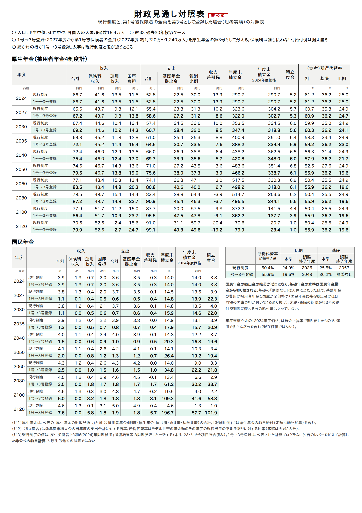
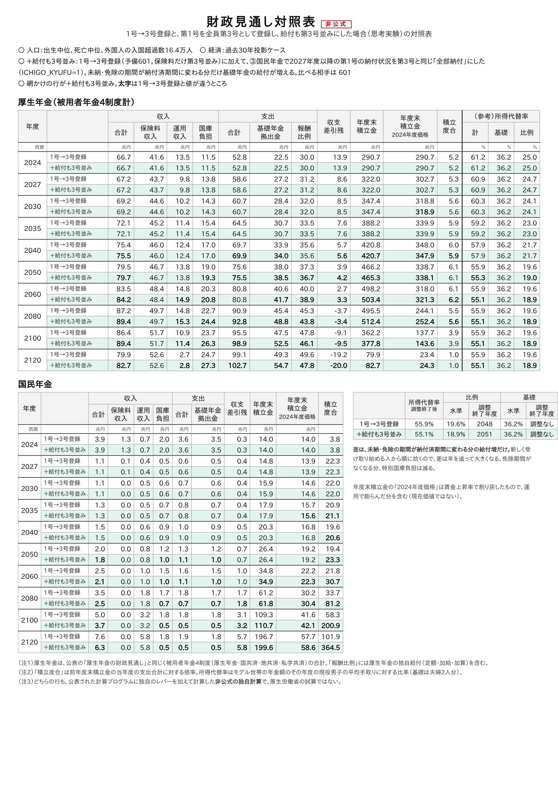

# 第1号被保険者を全員、第3号として登録したら — 基礎年金は天井まで上がり、費用は会社員の年金と国庫に回る（思考実験）

自営業・学生・無職などの**第1号被保険者を、2027年度から全員「第3号」として数え直したら**、年金財政はどう動くか。
人は動かさず、保険料を誰も払わないまま、**名簿の上で数え替えるだけ**の思考実験である。
厚生労働省の2024年財政検証の計算プログラムに、原本にないレバー `ICHIGO` を足して計算した。
計算に使ったプログラムと手順は、すべて GitHub で公開している：<https://github.com/p72/nenkin-zaisei-kensyo-2024>
（この記事の GitHub 上のページは [こちら](https://github.com/p72/nenkin-zaisei-kensyo-2024/blob/main/%E5%8B%89%E5%BC%B7/%E5%BF%9C%E7%94%A8%E7%B7%A8/%E7%AC%AC1%E5%8F%B7%E3%82%92%E5%85%A8%E5%93%A1%E7%AC%AC3%E5%8F%B7%E3%81%AB%E3%81%97%E3%81%9F%E3%82%89.md)）。

> **元第1号の人は、国民年金の保険料を払わなくなる（ゼロ）。** いまの第3号（会社員の妻など）と同じ扱いで、
> 月17,000円（2004年度価格）の保険料はなくなる。その人たちの基礎年金の費用は、厚生年金（会社員・公務員の保険料）と
> 国庫（税金）が持つ。一方で、**年金額は第1号のときの納め方のまま**計算していて、
> 未納・免除だった月が「納付済」に変わる分の年金の増えは入っていない（「8. 注意」）。
> 年金額も第3号並みにした試算は「6. 給付も第3号並みにしたら」。

> **非公式の思考実験です。** 厚生労働省の試算ではありません。実際の制度改正案ではなく、
> 「基礎年金の水準は何で決まっているか」を確かめるための極端な例です。

## まとめ

| 元第1号の人（2027年度 約1,220万〜1,240万人） | 現行制度 | 第1号を全員第3号に |
|---|---|---|
| 国民年金の保険料 | 月17,000円（2004年度価格）を払う | **払わない（ゼロ）** |
| 国民年金の保険料収入（過去30年投影） | 年1.2〜1.3兆円 | **2028年度から0** |

| 所得代替率（調整終了後） | 現行制度 | 第1号を全員第3号に |
|---|---|---|
| 過去30年投影 | 50.4%（比例 24.9／基礎 25.5） | **55.9%**（比例 **19.6**／基礎 **36.2**） |
| 成長型経済移行・継続 | 57.6%（比例 25.0／基礎 32.6） | **61.2%**（比例 25.0／基礎 **36.2**） |
| 高成長実現 | 56.9%（比例 25.0／基礎 31.9） | **61.2%**（比例 25.0／基礎 **36.2**） |

- **基礎年金は3ケースとも天井（マクロ経済スライドの調整なし＝36.2%）まで上がる。**
  国民年金が払う基礎年金拠出金が0になり、基礎年金の水準が国民年金の財布から切り離されるため
- **費用は厚生年金（会社員・公務員の年金）と国庫に回る。** 過去30年投影では報酬比例の調整が
  2026年度から2048年度まで延び、比例は 24.9% → 19.6% に下がる。国庫負担は2060年度に 16.0 → 21.8兆円
- **国民年金の積立金は、使い道がないまま積み上がる**（2120年度の積立度合 1 → 98〜126）
- **年金額も第3号並みにすると**（未納・免除だった月を「納付済」に数える）、基礎年金の費用は2100年度に約1割増える。
  過去30年投影では所得代替率が 55.9% → 55.1%（比例 19.6 → 18.9、調整は2051年度まで）。成長型・高成長は所得代替率は変わらず、
  厚生年金の積立金が減る（6.）
- 基礎年金の水準を決めているのは、第1号がどれだけ保険料を払うかではなく、
  **拠出金の按分で国民年金にどれだけの頭数が割り当てられているか**である



ほかのケースの対照表：
成長型経済移行・継続（[PNG](../../検証/3号廃止/図/対照表_3002_601_1号全員3号登録.png)・[PDF](../../検証/3号廃止/図/対照表_3002_601_1号全員3号登録.pdf)）・
高成長実現（[PNG](../../検証/3号廃止/図/対照表_3001_601_1号全員3号登録.png)・[PDF](../../検証/3号廃止/図/対照表_3001_601_1号全員3号登録.pdf)）・
過去30年投影（[PDF](../../検証/3号廃止/図/対照表_3003_601_1号全員3号登録.pdf)）

---

## 1. 何をしたか

[基礎年金拠出金](../基礎年金拠出金.md) で見たとおり、基礎年金の費用は、各制度の「頭数」（拠出金算定対象者）に
応じて割り振られる。国民年金（第1号）は払い手が弱いので、割り当てられた頭数が多いほど国民年金の財布が苦しくなり、
基礎年金のマクロ経済スライドが長引く。

そこで、2027年度から次のようにした（`検証/実行/patches/sango-haishi.patch` の `ICHIGO` のブロック）。

| 変えたもの | 中身 |
|---|---|
| 国民年金の頭数 | 拠出金の算定対象者（納付者ベース）と産休・育休の免除者を 0 にする。保険料を払う人がいなくなり、**国民年金の保険料収入も 0 になる** |
| 元第1号の人の保険料 | **ゼロ**。第3号と同じで、本人は保険料を払わない |
| 厚生年金の頭数 | 第1号被保険者の数（未納・免除を含む）を、厚生年金の第3号の算定対象者に足す |
| 給付 | 動かさない（未納・免除の期間が第3号の納付済期間に変わる分の給付増は入っていない） |

2027年度の数字（過去30年投影）：

- 第1号被保険者 **1,243万人**（成長型・高成長は 1,219万人）を第3号に数え替える
- 拠出金の算定対象者は、第1号 601万人 → 0人、第3号 617万人 → **1,859万人**

## 2. 所得代替率と調整の終了年度

| | 現行：基礎／比例の調整終了 | 第1号を全員第3号に：基礎／比例 |
|---|---|---|
| 過去30年投影 | 2057／2026年度 | **調整なし**／**2048年度** |
| 成長型経済移行・継続 | 2037／2024年度 | **調整なし**／2024年度 |
| 高成長実現 | 2039／2024年度 | **調整なし**／2024年度 |

- 基礎年金は、国民年金の財布で調整の終了年度を探す（[マクロ経済スライド](../マクロ経済スライド.md)）。
  その財布が拠出金を払わなくなるので、調整がいらなくなり、天井（2024年度の水準 36.2%）に張りつく。
  これは天井に当たった値で、財政が均衡する答えではない
- 過去30年投影では、厚生年金がその分の費用を払いきれず、報酬比例の調整が22年延びる。
  成長型・高成長は厚生年金に余裕があるので、報酬比例は下がらない（そのかわり厚生年金の積立金が減る。
  成長型の2120年度の積立度合は 23.2 → 5.8）

## 3. 誰が払うか

元第1号の人は保険料を払わない。国民年金の保険料収入（過去30年投影）は次のとおりになる。

| 年度 | 現行制度 | 第1号を全員第3号に |
|---|---|---|
| 2026 | 1.29兆円 | 1.29兆円（実施前） |
| 2027 | 1.27兆円 | **0.11兆円**（前年度の1か月分が年度をまたいで入るだけ、推定） |
| 2028以降 | 年1.2〜1.3兆円 | **0** |

（付加年金の保険料だけは年20〜30億円残るが、レバーの作り方で残っているだけで、全体には効かない）

その分の基礎年金の費用を、だれが持つかを見る。

| 兆円・名目 | 年度 | 国民年金の保険料 | 国民年金の拠出金 | 厚生年金（4制度計）の拠出金 | 国庫負担（基礎年金＋特別国庫） |
|---|---|---|---|---|---|
| 過去30年投影 | 2027 | 1.3 → ほぼ0 | 3.0 → 0 | 23.8 → **27.2** | 13.9 → 14.1 |
| 過去30年投影 | 2060 | 1.2 → 0 | 3.1 → 0 | 26.8 → **40.6** | 16.0 → **21.8** |
| 過去30年投影 | 2100 | 1.3 → 0 | 3.5 → 0 | 30.0 → **47.5** | 18.0 → **25.5** |
| 成長型経済移行・継続 | 2060 | 2.0 → 0 | 5.9 → 0 | 62.1 → **75.4** | 36.4 → **40.4** |
| 高成長実現 | 2060 | 2.3 → 0 | 6.6 → 0 | 69.8 → **86.6** | 40.9 → **46.4** |

- 第1号の保険料（年1.2〜1.3兆円）がなくなり、国民年金が払っていた拠出金を厚生年金が肩代わりする
- 基礎年金が上がるので、その費用の半分を持つ**国庫負担も増える**（[国庫負担](../国庫負担.md)：
  基礎年金の費用の増 × 0.5）
- 国民年金の財布には、免除期間などの分の拠出金（特別国庫負担。過去30年投影で年0.5〜1.8兆円）だけが残る。
  これは同じ額の国庫負担が付いてくる通り抜けで、国民年金の収支を動かさない（[特別国庫負担](../特別国庫負担.md)）

## 4. 国民年金の積立金

| | 2060年度末（兆円・名目） | 2120年度末（兆円・名目） | 積立度合（2119年度末 ÷ 2120年度の支出） |
|---|---|---|---|
| 過去30年投影 | 14 → 35 | 5 → 197 | 1.0 → **101.9** |
| 成長型経済移行・継続 | 37 → 75 | 34 → 1,585 | 1.0 → **126.1** |
| 高成長実現 | 43 → 80 | 51 → 1,902 | 1.0 → **98.0** |

払い出すもの（拠出金）がほぼなくなるので、国民年金の積立金は運用益で積み上がり続ける。
現行制度では、ちょうど2120年度に積立度合 1 になるように基礎年金の調整が決まる（[有限均衡](../有限均衡.md)）。

## 5. モデル年金で見ると

月額・2024年度の物価、夫婦2人分（夫は会社員40年、妻は専業主婦）。

| | 年度 | 現行：計（基礎／比例） | 第1号を全員第3号に：計（基礎／比例） |
|---|---|---|---|
| 過去30年投影 | 2040 | 21.6万円（12.1／9.6） | 22.2万円（13.9／8.3） |
| 過去30年投影 | 2060 | 21.4万円（10.8／10.6） | **23.7万円**（15.4／8.3） |
| 成長型経済移行・継続 | 2060 | 33.8万円（19.1／14.6） | **35.8万円**（21.2／14.6） |
| 高成長実現 | 2060 | 39.2万円（22.0／17.2） | **42.2万円**（25.0／17.2） |

- 基礎年金はすべての人に効くので、**基礎年金だけの人ほど得をする**
- 過去30年投影では報酬比例が2割下がるので、報酬比例の大きい人（高所得の会社員など）は、
  基礎年金の増え方しだいで損をしうる

## 6. 給付も第3号並みにしたら

ここまでの試算は、**保険料だけ**第3号並み（ゼロ）にして、年金額は第1号のときの納め方のまま
（未納の月は0、免除の月は半分ほど）計算していた。本当の第3号は、保険料を払わなくても全部の月が「納付済」と数えられる。
そこで、③国民年金で**2027年度以降の第1号の納付状況を、第3号と同じ「全部納付」に**した試算も作った
（原本にないレバー `ICHIGO_KYUFU`、`検証/実行/patches/ichigo-kyufu.patch`。第3号の納付率を作る式と同じ）。
未納・免除だった月が「納付済」に変わる分だけ、元第1号の人の基礎年金が増える。

| | 所得代替率：保険料だけ → 給付も第3号並み | 報酬比例の調整終了 | 厚生年金の積立度合（2120年度） |
|---|---|---|---|
| 過去30年投影 | 55.9%（比例 19.6） → **55.1%**（比例 **18.9**） | 2048 → **2051**年度 | 1.0 → 1.0 |
| 成長型経済移行・継続 | 61.2%（比例 25.0） → 61.2%（比例 25.0） | 調整なし | 5.8 → **3.2** |
| 高成長実現 | 61.2%（比例 25.0） → 61.2%（比例 25.0） | 調整なし | 6.5 → **4.2** |

| 兆円・名目 | 年度 | 基礎年金の費用（拠出金の合計） | 特別国庫負担 | 国庫負担（基礎年金＋特別国庫） |
|---|---|---|---|---|
| 過去30年投影 | 2040 | 33.9 → 34.0（+0.1） | 0.9 → 0.9 | 17.9 → 17.9 |
| 過去30年投影 | 2060 | 40.6 → 41.7（+1.1） | 1.5 → 1.0 | 21.8 → 21.9（+0.1） |
| 過去30年投影 | 2100 | 47.5 → **52.5**（+5.0、+11%） | 1.8 → 0.5 | 25.5 → 26.8（+1.2） |
| 成長型経済移行・継続 | 2060 | 75.4 → 77.4（+2.0） | 2.7 → 2.0 | 40.4 → 40.6（+0.2） |
| 成長型経済移行・継続 | 2100 | 212.6 → **233.0**（+20.4、+10%） | 7.4 → 2.3 | 113.7 → 118.8（+5.1） |
| 高成長実現 | 2060 | 86.6 → 88.8（+2.3） | 3.1 → 2.3 | 46.4 → 46.7（+0.3） |
| 高成長実現 | 2100 | 297.4 → **325.9**（+28.5、+10%） | 10.4 → 3.3 | 159.1 → 166.2（+7.1） |

- **差はゆっくり出てくる。** 増えるのは2027年度以降の月の分だけで、その人たちが65歳になってから効くので、
  2040年度ではほとんど差がなく、2100年度に基礎年金の費用が約1割増える
- 増えた費用は、拠出金の按分で**ほぼ全部が厚生年金に回る**（国民年金の頭数は0のため）。過去30年投影では
  報酬比例が 19.6% → 18.9% にさらに下がり、成長型・高成長では所得代替率は変わらないかわりに厚生年金の積立金が減る
- **免除の期間がなくなるので、特別国庫負担は減る**（免除期間の年金は国庫が持つ部分があるため。[特別国庫負担](../特別国庫負担.md)）。
  それでも基礎年金の費用が増える分の半分を国庫が持つので、国庫負担の合計は少し増える
- 国民年金の財布からは特別国庫負担の分の支出も減るので、積立度合（2120年度）は 101.9 → 364.5（過去30年投影）とさらに大きくなる
- モデル年金（会社員の夫＋専業主婦の妻）は基礎年金が天井のままなので、過去30年投影の2060年度で
  23.7万円 → 23.4万円（報酬比例の分だけ下がる）



成長型経済移行・継続（[PNG](../../検証/3号廃止/図/対照表_3002_602_1号全員3号登録_給付も3号並み.png)・[PDF](../../検証/3号廃止/図/対照表_3002_602_1号全員3号登録_給付も3号並み.pdf)）・
過去30年投影（[PDF](../../検証/3号廃止/図/対照表_3003_602_1号全員3号登録_給付も3号並み.pdf)）

## 7. 適用拡大とのくらべ

[適用拡大](../適用拡大.md) は、第1号から本当に人を厚生年金へ移し、本物の保険料を厚生年金に入れる。
こちらは保険料を誰も払わないまま、名簿を付け替えるだけである。

| 過去30年投影 | 所得代替率 | 比例 | 基礎 |
|---|---|---|---|
| 現行制度 | 50.4% | 24.9 | 25.5 |
| 第1号を全員第3号に | 55.9% | 19.6 | **36.2** |
| （参考）適用拡大 約860万人 | **56.3%** | **23.1** | 33.2 |

（適用拡大の数字は [第3号被保険者に保険料を求めたら](../../検証/3号廃止/README.md) の試算）

基礎年金はこちらのほうが上がるが、合計では適用拡大を下回る。報酬比例を削って基礎年金に回しているだけで、
新しいお金が入っていないためである。

## 8. 注意

| 注意 | 内容 |
|---|---|
| 思考実験 | 第1号を第3号にする制度改正は提案されていない。基礎年金の水準を決めるしくみを見るための極端な例 |
| 給付が少なめ（保険料だけ第3号並み） | 保険料は第3号並み（ゼロ）にしたが、**年金額は第1号のときの納め方のまま**計算している（未納の月は0、免除の月は半分ほどしか数えない）。本当の第3号は保険料を払わなくても全部の月が「納付済」と数えられるので、2027年度以降の月を全部「納付済」と数えると、未納・免除だった人の基礎年金が増える（例：2027年度に30歳でそれまでずっと未納の人は、今の試算では0円、第3号並みなら30年分で満額の30/40＝月約5.3万円〔2026年度の額〕）。その分の費用も厚生年金と国庫が持つので、保険料だけ第3号並みにした試算は費用を少なめに見ている。**給付も第3号並みにした試算は6.** |
| 天井の値 | 基礎の 36.2% は「調整なし」に当たった値で、均衡解ではない |
| 2027年度の保険料 | 国民年金の保険料収入は2027年度に0.11兆円残る。前年度（2026年度）の保険料収入1.29兆円のちょうど12分の1で、1か月分の納付が年度をまたぐためとみられる（推定）。2028年度以降は0 |

## 9. 検算

この記事のために、3ケースとも計算し直した（2026年10月31日）。
[第3号被保険者に保険料を求めたら](../../検証/3号廃止/README.md) の「裏返しの思考実験」に載せていた数字
（所得代替率 55.9%・61.2%、報酬比例の調整 2048年度、国庫負担 16.0 → 21.8兆円、積立度合 101.9・98.0、第1号 1,243万・1,219万人）は、
**すべて一致した**。過去30年投影と高成長実現の財政見通し対照表も作り直し、文字のにじみ以外は同じであることを確かめた。
成長型経済移行・継続は今回新しく計算した。

## 10. 再現

リポジトリ：<https://github.com/p72/nenkin-zaisei-kensyo-2024>（この記事の表を出すスクリプト：[第1号を全員第3号にしたら.py](https://github.com/p72/nenkin-zaisei-kensyo-2024/blob/main/%E5%8B%89%E5%BC%B7/%E5%BF%9C%E7%94%A8%E7%B7%A8/%E7%AC%AC1%E5%8F%B7%E3%82%92%E5%85%A8%E5%93%A1%E7%AC%AC3%E5%8F%B7%E3%81%AB%E3%81%97%E3%81%9F%E3%82%89.py)）

```sh
git clone https://github.com/p72/nenkin-zaisei-kensyo-2024.git && cd nenkin-zaisei-kensyo-2024
./fetch.sh                                                                  # 未取得なら
検証/実行/run_pipeline.sh 3003 1 1 0 2 && 検証/実行/run_pipeline.sh 3002 && 検証/実行/run_pipeline.sh 3001   # 現行制度
STEPS=45 YOBI=601 ICHIGO=2027 検証/実行/run_pipeline.sh 3003 1 1 0 2           # 第1号を全員第3号に（約1分半）
SKIP_BUILD=1 STEPS=45 YOBI=601 ICHIGO=2027 検証/実行/run_pipeline.sh 3002
SKIP_BUILD=1 STEPS=45 YOBI=601 ICHIGO=2027 検証/実行/run_pipeline.sh 3001
STEPS=345 YOBI=602 ICHIGO=2027 ICHIGO_KYUFU=1 検証/実行/run_pipeline.sh 3003 1 1 0 2   # 給付も第3号並み（③から）
SKIP_BUILD=1 STEPS=345 YOBI=602 ICHIGO=2027 ICHIGO_KYUFU=1 検証/実行/run_pipeline.sh 3002
SKIP_BUILD=1 STEPS=345 YOBI=602 ICHIGO=2027 ICHIGO_KYUFU=1 検証/実行/run_pipeline.sh 3001
python3 勉強/応用編/第1号を全員第3号にしたら.py                                # この記事の表
python3 検証/3号廃止/make_taishohyo.py --case 3003 --yobi 601                   # 財政見通し対照表（3002・3001 も同じ）
python3 検証/3号廃止/make_taishohyo.py --case 3003 --yobi 602                   # 給付も第3号並み（601 と比べる）
```

`ICHIGO_KYUFU=1` は③国民年金の出力を `work/suuri/rev2024/nat/rslt-ichigo2027`・`nat/data-ichigo2027` に分けて書き、④はそこを読む。
通常試算の③の出力は上書きしない。

## 関連

- [第3号被保険者に保険料を求めたら年金に何が起こるか](../../検証/3号廃止/README.md)（この思考実験は、もともとその文書の「裏返しの思考実験」の節）
- [基礎年金拠出金](../基礎年金拠出金.md)・[適用拡大](../適用拡大.md)・[マクロ経済スライド](../マクロ経済スライド.md)・[国庫負担](../国庫負担.md)
