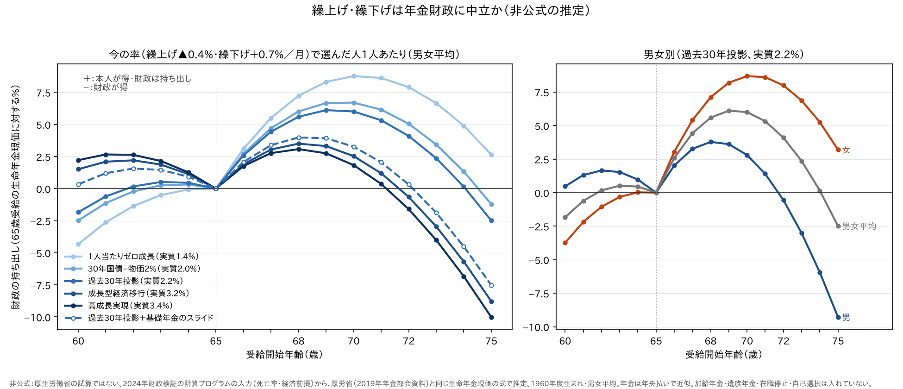

# 繰上げ・繰下げは年金財政に中立か — 今の死亡率と利回りで計算し直す

年金は60〜75歳のどこからでも受け取り始められる。65歳より早めると減り（繰上げ）、遅らせると増える（繰下げ）。
厚生労働省は、この減額率・増額率を「**数理的に年金財政上中立を基本として設定**」していると説明している。

では、2024年財政検証の死亡率と経済前提で計算し直しても、中立なのか。
厚生労働省と同じ式を、計算プログラムに入っている前提で解き直した（**非公式の推定**。厚生労働省の試算ではない）。

**結論：設計の考え方は「平均的な人について、決めた前提のもとで中立」。いまの前提で計算し直すと、
1か月0.7%の繰下げ増額は、70歳前後まで遅らせる人に有利で、その分だけ財政は持ち出しになる
（実質利回り2.2%の過去30年投影ケースで、1人あたり約6%）。一方、75歳まで遅らせると、ほとんどの前提で財政のほうが得をする。
繰上げの0.4%はほぼ中立。男女平均の死亡率で率を決めているので、女性の繰下げがいちばん有利になる。
ただ、繰上げ・繰下げを選ぶ人は少ないので、年金財政全体への影響は小さい。**



---

## 1. 制度のおさらい（2022年4月改正のあと）

| | 繰上げ受給 | 繰下げ受給 |
|---|---|---|
| 受け取り始める年齢 | 60〜64歳 | 66〜75歳 |
| 年金額の変わり方 | 1か月早めるごとに **▲0.4%**（最大 ▲24%） | 1か月遅らせるごとに **＋0.7%**（最大 ＋84%） |
| 対象 | 1962年4月2日以降に生まれた人（それより前は ▲0.5%） | 75歳まで遅らせられるのは1952年4月2日以降に生まれた人（それより前は70歳・＋42%まで） |
| 変わった額 | 一生そのまま。原則として取り消せない | 一生そのまま |
| 基礎年金と厚生年金 | 両方いっしょに繰り上げるのが原則 | 片方だけ遅らせることもできる |

よく見落とされる点（日本年金機構の案内より）。

- **繰上げ**：繰り上げたあとに障害を負っても、原則として障害基礎年金を請求できなくなる。
  65歳までは、遺族厚生年金とどちらか一方を選ぶことになる
- **繰下げ**：加給年金は増えず、待っている間は支給されない。在職老齢年金で支給停止された分は、増額の対象にならない。
  70歳を過ぎてから請求して繰下げを選ばなかった場合は、請求の5年前に繰下げを申し出たとみなして増額される（2023年4月から）

額面だけで比べた損益分岐は、60歳から繰り上げると **80歳10か月ごろ**に65歳受給に追い抜かれる。
70歳まで繰り下げると **81歳11か月ごろ**、75歳まで繰り下げると **86歳11か月ごろ**に65歳受給を追い抜く
（税・社会保険料は考えない）。

## 2. 厚生労働省の決め方

2019年10月の社会保障審議会年金部会の資料に、計算の方法が書いてある。

- 65歳から受け取ったときの受取総額の**生命年金現価**（将来の年金を、生きている確率で重み付けし、
  割引率で今の価値に直したもの）を **A** とする
- 繰下げ増額率は **A ÷（繰下げ開始の生命年金現価）− 1**、繰上げ減額率は **1 − A ÷（繰上げ開始の生命年金現価）**
- 使った前提は2つ
  - 死亡率：平成27年完全生命表（男女平均。65歳の平均余命21.8年）
  - 割引率：2019年財政検証のケースⅠ〜Ⅵの実質運用利回り（物価に対する）
- 結果：繰上げ ▲0.4%、繰下げ ＋0.7%。ケースによって0.6〜0.8%の幅があり、そのおおむね平均をとった
- 参考として、将来の生命表（2040年・2065年）で計算すると、繰下げは**月0.6%**、繰上げは月0.4%になる。
  厚生労働省は「将来の寿命の延びを勘案しても増減額率に大きな変化はない」として、0.7%を据え置いた

つまり「中立」は、**男女平均の死亡率**と**ある割引率**を決めたうえで、**平均的な人**について成り立つ、という意味である。

## 3. いまの前提で計算し直す

同じ式を、2024年財政検証の計算プログラムに入っている前提で解いた。

| 前提 | 何を使ったか |
|---|---|
| 死亡率 | ③国民年金の入力 `QX-M2023.csv`（2023年推計・死亡中位、2019〜2070年。2071年以降は2070年の値）。2025年度に65歳になる1960年度生まれを、その年ごとの死亡率で追いかける（コホート） |
| 65歳の平均余命 | 男女平均 **24.4年**、男 21.8年、女 27.1年（このコホートの値。2019年の資料は平成27年の期間生命表で21.8年） |
| 割引率（実質、物価に対する） | 2024年財政検証の長期（2034年度以降）の実質運用利回り：高成長実現 3.4%、成長型経済移行 3.2%、過去30年投影 2.2%、1人当たりゼロ成長 1.4%。あわせて、30年国債利回り（2026年10月22日 3.952%）から物価2%を引いた**約2.0%**を目安として置いた |
| マクロ経済スライド | 通常試算の④のカット率（基礎年金）。受け取り始めたあとの年金は物価で改定されるとみなし、スライドで目減りする分だけを追う |

年金は年の真ん中にまとめて払う形で近似した。

## 4. 中立になる率

1か月あたりの率に直したもの（男女平均）。

| 割引率（実質） | 70歳まで繰下げ | 75歳まで繰下げ | 60歳から繰上げ |
|---|---|---|---|
| 1人当たりゼロ成長 1.4% | 0.51% | 0.66% | 0.34% |
| 30年国債−物価2% 2.0% | 0.55% | 0.72% | 0.37% |
| **過去30年投影 2.2%** | **0.57%** | **0.74%** | **0.38%** |
| 成長型経済移行 3.2% | 0.64% | 0.85% | 0.42% |
| 高成長実現 3.4% | 0.66% | 0.87% | 0.43% |
| **今の制度** | **0.70%** | **0.70%** | **0.40%** |

読み方は2つ。

1. **遅らせる期間が長いほど、中立な率は高くなる。** 今の増額は「1か月0.7%の単利」だが、
   遅らせた分の価値は複利のように効くからである。0.7%は、70歳までなら高め、75歳までなら低めになる
2. **利回りが低いほど、中立な率は低くなる。** 割引率が低いと遠い将来の支払いの重みが増え、
   遅く受け取り始める人の受取総額の価値が上がるからである。低成長の世界ほど、0.7%は気前がいい

## 5. 今の率で選んだ人1人あたりの、財政の持ち出し

65歳から受け取る人の生命年金現価に対する割合。**＋は本人が得して財政が持ち出し、−は財政が得**（男女平均）。

| 前提 | 60歳 | 62歳 | 64歳 | 66歳 | 68歳 | **70歳** | 72歳 | 75歳 |
|---|---|---|---|---|---|---|---|---|
| 1人当たりゼロ成長 1.4% | −4.3% | −1.4% | −0.1% | +3.1% | +7.2% | **+8.8%** | +7.9% | +2.7% |
| 30年国債−物価2% 2.0% | −2.5% | −0.2% | +0.3% | +2.7% | +6.0% | **+6.7%** | +5.1% | −1.2% |
| 過去30年投影 2.2% | −1.8% | +0.2% | +0.5% | +2.6% | +5.6% | **+6.0%** | +4.1% | −2.5% |
| 成長型経済移行 3.2% | +1.5% | +2.2% | +1.1% | +1.9% | +3.5% | **+2.5%** | −0.6% | −8.8% |
| 高成長実現 3.4% | +2.2% | +2.6% | +1.3% | +1.8% | +3.1% | **+1.8%** | −1.6% | −10.0% |
| 過去30年投影 2.2%＋基礎年金のスライド | +0.3% | +1.6% | +0.9% | +2.1% | +4.0% | **+3.3%** | +0.3% | −7.5% |
| 高成長実現 3.4%＋基礎年金のスライド | +4.3% | +4.0% | +1.7% | +1.3% | +1.6% | **−0.6%** | −4.8% | −14.0% |

- **いまの利回りの水準（実質2%前後）では、66〜74歳から受け取り始める人が得をする。**
  いちばん得なのは70歳前後で、財政は1人あたり約6〜7%の持ち出しになる
- **75歳まで待つと、ほとんどの前提で財政のほうが得をする。** 単利の0.7%は、「ほどほどの繰下げ」に甘く、
  「目いっぱいの繰下げ」に辛い
- **繰上げの0.4%は、おおむね中立**（±4%以内）。利回りが高い世界では、繰り上げる人がやや得をする

## 6. 男女の差

率は男女平均の死亡率で決めている。女性は長生きなので、遅く受け取り始めても受け取る期間が長い。

| 過去30年投影 2.2% | 70歳まで繰下げ | 75歳まで繰下げ | 60歳から繰上げ | 中立な繰下げ率（70歳まで） |
|---|---|---|---|---|
| 男 | +2.8% | −9.3% | +0.5% | 0.64% |
| 女 | **+8.7%** | **+3.2%** | −3.7% | 0.51% |
| 男女平均 | +6.0% | −2.5% | −1.8% | 0.57% |

**女性の繰下げがいちばん有利**で、75歳まで待っても得をする。男性は70歳までなら少し得、75歳まで待つと損になる。

## 7. マクロ経済スライドとの関係

マクロ経済スライドが続いている間は、受け取り始めたあとの年金も実質で目減りしていく。
遅く受け取り始める人ほど、目減りしたあとの年金を受け取る割合が大きいので、**繰下げの価値は下がる**。
割引率を上げたのと同じ向きに効く。

過去30年投影ケースでは、基礎年金のスライドが2057年度まで続く。1960年度生まれでいえば、97歳まで目減りが続く。
これを入れると、中立な繰下げ率は0.57%→0.63%（70歳まで）、0.74%→0.82%（75歳まで）に上がり、
70歳までの繰下げの持ち出しは約6%→約3%に縮む（5.の表の「＋基礎年金のスライド」の行）。
報酬比例はスライドが2026年度でほぼ終わるので、厚生年金の部分は「スライドなし」の行に近い。

## 8. 年金財政全体への影響

計算プログラムの基礎率（`kragsg_2024.csv`）では、繰上げを選ぶ人の割合は60〜64歳を合わせて**男5.0%・女3.3%**である。
繰下げを選ぶ人も少ない。1人あたりで数%の持ち出しや得があっても、**年金財政全体への影響は小さい**（推定）。

なお、2024年財政検証の計算プログラムは、繰上げ・繰下げを財政見通しに入れている。

- ②厚生年金の給付費推計（`厚生年金/給付費推計/krgn.cpp`）：60〜64歳の繰上げ請求割合と、減額率0.5%・0.4%
- ③国民年金：受給開始年齢別の給付率 `Kyufu_ritu` と、75歳繰下げの近似 `Waribikiritu`
  （仕様書 §5.1・§5.2、原本の不具合 J3）

受給開始年齢の分布は年度によらず一定で、今回のように「率が中立かどうか」で選ぶ人が増えることは考えていない。

## 9. この計算の限界（すべて推定）

- **入れていないもの**：加給年金・遺族厚生年金・在職で止められた分が増額されないこと（入れると、繰下げの持ち出しは小さくなる方向）。
  健康で長生きしそうな人ほど繰り下げる「自己選択」（入れると、持ち出しは大きくなる方向）。税・社会保険料
- **割引率に何を使うか自体に、正解はない。** ここでは厚生労働省と同じく、実質運用利回り（物価に対する）を使った
- 年金は年央払いで近似し、1960年度生まれの1世代だけを計算した
- スライドは基礎年金のカット率だけを追った。新規裁定（67歳まで）の賃金での改定は入れていない
- 死亡率は2070年までしか入っていないので、それより後は2070年の値で据え置いた

## 10. 再現方法

```bash
# スライド込みの行を出すには、通常試算を先に流す（ほかの行は流さなくても出る）
検証/実行/run_pipeline.sh 3003 1 1 0 2
検証/実行/run_pipeline.sh 3001

python3 勉強/応用編/繰上げ繰下げの中立.py report   # この記事の表
python3 勉強/応用編/繰上げ繰下げの中立.py graph    # この記事の図
```

## 出典

- 厚生労働省「繰下げ制度の柔軟化」第12回社会保障審議会年金部会 資料1（2019年10月18日）
  <https://www.mhlw.go.jp/content/12601000/000558227.pdf>
- 日本年金機構「年金の繰上げ受給」 <https://www.nenkin.go.jp/service/jukyu/roureinenkin/kuriage-kurisage/20140421-01.html>
- 日本年金機構「年金の繰下げ受給」 <https://www.nenkin.go.jp/service/jukyu/roureinenkin/kuriage-kurisage/20140421-02.html>
- 日本年金機構「令和5年4月からの繰下げ制度の改正」 <https://www.nenkin.go.jp/oshirase/topics/2023/r5_kurisage_kaisei.html>
- 日本年金機構「繰上げ受給の減額率の見直し」 <https://www.nenkin.go.jp/oshirase/topics/2022/0401.files/02_0401kuriage.pdf>
- 財務省「国債金利情報」（2026年10月22日の値） <https://www.mof.go.jp/jgbs/reference/interest_rate/jgbcm.csv>
- 死亡率・経済前提・カット率は、2024年財政検証の計算プログラム（厚生労働省、資料001365945）の入力と出力

---

**非公式の推定です。** 厚生労働省が作成・承認したものではありません。個人の受給開始時期の判断には使わず、
ご自身の年金は「ねんきんネット」か年金事務所で確かめてください。
