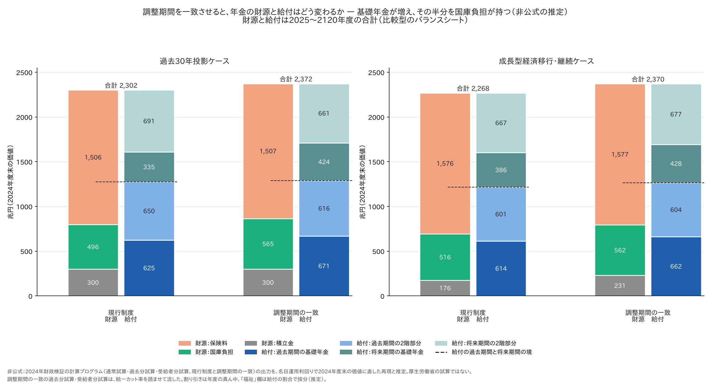
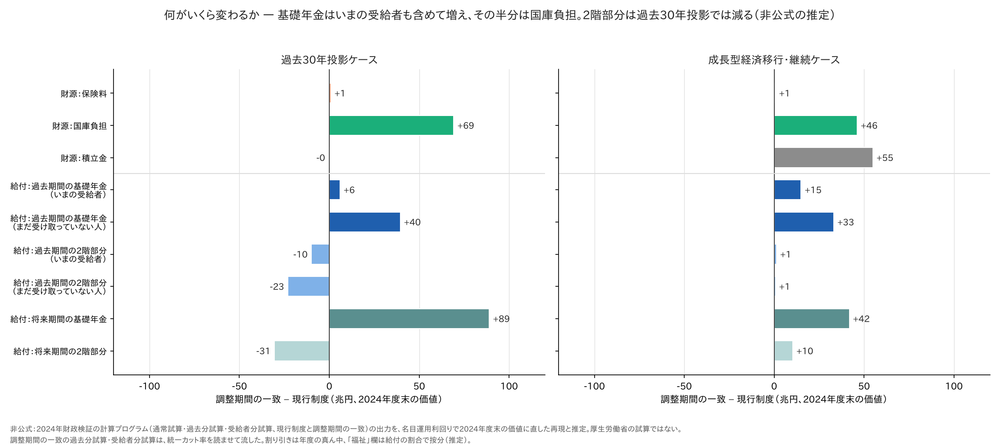
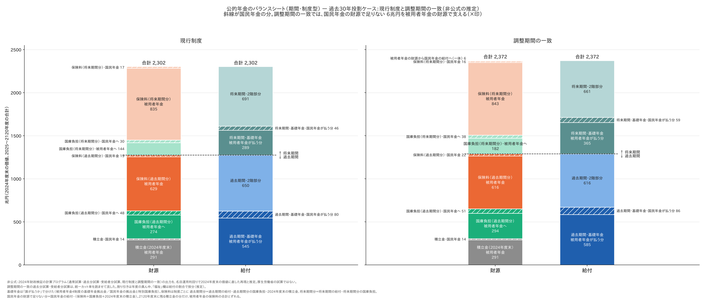
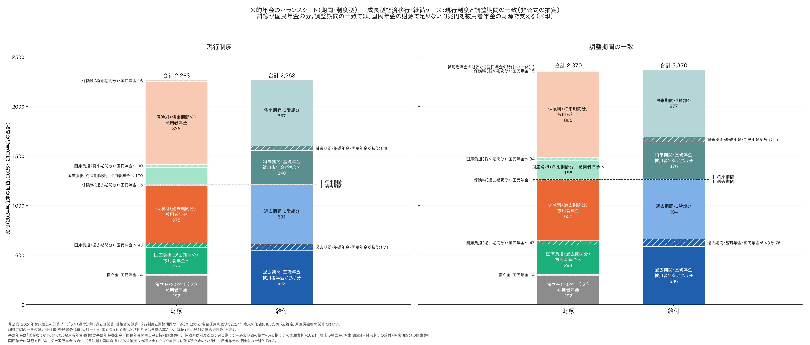
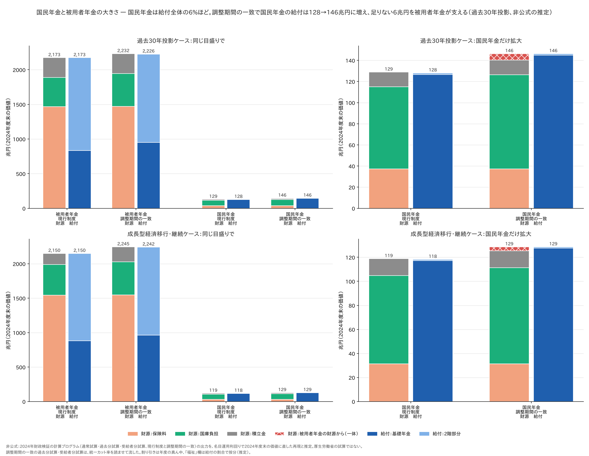
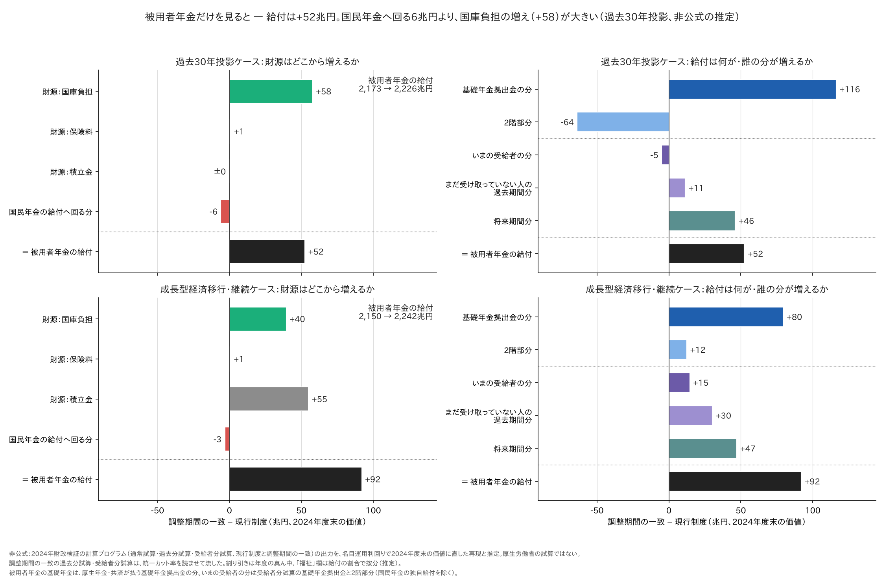
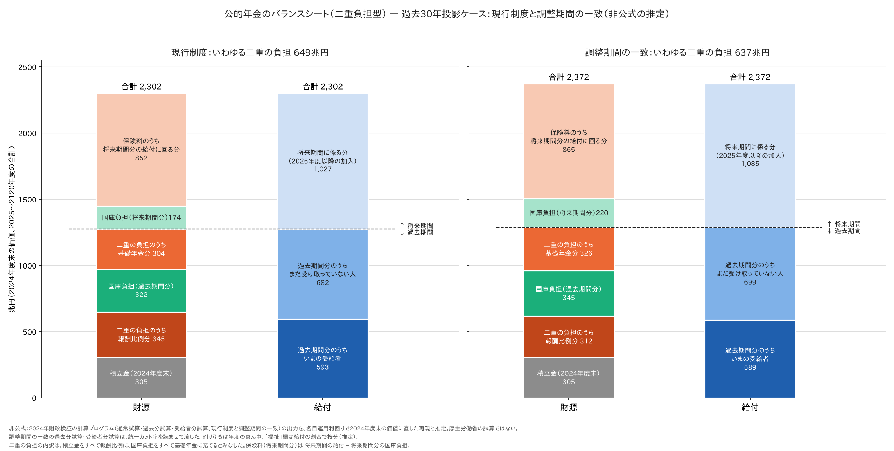
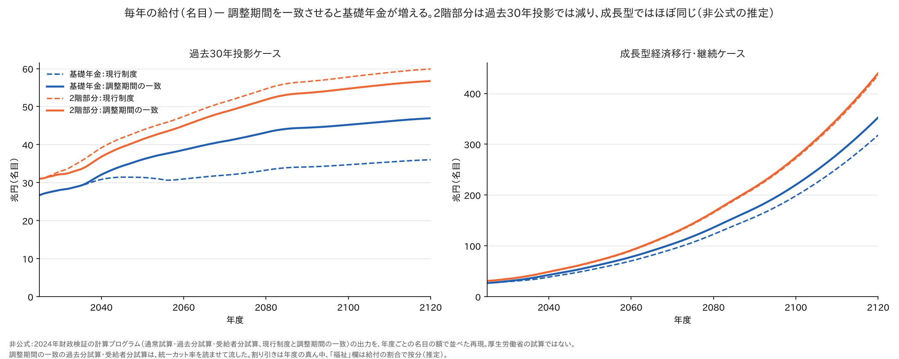
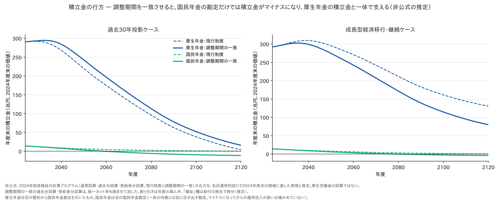
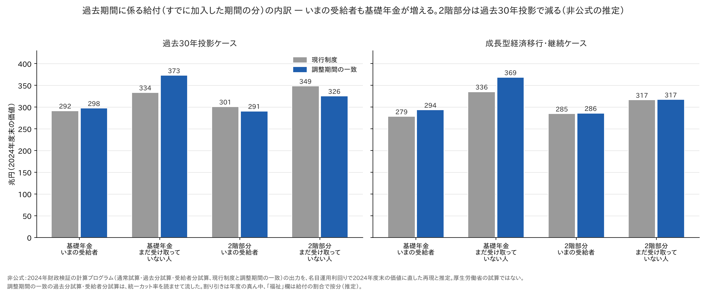

# マクロ経済スライドの調整期間を一致させたら、年金の財源と給付はどう変わるか — バランスシートで並べる

- この記事（GitHub）：<https://github.com/p72/nenkin-zaisei-kensyo-2024/blob/main/%E5%8B%89%E5%BC%B7/%E5%BF%9C%E7%94%A8%E7%B7%A8/%E8%AA%BF%E6%95%B4%E6%9C%9F%E9%96%93%E3%81%AE%E4%B8%80%E8%87%B4%E3%81%AE%E3%83%90%E3%83%A9%E3%83%B3%E3%82%B9%E3%82%B7%E3%83%BC%E3%83%88.md>
- この記事（Web・GitHub Pages）：<https://p72.github.io/nenkin-zaisei-kensyo-2024/%E5%8B%89%E5%BC%B7/%E5%BF%9C%E7%94%A8%E7%B7%A8/%E8%AA%BF%E6%95%B4%E6%9C%9F%E9%96%93%E3%81%AE%E4%B8%80%E8%87%B4%E3%81%AE%E3%83%90%E3%83%A9%E3%83%B3%E3%82%B9%E3%82%B7%E3%83%BC%E3%83%88.html>
- 再現スクリプト：[調整期間の一致のバランスシート.py](https://github.com/p72/nenkin-zaisei-kensyo-2024/blob/main/%E5%8B%89%E5%BC%B7/%E5%BF%9C%E7%94%A8%E7%B7%A8/%E8%AA%BF%E6%95%B4%E6%9C%9F%E9%96%93%E3%81%AE%E4%B8%80%E8%87%B4%E3%81%AE%E3%83%90%E3%83%A9%E3%83%B3%E3%82%B9%E3%82%B7%E3%83%BC%E3%83%88.py)
- リポジトリ：<https://github.com/p72/nenkin-zaisei-kensyo-2024>

**調整期間の一致**は、基礎年金と報酬比例（2階部分）で別々に終わるマクロ経済スライドの調整を、同じ年度に終える案である
（しくみは [調整期間の一致](../調整期間の一致.md)）。国民年金と厚生年金を1つの財布とみなして一緒に均衡させるので、
基礎年金の調整が早く終わって高くなり、その分、報酬比例の調整が長くなる。

この案で、[過去期間に係る給付と二重の負担](過去期間の給付と二重の負担.md) で再現した「年金のバランスシート」
（2025〜2120年度の財源と給付を、2024年度末の価値に直して並べたもの）が、**現行制度と比べてどう変わるか**を並べた。

> **非公式の推定です。** 厚生労働省の試算ではありません。調整期間の一致の過去分試算・受給者分試算は、
> 統一カット率を計算プログラムに読ませて流したもので、公表されたバランスシートはありません（6.）。

## まとめ（過去30年投影ケース、兆円、2024年度末の価値）

| 項目 | 現行制度 | 調整期間の一致 | 差 |
|---|---|---|---|
| **財源** | **2,302** | **2,372** | **＋71** |
| 　保険料 | 1,506 | 1,507 | ＋1 |
| 　国庫負担 | 496 | 565 | **＋69** |
| 　積立金（取り崩しと運用収入） | 300 | 300 | ±0 |
| **給付** | **2,302** | **2,372** | **＋71** |
| 　過去期間（2024年度までの加入分）：基礎年金 | 625 | 671 | **＋45** |
| 　過去期間：2階部分 | 650 | 616 | −33 |
| 　将来期間（2025年度からの加入分）：基礎年金 | 335 | 424 | **＋89** |
| 　将来期間：2階部分 | 691 | 661 | −31 |
| （参考）所得代替率（モデル世帯） | 50.4%（比例24.9＋基礎25.5） | 56.2%（比例22.9＋基礎33.2） | ＋5.8pt |

- **基礎年金が増え（＋134兆円）、2階部分が減る（−63兆円）。** マクロ経済スライドの調整が、基礎年金は2057年度から2036年度に早く終わり、
  報酬比例は2026年度から2036年度に長く続く
- **増えた給付（＋71兆円）は、ほとんど国庫負担（＋69兆円）でまかなう。** 基礎年金の半分は国庫負担なので、基礎年金が増えると国庫負担も自動で増える。
  保険料と積立金はほとんど変わらない
- **いまの受給者の基礎年金も増える**（過去期間のうち受給者分 292 → 298兆円）。2階部分は減る（301 → 291兆円）
- **国民年金の財源だけでは足りなくなる。** 国民年金の給付が増える分（＋18兆円）のうち、国庫負担で持たない6兆円を被用者年金の財源で支える。
  国民年金は給付全体の6%ほどの大きさ（2.・3.）
- **被用者年金だけを見ても、給付は増える（＋52兆円）。** 国民年金へ回る6兆円より、被用者年金への国庫負担の増え（＋58兆円）のほうが大きいから。
  ただし増えた分の財源は税で、中身は2階部分から基礎年金への入れ替え（2階 −64、基礎年金 ＋116）。いまの受給者の分はわずかに減る（4.）
- 成長型経済移行・継続ケースでは、報酬比例はもともと調整がない（2024年度で終了）ので2階部分は減らず、
  基礎年金の調整（2037年度まで）がなくなる。その費用は国庫負担（＋46兆円）と、2120年度に残る予定だった積立金（＋55兆円）でまかなう



## 1. 何がいくら変わるか



| 調整期間の一致 − 現行制度（兆円） | 過去30年投影 | 成長型経済移行・継続 |
|---|---|---|
| 財源：保険料 | ＋1 | ＋1 |
| 財源：国庫負担 | **＋69** | **＋46** |
| 財源：積立金 | ±0 | **＋55** |
| 給付：過去期間の基礎年金（いまの受給者） | ＋6 | ＋15 |
| 給付：過去期間の基礎年金（まだ受け取っていない人） | ＋40 | ＋33 |
| 給付：過去期間の2階部分（いまの受給者） | −10 | ＋1 |
| 給付：過去期間の2階部分（まだ受け取っていない人） | −23 | ＋1 |
| 給付：将来期間の基礎年金 | ＋89 | ＋42 |
| 給付：将来期間の2階部分 | −31 | ＋10 |

- 過去30年投影では、基礎年金の増え（＋134）が2階部分の減り（−63）より大きい。差の71兆円は、ほぼ国庫負担の増えでまかなう
- 成長型経済移行・継続では、2階部分もわずかに増える（＋12）。厚生年金の給付のうち、加給年金・中高齢寡婦加算・経過的加算などは
  基礎年金の改定率に連動するので、基礎年金の調整がなくなるとこれらも増える
- 国庫負担の増えは、基礎年金の増えのほぼ半分（過去30年投影 69／134、成長型 46／90）

## 2. バランスシート（期間・制度型）— 被用者年金と国民年金に分ける

財源と給付を、期間（過去・将来）と制度（被用者年金・国民年金）に分けて、現行制度と並べた。斜線が国民年金の分。
基礎年金は「誰が払うか」で分けた（被用者年金＝厚生年金・共済の基礎年金拠出金、国民年金＝国民年金の拠出金と特別国庫負担）。



- 調整期間の一致では、国民年金の給付（基礎年金拠出金）が増えるが、国民年金の財源（保険料・国庫負担・2024年度末の積立金）では足りない。
  **足りない6兆円を、被用者年金の財源（保険料・積立金）で支える**（図の×印）。現行制度では、国民年金は自分の財源でほぼまかなえている（差は1兆円未満）
- 被用者年金の側では、基礎年金拠出金が増え（過去期間 545 → 585、将来期間 289 → 365）、2階部分が減る。被用者年金への国庫負担も増える（過去期間 274 → 294、将来期間 144 → 182）



## 3. 国民年金と被用者年金の大きさ



| 兆円（2024年度末の価値） | 被用者年金：現行 | 被用者年金：一致 | 国民年金：現行 | 国民年金：一致 |
|---|---|---|---|---|
| 給付の合計（過去30年投影） | 2,173 | 2,226 | 128 | 146 |
| 　うち基礎年金（過去期間＋将来期間） | 834 | 950 | 126 | 145 |
| 財源：保険料 | 1,468 | 1,469 | 37 | 37 |
| 財源：国庫負担 | 418 | 476 | 78 | 89 |
| 財源：積立金 | 287 | 287 | 14 | 14 |
| 被用者年金の財源から国民年金の給付に回る分 | | | ≒0 | **6** |
| 国民年金の給付の割合 | | | 5.6% | 6.2% |
| 給付の合計（成長型経済移行・継続） | 2,150 | 2,242 | 118 | 129 |
| 被用者年金の財源から国民年金の給付に回る分（成長型） | | | ≒0 | **3** |

- **国民年金は、公的年金の給付全体の6%ほどの大きさしかない。** 同じ目盛りで並べると、被用者年金の17分の1ほど
- 国民年金の財源の6割は国庫負担（現行 78／129、一致 89／146）。保険料は37兆円で、調整期間の一致でも変わらない
- 調整期間の一致で、国民年金の給付は 128 → 146兆円（＋18）に増える。そのうち国庫負担の増え（＋11）で6割ほど、
  残り6兆円を被用者年金の財源で支える。被用者年金にとっては、給付全体（2,226兆円）の0.3%ほど
- 国民年金の財源で足りない分 ＝ 国民年金の給付 −（保険料＋国庫負担＋2024年度末の積立金）。現行制度ではほぼ0（−1兆円）で、0とみなした

## 4. 被用者年金にとってはプラスか — 国民年金へ6兆円回っても、給付は52兆円増える

調整期間の一致では、被用者年金の財源から国民年金の給付へ6兆円が回る（2.・3.）。それでも、被用者年金のバランスシート自体は大きくなる。
被用者年金だけを取り出して、現行制度と並べた。



| 被用者年金（兆円、2024年度末の価値） | 過去30年投影：現行 | 同：一致 | 差 | 成長型：現行 | 同：一致 | 差 |
|---|---|---|---|---|---|---|
| **給付の合計** | **2,173** | **2,226** | **＋52** | **2,150** | **2,242** | **＋92** |
| 　基礎年金拠出金の分 | 834 | 950 | ＋116 | 883 | 962 | ＋80 |
| 　2階部分 | 1,340 | 1,276 | −64 | 1,267 | 1,279 | ＋12 |
| 　いまの受給者の分 | 554 | 549 | −5 | 529 | 543 | ＋15 |
| 　まだ受け取っていない人の過去期間分 | 640 | 652 | ＋11 | 615 | 645 | ＋30 |
| 　将来期間分 | 980 | 1,026 | ＋46 | 1,006 | 1,053 | ＋47 |
| 財源：保険料 | 1,468 | 1,469 | ＋1 | 1,545 | 1,546 | ＋1 |
| 財源：国庫負担 | 418 | 476 | **＋58** | 443 | 482 | **＋40** |
| 財源：積立金 | 287 | 287 | ±0 | 162 | 217 | **＋55** |
| 国民年金の給付へ回る分 | ≒0 | 6 | −6 | ≒0 | 3 | −3 |

被用者年金の給付の増え ＝ 国庫負担の増え ＋ 保険料の増え ＋ 積立金の増え − 国民年金へ回る分。
過去30年投影では **＋52 ＝ ＋58 ＋1 ±0 −6**、成長型経済移行・継続では **＋92 ＝ ＋40 ＋1 ＋55 −3**（四捨五入で1ずれる）。

**制度として見れば、被用者年金にとってプラスと言える。** 保険料は同じ（＋1兆円）のまま、給付の合計が増える。
国民年金へ回る6兆円は、被用者年金に入る国庫負担の増え（＋58兆円）の1割ほどで、それを差し引いても給付は増える。
「被用者年金が国民年金を支えて損をする」という見方は、流れの6兆円だけを見ると出てくるが、国庫負担の増えまで含めると逆になる。

ただし、次の4つに気をつける。

- **増えた分の財源は税（国庫負担）。** 基礎年金の半分は国庫負担なので、基礎年金が増えると国庫負担が自動で増える。
  制度全体で国庫負担は69兆円増える（被用者年金へ58、国民年金へ11）。会社員も税を払うので、年金の保険料としては得でも、
  税の負担まで含めた損得は、税を誰がどれだけ払うか（増税か、国債か、ほかの歳出を削るか）による。このバランスシートには出てこない
- **中身は、2階部分から基礎年金への入れ替え。** 過去30年投影では、基礎年金拠出金の分が116兆円増え、2階部分が64兆円減る。
  被用者年金の中でも、2階部分の比重が大きい人（報酬の高い人）ほど増えは小さく、減ることもありうる（推定、10.）
- **いまの受給者の分は、過去30年投影ではわずかに減る**（554 → 549兆円、−5）。増えるのは、まだ受け取っていない人の過去期間分（＋11）と
  将来期間分（＋46）。報酬比例の調整が長く続く（2036年度まで）ので、すでに受け取っている人には2階部分の減りが先に効く
- **成長型経済移行・継続では、積立金を使う。** 被用者年金の給付の増え（＋92）のうち55兆円は、2120年度末に残す予定だった積立金を
  取り崩してまかなう（2120年度末の厚生年金の積立金は現在価値 130 → 80兆円、国民年金の勘定もマイナスになる。8.）。2120年度より後に残る余裕が小さくなる

バランスシートが「大きくなる」のは、給付の現在価値が増え、それを支える財源も同じだけ増えるということ。
大きさそのものは得の尺度ではなく、**増えた財源を誰が持つか**（ここでは主に税）で損得が決まる。

## 5. バランスシート（二重負担型）

[過去期間に係る給付と二重の負担](過去期間の給付と二重の負担.md) と同じ形（過去期間の財源を、積立金・国庫負担と、
「いわゆる二重の負担」の報酬比例分・基礎年金分に分ける）で、現行制度と並べた。



| 兆円（過去30年投影） | 現行制度 | 調整期間の一致 | 差 |
|---|---|---|---|
| 過去期間に係る給付 | 1,275 | 1,287 | ＋12 |
| − 過去期間に係る国庫負担 | 322 | 345 | ＋23 |
| − 積立金（2024年度末） | 305 | 305 | ±0 |
| ＝ いわゆる二重の負担 | 649 | 637 | −11 |
| 　うち報酬比例分 | 345 | 312 | −33 |
| 　うち基礎年金分 | 304 | 326 | ＋22 |

- 過去期間の給付は少し増える（＋12）が、国庫負担の増え（＋23）のほうが大きいので、いわゆる二重の負担は11兆円減る
- 内訳は、報酬比例分が減り（2階部分の調整が長くなるため）、基礎年金分が増える

## 6. 計算のしかた

| 試算 | 予備番号 | 中身 |
|---|---|---|
| 現行制度 | 000 | 通常試算・過去分試算・受給者分試算（[過去期間に係る給付と二重の負担](過去期間の給付と二重の負担.md) と同じ） |
| 調整期間の一致 | ⑤ 100・④ 101 | `TOUGOU=1`。④を2回まわし、⑤が基礎年金と報酬比例の統一カット率（101）を書く |
| 同・過去分試算／受給者分試算 | 101 | `SAIMU=1／2` を、統一カット率（101）を読ませて流した |

- **過去分試算に統一カット率を読ませる。** ⑤の過去分試算は、通常試算のカット率ファイル（`cuta・cutb-…-{予備番号}`）を読む。
  予備番号を101にすると、調整期間の一致の統一カット率で過去期間分の給付を計算する。
  ④の過去分試算は `bas/rslt/cuta-…-101` を読むが、調整期間の一致の④の2周目はこのファイルを空のまま残すので、⑤が書いた統一カット率を写してから流した
- **⑤の要約に国民年金が合算されている。** 調整期間の一致では、⑤が厚生年金と国民年金を一体で均衡させるので、
  ⑤の要約（全厚年１）の積立金・保険料・国庫負担・基礎年金拠出金に、国民年金の分が合算されて出る。
  全体の合計はその要約をそのまま使い、厚生年金だけの値は「要約 − ④の国民年金勘定」で出した
- 割り引き方（名目運用利回り、年度の真ん中で払うとみなす）・「福祉」欄の扱いは、現行制度の再現と同じ
- **検算**：調整期間の一致でも、財源の合計と給付の合計が一致する（過去30年投影 2,372兆円、成長型 2,370兆円）。
  2024年度末の積立金（305兆円）も現行制度と同じ。現行制度の数字は、この計算を足しても1桁も変わらない

## 7. 毎年の給付



- 過去30年投影では、現行制度の基礎年金は2057年度までスライドで削られて、名目でも30兆円ほどで伸び悩む（点線）。
  調整期間の一致では2036年度に削りが終わり、2120年度には47兆円まで伸びる（実線）
- 2階部分は逆に、現行制度より低く推移する（2120年度で60 → 57兆円）
- 成長型経済移行・継続では、2階部分はほぼ同じで、基礎年金だけが上に出る

## 8. 積立金の行方 — 国民年金だけでは足りなくなる



| 年度末の積立金（兆円、2024年度末の価値） | 過去30年投影：現行 | 同：一致 | 成長型：現行 | 同：一致 |
|---|---|---|---|---|
| 厚生年金（2120年度末） | 4 | 16 | 130 | 80 |
| 国民年金（2120年度末） | 0.3 | **−11** | 0.3 | **−4** |
| 国民年金の積立金がマイナスになる年度 | ― | **2060年度** | ― | **2079年度** |

- 調整期間の一致では、基礎年金を国民年金の財布だけで均衡させない。**国民年金の勘定だけを見ると、積立金は途中でマイナスになる**
- そのマイナスは、厚生年金の積立金と一体で均衡させることで埋まる。過去30年投影では、厚生年金の積立金が現行制度より多めに残り
  （報酬比例の調整が長く続くため）、それが国民年金の不足を支える形になる
- 成長型経済移行・継続では、厚生年金が2120年度に残す予定だった積立金（現在価値130兆円）を80兆円まで使う
- 国民年金の勘定は④の出力。積立金がマイナスになってからの運用収入の扱いが一体の計算と同じかどうか確かめておらず、この勘定だけでは財源と給付がぴったりは合わない（2120年度末のマイナス11兆円と、流れで見た不足6兆円がずれる）。
  全体の合計は⑤の一体の計算で合う

## 9. いまの受給者の分はどう変わるか



| 過去期間に係る給付（兆円） | 過去30年投影：現行 | 同：一致 | 成長型：現行 | 同：一致 |
|---|---|---|---|---|
| 基礎年金：いまの受給者 | 292 | 298 | 279 | 294 |
| 基礎年金：まだ受け取っていない人 | 334 | 373 | 336 | 369 |
| 2階部分：いまの受給者 | 301 | 291 | 285 | 286 |
| 2階部分：まだ受け取っていない人 | 349 | 326 | 317 | 317 |

- いまの受給者も、基礎年金は増える。過去30年投影では2階部分が減り、受給者の分の合計はほぼ同じ（593 → 589兆円）
- まだ受け取っていない人の過去の加入分は、基礎年金の増えが大きく、合計で増える（682 → 699兆円）

## 10. 高い報酬の人と低い報酬の人

この記事は制度全体の合計で、人ごとの損得は計算していない。基礎年金は加入期間が同じなら報酬にかかわらず同じ額なので、
2階部分の比重が小さい人（報酬の低い人・会社員の期間の短い人・国民年金だけの人）ほど、調整期間の一致で年金が増えやすく、
2階部分の比重が大きい人ほど、基礎年金の増えより2階部分の減りが大きくなりうる（推定）。
被用者年金の合計で見た増減は 4.

## 11. 読むときの注意

| 注意 | 内容 |
|---|---|
| 推定 | 調整期間の一致の過去分試算・受給者分試算は、統一カット率を読ませて流した。計算プログラムが想定している組み合わせかどうかは確かめていない。全体の財源と給付が一致することで確かめている |
| 制度別の分け方 | 一体で均衡させるので、厚生年金と国民年金に分けた数字（2.〜4.・8.）は参考。国民年金の財源で足りない分は「給付 −（保険料＋国庫負担＋2024年度末の積立金）」で出した。④の国民年金勘定の積立金（8.）とは一致しない |
| 2階部分 | 厚生年金の「独自給付」には、基礎年金の改定率に連動する加給年金・経過的加算なども入るので、基礎年金の調整が変わると少し動く |
| 割引率 | 名目運用利回りで割り引いた。割引率を変えると金額は大きく動く |
| 所得代替率 | 過去30年投影の所得代替率は [第3号被保険者の廃止の計算結果](../../検証/3号廃止/結果.md) の「現行制度＋調整期間の一致」 |

## 12. 再現

```sh
# 現行制度（過去期間の給付と二重の負担 と同じ）
検証/実行/run_pipeline.sh 3003 1 1 0 2
SAIMU=1 STEPS=2345 SKIP_BUILD=1 検証/実行/run_pipeline.sh 3003 1 1 0 2
SAIMU=2 STEPS=2345 SKIP_BUILD=1 検証/実行/run_pipeline.sh 3003 1 1 0 2
# 調整期間の一致（④⑤だけ流し直す）
TOUGOU=1 YOBI=100 YOBI2=101 STEPS=45 SKIP_BUILD=1 検証/実行/run_pipeline.sh 3003 1 1 0 2
cp work/suuri/rev2024/emp/rslt/ez_arev/cutr/cuta-3003-3003-3003-3003-1120-101.csv \
   work/suuri/rev2024/bas/rslt/cuta-3003-3003-3003-3003-1120-101.csv
SAIMU=1 YOBI=101 STEPS=45 SKIP_BUILD=1 検証/実行/run_pipeline.sh 3003 1 1 0 2
SAIMU=2 YOBI=101 STEPS=45 SKIP_BUILD=1 検証/実行/run_pipeline.sh 3003 1 1 0 2
# 成長型経済移行・継続（3002）は人口・労働力率の引数を付けずに同じように
python3 勉強/応用編/調整期間の一致のバランスシート.py    # 表と図（勉強/応用編/図/調整期間の一致_*.png）
```

## 関連

- [調整期間の一致](../調整期間の一致.md)（しくみとコード）
- [過去期間に係る給付と二重の負担](過去期間の給付と二重の負担.md)（現行制度のバランスシートの再現）
- [厚生年金の国庫負担を廃止して一律給付にしたら、年金の財源と給付はどう変わるか](厚生年金の国庫負担を廃止して一律給付にしたら_バランスシート.md)
