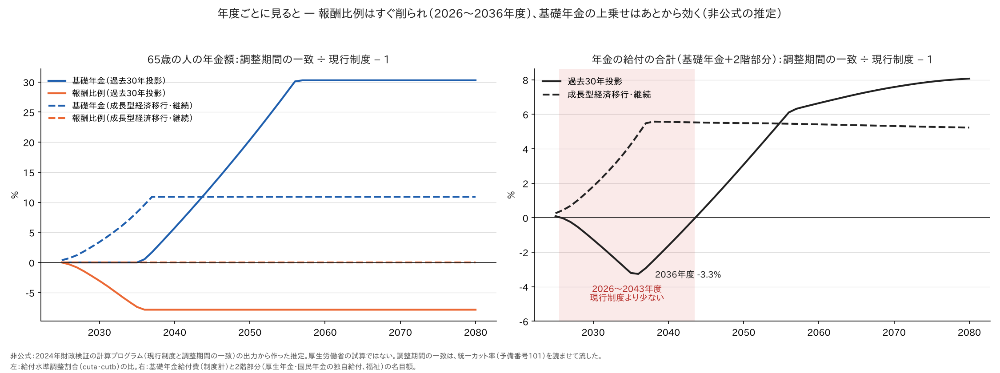
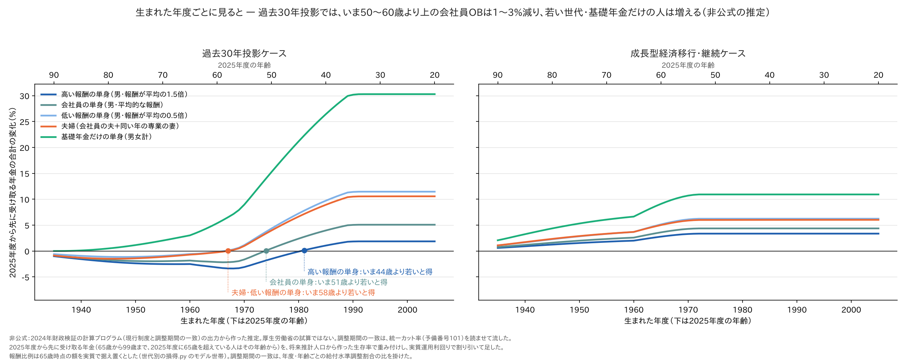
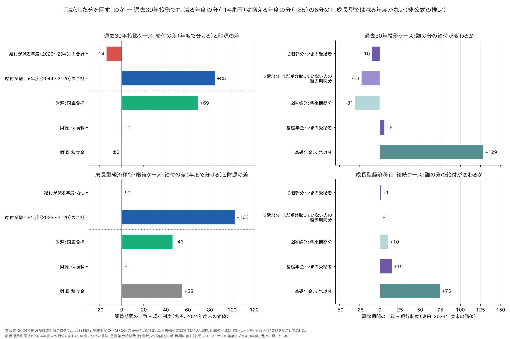
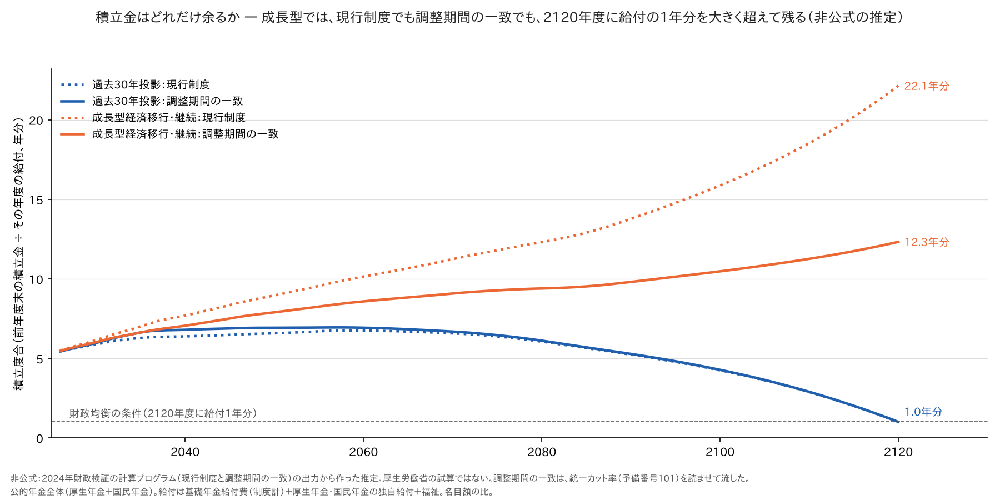

# マクロ経済スライドの調整期間を一致させたら、誰の年金が減って誰の年金が増えるか — 年度別・世代別・世帯別

- この記事（GitHub）：<https://github.com/p72/nenkin-zaisei-kensyo-2024/blob/main/%E5%8B%89%E5%BC%B7/%E5%BF%9C%E7%94%A8%E7%B7%A8/%E8%AA%BF%E6%95%B4%E6%9C%9F%E9%96%93%E3%81%AE%E4%B8%80%E8%87%B4%E3%81%AE%E4%B8%96%E4%BB%A3%E5%88%A5.md>
- この記事（Web・GitHub Pages）：<https://p72.github.io/nenkin-zaisei-kensyo-2024/%E5%8B%89%E5%BC%B7/%E5%BF%9C%E7%94%A8%E7%B7%A8/%E8%AA%BF%E6%95%B4%E6%9C%9F%E9%96%93%E3%81%AE%E4%B8%80%E8%87%B4%E3%81%AE%E4%B8%96%E4%BB%A3%E5%88%A5.html>
- 再現スクリプト：[調整期間の一致の世代別.py](https://github.com/p72/nenkin-zaisei-kensyo-2024/blob/main/%E5%8B%89%E5%BC%B7/%E5%BF%9C%E7%94%A8%E7%B7%A8/%E8%AA%BF%E6%95%B4%E6%9C%9F%E9%96%93%E3%81%AE%E4%B8%80%E8%87%B4%E3%81%AE%E4%B8%96%E4%BB%A3%E5%88%A5.py)
- リポジトリ：<https://github.com/p72/nenkin-zaisei-kensyo-2024>

**調整期間の一致**（[しくみ](../調整期間の一致.md)）について、こういう言い方を見かける。

> 「今から15年くらいの間に厚生年金を貰う元会社員老人の年金を減らして、今の45歳以下の年代が老人になった時の年金に回す政策」

これは本当か。[調整期間の一致のバランスシート](調整期間の一致のバランスシート.md) と同じ試算（2024年財政検証の計算プログラムを、
現行制度と調整期間の一致で流したもの）を、**年度ごと・生まれた年度ごと・世帯ごと**に並べて確かめた。

**答えは経済の前提でまるで変わる。** 2024年財政検証の4つのケースのうち、真ん中の2つを同じ重みで並べる。

| 長期の前提（2060年度、経済前提ファイル） | 成長型経済移行・継続 | 過去30年投影 |
|---|---|---|
| 物価上昇率 | 2.0% | 0.8% |
| 実質賃金上昇率 | 1.5% | 0.5% |
| 実質運用利回り | 3.2% | 2.2% |
| 現行制度の所得代替率（モデル世帯、最終） | 57.6%（比例25.0＋基礎32.6） | 50.4%（比例24.9＋基礎25.5） |
| 調整期間の一致の所得代替率 | **61.2%**（比例25.0＋基礎36.2） | **56.2%**（比例22.9＋基礎33.2） |

> **非公式の推定です。** 厚生労働省の試算ではありません。調整期間の一致は、統一カット率を計算プログラムに読ませて流したものです。
> 世代ごとの数字はモデル世帯の推定です（6.）。

## まとめ — 過去30年投影なら半分は合っている。成長型なら当たらない

| 言われていること | 過去30年投影 | 成長型経済移行・継続 |
|---|---|---|
| 今から15年くらい、年金が減る | **おおむね正しい**：給付の合計が現行制度より少ないのは2026〜2043年度。いちばん少ない2036年度で −3.3% | **当たらない**：給付はどの年度も現行制度より多い（2026年度 ＋0.4%、2040年度以降 ＋5.5%前後） |
| 減るのは元会社員の高齢者 | 向きは正しい。ただし減り方は**残りの年金の1〜3%** | **当たらない**：誰の年金も減らない。いまの85歳でも ＋1〜3% |
| 45歳以下が得をする | **高い報酬の人にだけ当てはまる**：境目は高い報酬の単身 44歳、会社員の単身 51歳、夫婦 58歳 | 全世代が得。若いほど得が大きい（25歳で ＋3〜11%、85歳で ＋1〜3%） |
| 高齢者の分を若い世代に「回す」 | **不正確**：減る年度の分（−14兆円）は増える年度の分（＋85兆円）の6分の1。主な財源は国庫負担（＋69兆円） | **当たらない**：高齢者から何も取らない。財源は国庫負担（＋46兆円）と、**現行制度では使われずに余る厚生年金の積立金**（＋55兆円） |

言い直すと、こうなる。

> **過去30年投影の前提なら**：2026〜2043年度の給付を少し（最大3%）抑え、そのあとの基礎年金を厚くする政策。
> いま50代後半より上の会社員OBは残りの年金が1〜3%減り、若い世代・報酬の低い人・基礎年金だけの人は増える。
> 増える分の大部分は税（国庫負担）でまかなうので、高齢者から若い世代へ回る分は小さい。
>
> **成長型経済移行・継続の前提なら**：基礎年金のマクロ経済スライドを止めて、所得代替率を61.2%のまま保つ政策。
> 誰の年金も減らない。費用は税と、現行制度では2120年度に給付22年分も積み上がり、使い道の決まっていない厚生年金の積立金でまかなう。

## 1. 年度ごとに見る



| 年度 | 過去30年投影：基礎年金の水準 | 同：報酬比例の水準 | 同：給付の合計 | 成長型：基礎年金の水準 | 同：報酬比例の水準 | 同：給付の合計 |
|---|---|---|---|---|---|---|
| 2026 | ±0% | −0.3% | −0.0% | ＋0.7% | ±0% | ＋0.4% |
| 2030 | ±0% | −3.1% | −1.3% | ＋3.4% | ±0% | ＋1.8% |
| 2036 | ＋0.5% | −7.9% | **−3.3%** | ＋9.6% | ±0% | ＋4.9% |
| 2040 | ＋5.7% | −7.9% | −1.6% | ＋10.9% | ±0% | ＋5.6% |
| 2043 | ＋9.9% | −7.9% | −0.3% | ＋10.9% | ±0% | ＋5.5% |
| 2045 | ＋12.8% | −7.9% | ＋0.7% | ＋10.9% | ±0% | ＋5.5% |
| 2050 | ＋20.4% | −7.9% | ＋3.1% | ＋10.9% | ±0% | ＋5.5% |
| 2057 | ＋30.3% | −7.9% | ＋6.3% | ＋10.9% | ±0% | ＋5.4% |

水準は65歳の人の年金額で、調整期間の一致 ÷ 現行制度 − 1。給付の合計は基礎年金給付費（制度計）と2階部分の名目額。

**過去30年投影**

- **減る時期と増える時期がずれる。** 報酬比例は2026年度からすぐ削られ、2036年度に −7.9% で止まる。
  基礎年金は2036年度まで現行制度と同じだけ削られ、上乗せが効くのは2037年度から（現行制度は2057年度まで削り続けるので、差が年々開く）
- そのため、給付の合計は **2026〜2043年度の18年間、現行制度より少ない**。「今から15年くらい」はおおむね当たっている
- ただし、報酬比例の −7.9% は**2036年度以降もずっと続く**。いまの若い世代が年金を受け取るときも、報酬比例は現行制度より低い。
  若い世代が得をするのは、基礎年金の ＋30% がそれを上回るから

**成長型経済移行・継続**

- 現行制度でも、報酬比例の調整は2024年度で終わっている（2023・2024年度の実績の分だけ）。調整期間の一致で変わるのは、
  **基礎年金の調整（現行制度は2037年度まで）がなくなる**ことだけ
- だから、報酬比例は1円も変わらず、基礎年金だけが2025年度から少しずつ上に離れ、2037年度以降は ＋10.9% で並ぶ。**減る年度がない**
- 給付の合計で見ると ＋5.5%前後。過去30年投影（最後は ＋6〜8%）より小さいが、すぐに効く

## 2. 生まれた年度ごとに見る

2025年度から先に受け取る年金の合計（生存率で重み付け、実質で割り引き）が、現行制度と比べてどれだけ変わるか。



### 過去30年投影 — 境目は45歳とは限らない

| 2025年度の年齢 | 高い報酬の単身 | 会社員の単身 | 低い報酬の単身 | 夫婦 | 基礎年金だけ |
|---|---|---|---|---|---|
| 85歳 | −1.6%（−25万円） | −1.4%（−16万円） | −0.9%（−8万円） | −1.3%（−27万円） | ＋0.1%（＋1万円） |
| 75歳 | −2.4%（−65万円） | −1.9%（−41万円） | −1.1%（−17万円） | −1.4%（−50万円） | ＋1.1%（＋11万円） |
| 65歳 | −2.5%（−101万円） | −1.8%（−57万円） | −0.6%（−13万円） | −0.7%（−35万円） | ＋3.0%（＋41万円） |
| 60歳 | −3.2%（−128万円） | −2.1%（−66万円） | −0.2%（−4万円） | −0.3%（−13万円） | ＋5.4%（＋70万円） |
| 55歳 | −3.1%（−126万円） | −1.6%（−51万円） | ＋1.1%（＋24万円） | ＋1.0%（＋48万円） | ＋9.0%（＋115万円） |
| 50歳 | −1.5%（−63万円） | ＋0.5%（＋15万円） | ＋4.3%（＋93万円） | ＋4.0%（＋194万円） | ＋15.2%（＋191万円） |
| 45歳 | −0.1%（−4万円） | ＋2.4%（＋76万円） | ＋7.3%（＋157万円） | ＋6.7%（＋327万円） | ＋21.2%（＋261万円） |
| 40歳 | ＋1.1%（＋45万円） | ＋4.0%（＋129万円） | ＋9.7%（＋212万円） | ＋8.9%（＋443万円） | ＋26.4%（＋321万円） |
| 35歳 | ＋1.8%（＋81万円） | ＋5.0%（＋167万円） | ＋11.4%（＋253万円） | ＋10.5%（＋529万円） | ＋30.2%（＋367万円） |
| 25歳 | ＋1.9%（＋87万円） | ＋5.1%（＋177万円） | ＋11.5%（＋268万円） | ＋10.6%（＋560万円） | ＋30.3%（＋388万円） |

- **損から得に変わる境目（2025年度の年齢）**：高い報酬の単身 **44歳**、会社員の単身 **51歳**、夫婦・低い報酬の単身 **58歳**、
  基礎年金だけの単身は**全世代で得**（減る世代がない）
- 「45歳以下」が当てはまるのは、高い報酬の人だけ。平均的な会社員なら50歳前後、専業の妻のいる夫婦なら50代後半が境目
- **減る世代の減り方は、残りの年金の1〜3%**（高い報酬の単身で最大 −3.2%）。いちばん減るのは、いま60歳前後の高い報酬の人
  （報酬比例の削りを長く受け、基礎年金の上乗せが効く前に受け取りの多くが終わる）
- 2階部分の比重が小さいほど得をする。専業の妻のいる夫婦は、妻の基礎年金にも上乗せが効くので、同じ報酬の単身より得をしやすい

### 成長型経済移行・継続 — 全世代・全世帯で増える

| 2025年度の年齢 | 高い報酬の単身 | 会社員の単身 | 低い報酬の単身 | 夫婦 | 基礎年金だけ |
|---|---|---|---|---|---|
| 85歳 | ＋0.9%（＋14万円） | ＋1.2%（＋14万円） | ＋1.7%（＋14万円） | ＋1.7%（＋35万円） | ＋3.2%（＋18万円） |
| 75歳 | ＋1.5%（＋40万円） | ＋2.0%（＋40万円） | ＋2.8%（＋40万円） | ＋2.9%（＋97万円） | ＋5.3%（＋49万円） |
| 65歳 | ＋2.0%（＋75万円） | ＋2.6%（＋75万円） | ＋3.7%（＋75万円） | ＋3.7%（＋170万円） | ＋6.6%（＋85万円） |
| 60歳 | ＋2.8%（＋107万円） | ＋3.6%（＋107万円） | ＋5.1%（＋107万円） | ＋5.0%（＋237万円） | ＋9.1%（＋118万円） |
| 55歳 | ＋3.3%（＋133万円） | ＋4.3%（＋133万円） | ＋6.1%（＋133万円） | ＋5.9%（＋289万円） | ＋10.7%（＋145万円） |
| 50歳 | ＋3.4%（＋148万円） | ＋4.4%（＋148万円） | ＋6.2%（＋148万円） | ＋6.0%（＋320万円） | ＋10.9%（＋160万円） |
| 40歳 | ＋3.4%（＋174万円） | ＋4.4%（＋174万円） | ＋6.2%（＋174万円） | ＋6.0%（＋377万円） | ＋10.9%（＋188万円） |
| 25歳 | ＋3.4%（＋220万円） | ＋4.4%（＋220万円） | ＋6.2%（＋220万円） | ＋6.0%（＋475万円） | ＋10.9%（＋237万円） |

- **減る世代・世帯はない。** いまの85歳でも ＋1〜3%
- **増える額（万円）は、報酬にかかわらず同じ。** 報酬比例は変わらず、基礎年金だけが上がるから。割合で見ると、年金に占める基礎年金の比重が大きい人
  （報酬の低い人・専業の妻のいる夫婦・基礎年金だけの人）ほど大きい
- **若いほど得が大きいが、差は過去30年投影ほど開かない。** いまの50代前半より若い世代は、65歳になるのが2037年度以降なので、割合がほぼ同じ（会社員の単身で ＋4.4%）になる。
  高齢の世代は、基礎年金の上乗せが育ちきる前の年度（2025〜2036年度）に受け取る分が多いので、割合が小さい

表の万円は2024年度の物価で、受け取り始め（2025年度か65歳）の時点の価値。
単身は男、報酬は平均の1.5倍・1倍・0.5倍で40年。夫婦は会社員（平均的な報酬）の夫と同い年の専業の妻。

## 3. 「回す」のか — 財源はどこから来るか



| 兆円（2024年度末の価値） | 過去30年投影 | 成長型経済移行・継続 |
|---|---|---|
| 給付が減る年度の差の合計 | **−14**（2026〜2043年度） | なし |
| 給付が増える年度の差の合計 | **＋85**（2044〜2120年度） | **＋102**（2025〜2120年度） |
| 財源：国庫負担 | **＋69** | **＋46** |
| 財源：保険料 | ＋1 | ＋1 |
| 財源：積立金 | ±0 | **＋55** |
| 2階部分：いまの受給者 | −10 | ＋1 |
| 2階部分：まだ受け取っていない人の過去期間分 | −23 | ＋1 |
| 2階部分：将来期間分 | −31 | ＋10 |
| 基礎年金：いまの受給者 | ＋6 | ＋15 |
| 基礎年金：それ以外 | ＋129 | ＋75 |

**過去30年投影**

- **減る年度の分（−14兆円）では、増える年度の分（＋85兆円）の6分の1しかまかなえない。** 残りはほぼ国庫負担の増え（＋69兆円）。
  基礎年金の半分は国庫負担なので、基礎年金を厚くすると国庫負担が自動で増える
- **いまの受給者から削られるのは、2階部分の10兆円。** いまの受給者は基礎年金で6兆円増えるので、差し引き4兆円の減り。
  2階部分の削り（合計 −64兆円）の大部分（−54兆円）は、まだ受け取っていない人の分で、**若い世代自身の2階部分**も削られる
- だから「高齢者の分を若い世代に回す」というより、**「2階部分を基礎年金に組み替え、増える分を税でまかなう」**のが実態に近い

**成長型経済移行・継続**

- **高齢者からは何も取らない。** 2階部分はむしろ少し増える（加給年金・経過的加算などは基礎年金の改定率に連動するため）
- 財源は国庫負担（＋46兆円）と、**積立金（＋55兆円）**。この積立金が何なのかは次の 4.
- いまの受給者の分も増える（基礎年金 ＋15兆円、2階部分 ＋1兆円）

どちらのケースでも、税は若い世代も払うので、世代ごとの損得を税まで含めて見ると、若い世代の得はこの記事の数字より小さくなる
（推定。税の負担はこの記事では計算していない）。被用者年金だけで見た損得は [調整期間の一致のバランスシート](調整期間の一致のバランスシート.md) の 4.

## 4. 成長型経済移行・継続をくわしく — 「余る積立金」を基礎年金に使う



| 積立度合（前年度末の積立金 ÷ その年度の給付、年分） | 2030 | 2050 | 2080 | 2100 | 2120 |
|---|---|---|---|---|---|
| 成長型：現行制度 | 6.1 | 9.0 | 12.3 | 15.9 | **22.1** |
| 成長型：調整期間の一致 | 6.0 | 7.9 | 9.4 | 10.5 | **12.3** |
| 過去30年投影：現行制度 | 5.9 | 6.6 | 6.1 | 4.2 | 1.0 |
| 過去30年投影：調整期間の一致 | 6.0 | 6.9 | 6.1 | 4.3 | 1.0 |

公的年金全体（厚生年金＋国民年金）。2120年度末の積立金（2024年度末の価値）は、成長型で厚生年金 130 → 80兆円、国民年金 0.3 → −4兆円。

### 4.1 現行制度では、厚生年金の積立金が「余る」

- マクロ経済スライドは、2120年度に**給付の1年分**の積立金が残るところまで給付を削る（有限均衡方式）。過去30年投影では、現行制度も調整期間の一致も、
  ぴったり1.0年分で終わる
- 成長型経済移行・継続では、**現行制度の2120年度の積立度合が22.1年分**になる。報酬比例は、2024年度までの実績の調整だけで、
  この先まったく削らなくても厚生年金の財政が釣り合ってしまうから。マクロ経済スライドは給付を削る方向にしか働かない（給付を上げる方向には働かない）ので、
  釣り合いを超えた分は、**誰の給付にも回らずに積み上がる**
- 一方、基礎年金は国民年金の財布で釣り合わせるので、2037年度まで削られる（基礎年金の所得代替率 36.2% → 32.6%）

### 4.2 調整期間の一致は、その余りの一部を基礎年金に回す

- 厚生年金と国民年金を一体で釣り合わせるので、厚生年金の余りで基礎年金を支えられる。**基礎年金の調整がいらなくなり**、所得代替率は2024年度の61.2%のまま保たれる
- 調整を**まったくしなくても**、2120年度の積立度合は12.3年分残る。余りの4割ほど（2120年度末の厚生年金の積立金で 130 → 80兆円、2024年度末の価値）を使い、まだ6割残る
- 国民年金の勘定だけを見ると、積立金は2079年度にマイナスになる（[バランスシートの記事](調整期間の一致のバランスシート.md) の 8.）。厚生年金の余りがそれを支える形になる

### 4.3 費用を持つのは誰か

| 財源 | 兆円 | 誰の負担か |
|---|---|---|
| 国庫負担 | ＋46 | 税を払う人（世代を問わない。増税・国債・ほかの歳出の削減のどれで出すかで変わる） |
| 積立金 | ＋55 | 現行制度なら2120年度より後まで使われずに残る分。**いま生きている誰かの年金を削った分ではない** |
| 保険料 | ＋1 | ほぼ変わらない |

- 成長型では、この政策は「高齢者から若い世代へ回す」ではなく、**「使い道の決まっていない積立金と税で、全世代の基礎年金を上げる」**政策になる
- 積立金の余りは、ほかの使い方もありうる（たとえば保険料の引き下げや、2120年度より後の世代のための備え）。調整期間の一致は、
  その余りを基礎年金の底上げに使う、という選択になる（推定）

### 4.4 成長型を読むときの注意

- **2025年度の調整は、実際にはもう行われた。** 2025年度の年金額は、マクロ経済スライドで0.4%抑えられた（＋1.9%の改定）
  （名目手取り賃金変動率 ＋2.3% からスライド調整 ▲0.4%。
  厚生労働省「[令和7年度の年金額改定についてお知らせします](https://www.mhlw.go.jp/stf/houdou/0000191631_00019.html)」2025年1月24日）。
  この試算の調整期間の一致は2025年度の調整もしない計算なので、基礎年金の ＋10.9% のうち約0.4%分は、実際にはもう取り戻せない。
  また、実際に制度を変えるなら、効き始めるのはもっと先になる（推定）
- **前提が外れたら、5年ごとの財政検証で計算し直す。** 経済が成長型より弱くなれば、調整期間の一致のもとでも基礎年金と報酬比例が一緒に削られる。
  そのときの姿は、過去30年投影の側（1.〜3.）に近づく
- 成長型の現行制度で「余る」積立金が本当に余るかどうかは、運用利回り（実質3.2%）と賃金（実質1.5%）の前提しだい

## 5. 計算のしかた

| 項目 | 中身 |
|---|---|
| 試算 | 現行制度は予備番号000。調整期間の一致は `TOUGOU=1`（⑤ 100・④ 101）と、統一カット率（101）を読ませた過去分試算・受給者分試算。手順は [調整期間の一致のバランスシート](調整期間の一致のバランスシート.md) の 12. |
| 水準の比 | ④⑤が書く**給付水準調整割合** R(年度, 年齢)（`emp/rslt/ez_arev/cutr` の `cuta`＝基礎年金、`cutb`＝報酬比例）の、調整期間の一致 ÷ 現行制度。スライド前の年金額は2つの試算で同じなので、この比がそのまま年金額の比になる（[数式モデル §8.4](../../年金財政検証_数式モデル.md)） |
| 年度別 | 基礎年金給付費（制度計）と2階部分（厚生年金の独自給付＋国民年金の独自給付＋福祉）の名目額。現在価値は名目運用利回りで2024年度末に割り引いた |
| 世代別 | [世代別の損得.py](世代別の損得.py) のモデル世帯（基礎年金は満額、報酬比例は65歳時点の額を実質で据え置き、生存率は将来推計人口から、実質運用利回りで割り引き、99歳まで）。2025年度から先に受け取る分だけを数え、調整期間の一致は年度・年齢ごとに水準の比を掛けた |
| 高い報酬・低い報酬 | 平均的な報酬で40年の報酬比例を、1.5倍・0.5倍にした（報酬比例は報酬に比例するので）。基礎年金は同じ |
| 積立度合 | 公的年金全体の前年度末の積立金 ÷ その年度の給付（基礎年金給付費（制度計）＋独自給付＋福祉）。過去30年投影の2120年度で1.00になり、財政均衡の条件と合う |
| 所得代替率 | ⑤の要約（03summary）のモデル世帯の値。調整期間の一致は予備番号100 |

## 6. 読むときの注意

| 注意 | 内容 |
|---|---|
| 推定 | 調整期間の一致は統一カット率を読ませて流した。計算プログラムが想定している組み合わせかどうかは確かめていない（バランスシートの記事と同じ） |
| どちらの前提か | この記事は、どちらのケースが現実に近いかを判断しない。2つのケースで答えが逆になる点が、この政策を読むときのいちばん大事なところ |
| モデル世帯 | 実際の人は加入期間・報酬の推移・共働きなどがさまざま。2025年度に65歳を超えている人の報酬比例は、2024年度の水準で代用した。2階部分の比重が大きいほど損に、小さいほど得に寄る、という向きは変わらない |
| 税 | 国庫負担の増え（＋69・＋46兆円）を誰がどう負担するか（増税・国債・ほかの歳出）は計算していない。世代ごとの損得を税まで含めると数字は変わる |
| 割引 | 世代別は実質運用利回り、年度別の現在価値は名目運用利回りで割り引いた。過去30年投影の世代別を実質賃金上昇率で割り引いても、境目は高い報酬の単身 44歳・会社員の単身 51歳で変わらず、夫婦・低い報酬の単身は 60〜61歳になる |
| 加給年金など | 年度別の2階部分には、基礎年金の改定率に連動する加給年金・経過的加算なども入る。世代別のモデル世帯には入れていない |

## 7. 再現

```sh
# 調整期間の一致のバランスシート の手順で、現行制度（000）と調整期間の一致（101）を流しておく
python3 勉強/応用編/調整期間の一致の世代別.py            # 表と図（勉強/応用編/図/調整期間の一致_世代別_*.png）
```

## 関連

- [調整期間の一致](../調整期間の一致.md)（しくみとコード）
- [マクロ経済スライドの調整期間を一致させたら、年金の財源と給付はどう変わるか](調整期間の一致のバランスシート.md)（バランスシート。被用者年金にとってプラスか）
- [厚生年金の国庫負担を廃止して一律給付にしたら：世代ごとの損得](厚生年金の国庫負担を廃止して一律給付にしたら_世代ごとの損得.md)（同じモデル世帯を使った世代別の比較）
