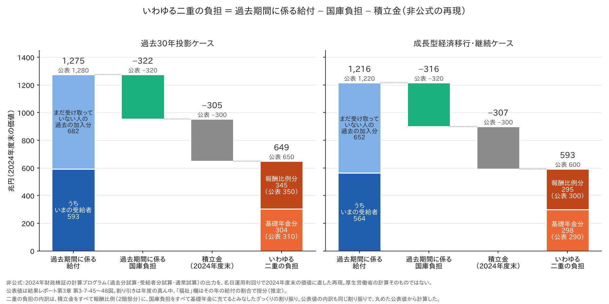
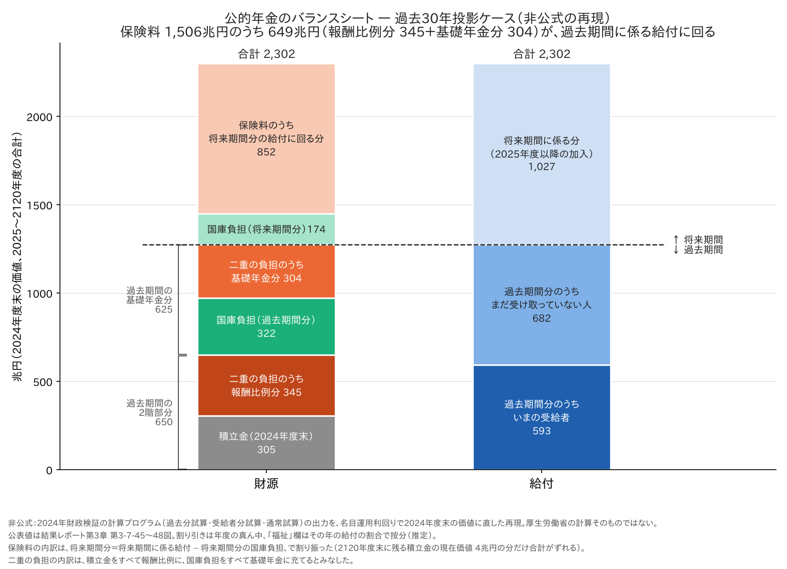
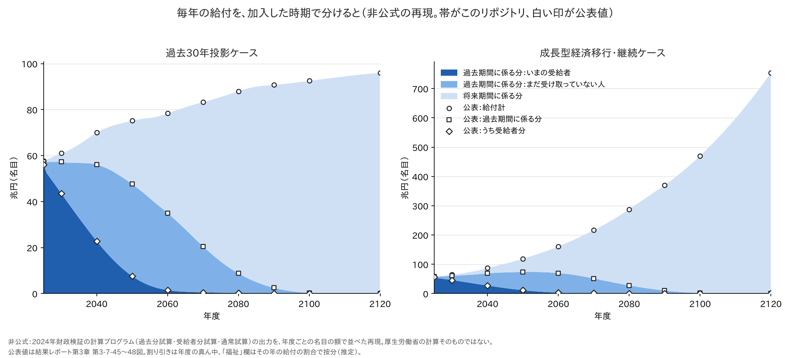

# 過去期間に係る給付1,280兆円と「二重の負担」650兆円 — 年金のバランスシートを計算プログラムで再現する

- この記事（GitHub）：<https://github.com/p72/nenkin-zaisei-kensyo-2024/blob/main/%E5%8B%89%E5%BC%B7/%E5%BF%9C%E7%94%A8%E7%B7%A8/%E9%81%8E%E5%8E%BB%E6%9C%9F%E9%96%93%E3%81%AE%E7%B5%A6%E4%BB%98%E3%81%A8%E4%BA%8C%E9%87%8D%E3%81%AE%E8%B2%A0%E6%8B%85.md>
- この記事（Web・GitHub Pages）：<https://p72.github.io/nenkin-zaisei-kensyo-2024/%E5%8B%89%E5%BC%B7/%E5%BF%9C%E7%94%A8%E7%B7%A8/%E9%81%8E%E5%8E%BB%E6%9C%9F%E9%96%93%E3%81%AE%E7%B5%A6%E4%BB%98%E3%81%A8%E4%BA%8C%E9%87%8D%E3%81%AE%E8%B2%A0%E6%8B%85.html>
- 再現スクリプト：[二重の負担.py](https://github.com/p72/nenkin-zaisei-kensyo-2024/blob/main/%E5%8B%89%E5%BC%B7/%E5%BF%9C%E7%94%A8%E7%B7%A8/%E4%BA%8C%E9%87%8D%E3%81%AE%E8%B2%A0%E6%8B%85.py)
- リポジトリ：<https://github.com/p72/nenkin-zaisei-kensyo-2024>

2024年財政検証の結果レポートには、公的年金の「バランスシート」が載っている。
過去30年投影ケースでは、**過去期間に係る給付 1,280兆円**、そこから国庫負担と積立金を引いた**いわゆる二重の負担 650兆円**。
この数字を、公表された計算プログラムで計算し直した。

> **非公式の再現です。** 計算プログラムの出力そのものを使っていますが、割り引き方と「福祉」欄の按分は
> 公表値にいちばん合う方法を選んだもので、厚生労働省の計算手順と同じだとは確かめていません（推定）。

## まとめ（過去30年投影ケース、兆円、2024年度末の価値）

| 項目 | このリポジトリ | 公表値 |
|---|---|---|
| 給付の合計（2025〜2120年度） | 2,302 | 2,300 |
| **過去期間に係る給付**（2024年度以前の加入期間の分） | **1,275** | **1,280** |
| 　2階部分 ＋ 基礎年金分 | 650 ＋ 625 | 650 ＋ 630 |
| 　うち、いまの受給者の分 | 593（301 ＋ 292） | 590（300 ＋ 290） |
| **過去期間に係る国庫負担** | **322** | **320** |
| **積立金から得られる財源** | **300** | **300** |
| **いわゆる二重の負担** ＝ 1,275 − 322 − 305 | **649** | **650** |
| 　うち報酬比例分（過去期間の2階部分 − 積立金） | 345 | 350（650 − 300） |
| 　うち基礎年金分（過去期間の基礎年金分 − 国庫負担） | 304 | 310（630 − 320） |

- 過去期間に係る給付と国庫負担・積立金は、公表値（10兆円単位）に**丸めの範囲で一致**した
- 年度ごとの額（名目）も、公表の表と**ほぼ0.1兆円まで一致**する（3.）
- 計算プログラムの**過去分試算**（加入を2024年度で打ち切る）と**受給者分試算**を使えば出せる
- **二重の負担は、性質の違う2つの合計**である。ざっくり**報酬比例年金 350兆円・基礎年金 310兆円**（公表値から。このリポジトリでは345兆円・304兆円）。
  ひとかたまりの金額として、何か一つの財源を650〜660兆円にまるまる充てるのは適当ではない（4.）



## 1. 何の数字か

| 言葉 | 中身 |
|---|---|
| 給付 | 2025〜2120年度（財政均衡期間）に払う公的年金（厚生年金＋国民年金）の給付 |
| 過去期間に係る分 | そのうち、**2024年度以前の加入期間**にもとづく分。いまの受給者の年金は全部ここに入る |
| 将来期間に係る分 | 2025年度以降の加入でつく分 |
| 換算 | 毎年の額を**運用利回り**で割り引いて、**2024年度末の一時金**に直して足す |
| 経済前提 | 過去30年投影ケース（物価0.8%、実質賃金0.5%、運用利回りは賃金＋1.7%で名目およそ3.0%）。成長型経済移行・継続ケース（物価2.0%、実質賃金1.5%、運用利回りは賃金＋1.7%で名目およそ5.3%） |
| 二重の負担 | いまから積立方式に切り替えたら、過去期間分の給付のうち、国庫負担と積立金で足りない分 |

**割り引くとは、遠い先の額ほど小さく数えること**である。運用利回りで割り引いた額は「いま、その額を積み立てて運用すれば、
将来その給付を払える」額にあたる。過去30年投影ケース（名目およそ3.0%）では、2050年度の給付75兆円は2024年度末の価値で35兆円、
2120年度の給付96兆円はわずか6兆円になる。成長型経済移行・継続ケースでは名目の給付が大きく伸びるが、割引率も高いので
（2120年度の754兆円が6兆円）、合計（2,268兆円）は過去30年投影ケース（2,302兆円）とあまり変わらない。

どの割引率を使うかで額が大きく変わることは、結果レポートでも念を押されている（第3-7-46図）。
たとえば50年後の100兆円は、4%で割り引くと14兆円、2%で割り引くと37兆円になる。
運用利回りで割り引くのは、積立方式の年金の責任準備金（いま持っているべき積立金）と比べるためで、
経済の大きさと比べたいときは賃金上昇率で割り引くほうが適切だ、とレポートは説明している。

積立方式なら、過去期間分の給付は過去の保険料と運用益で積み立ててあるはずのもの。いまの制度は賦課方式が基本なので、
その積立金は持っていない（持つ必要もない）。結果レポートはこの不足を「いわゆる二重の負担」と呼び、
積立方式に移っても、この分を今後の現役世代が払うなら世代間の格差は解消しない、と説明している。

バランスシートの形で並べると、**いまの制度では、二重の負担にあたる649兆円は、これから払われる保険料（1,506兆円）でまかなう**
ことになっている。保険料のうち852兆円が将来期間分の給付に、残り649兆円（報酬比例分 345兆円＋基礎年金分 304兆円）が
過去期間分の給付に回る、という割り振りである。



## 2. 計算プログラムでの出し方

計算プログラムには、通常の試算のほかに、債務を計算するための2つの試算がある（`run_pipeline.sh` の `SAIMU`）。

| 試算 | 中身 | 出てくるもの |
|---|---|---|
| 通常試算 | ふつうの財政見通し | 給付の合計 |
| **過去分試算**（SAIMU=1、出力に AK） | 加入期間を**2024年度で打ち切って**年金を計算する。2025年度以降の加入は年金に反映しない | 過去期間に係る給付 |
| **受給者分試算**（SAIMU=2、出力に AJ） | いまの受給者の分だけ | うち受給者分 |

将来期間に係る分 ＝ 通常試算 − 過去分試算。国庫負担も同じように分ける。
3本とも、マクロ経済スライドのカット率は通常試算のものを使う（⑤が通常試算のカット率ファイルを読む）。

給付と財源は、計算プログラムの出力の次の欄を足した。

| 公表の項目 | 計算プログラムの出力 |
|---|---|
| 基礎年金分 | ④の「基礎年金給付費（新法＋旧法）」の制度計 |
| 2階部分 | ⑤の厚生年金4制度の「独自給付」と「福祉」＋ ④の国民年金の独自給付（付加年金・寡婦年金・死亡一時金） |
| 国庫負担 | ⑤の厚生年金4制度の「国庫負担」＋ ④の国民年金の国庫負担（基礎年金・特別国庫負担ほか） |
| 保険料 | ⑤の厚生年金4制度の「保険料」＋ ④の国民年金の保険料（付加保険料を含む） |
| 積立金から得られる財源 | 2024年度末の積立金（厚生年金4制度＋国民年金）− 2120年度末の積立金の現在価値 |

公表値に合わせるために置いた**推定**が2つある。

| 推定 | 内容 | 根拠 |
|---|---|---|
| 割り引き方 | 毎年の給付・保険料・国庫負担は**年度の真ん中**で払うとみなし、2024年度末へ名目運用利回りで割り引く | 年度末で割り引くと給付の合計が2,267兆円、年度初めだと2,336兆円になり、年度の真ん中（2,302兆円）がいちばん公表値（2,300兆円）に合う |
| 「福祉」欄 | 過去分試算・受給者分試算でも通常試算と同じ額（年0.2〜0.3兆円）が出るので、その年の給付に占める割合で過去期間分・受給者分に按分する | 按分すると、年度ごとの額が公表の表と0.1兆円単位で合う（入れないと2025年度が0.3兆円足りない） |

## 3. 年度ごとの額（過去30年投影ケース、兆円・名目）



成長型経済移行・継続ケースでは賃金と物価が速く上がるので、名目の給付は2120年度に754兆円まで増えるが、
過去期間分の山（2050年度ごろに74兆円）が消えるのは過去30年投影ケースと同じく2100年度ごろである。

| 年度 | 給付計 | 公表 | 過去期間に係る分 | 公表 | うち受給者分 | 公表 |
|---|---|---|---|---|---|---|
| 2025 | 57.7 | 57.7 | 57.4 | 57.4 | 55.9 | 56.0 |
| 2030 | 61.1 | 61.1 | 57.3 | 57.3 | 43.5 | 43.6 |
| 2040 | 70.0 | 70.1 | 56.1 | 56.1 | 22.8 | 22.8 |
| 2050 | 75.2 | 75.2 | 47.6 | 47.6 | 7.6 | 7.6 |
| 2060 | 78.4 | 78.4 | 35.0 | 35.0 | 1.5 | 1.5 |
| 2070 | 83.2 | 83.3 | 20.5 | 20.5 | 0.5 | 0.5 |
| 2080 | 87.9 | 88.0 | 8.8 | 8.8 | 0.2 | 0.2 |
| 2090 | 90.7 | 90.8 | 2.5 | 2.5 | 0.1 | 0.1 |
| 2100 | 92.5 | 92.5 | 0.3 | 0.3 | 0.0 | 0.0 |
| 2120 | 95.9 | 96.0 | 0.0 | 0.0 | 0.0 | 0.0 |

- 過去期間分は2025年度でほぼ全部（57.4兆円）。いまの受給者の分（56.0兆円）が大半で、年を追って減り、2100年度ごろに0になる
- 2120年度までの過去期間分を2024年度末の価値で足すと1,275兆円、いまの受給者の分だけで593兆円

## 4. 二重の負担の計算

| 兆円（2024年度末の価値） | 過去30年投影 | 公表 | 成長型経済移行・継続 | 公表 |
|---|---|---|---|---|
| 過去期間に係る給付 | 1,275 | 1,280 | 1,216 | 1,220 |
| − 過去期間に係る国庫負担 | 322 | 320 | 316 | 320 |
| − 積立金 | 305 | 300 | 307 | 300 |
| ＝ **いわゆる二重の負担** | **649** | **650** | **593** | **600** |
| 　うち報酬比例分（過去期間の2階部分 − 積立金） | 345 | 350 | 295 | 300 |
| 　うち基礎年金分（過去期間の基礎年金分 − 国庫負担） | 304 | 310 | 298 | 290 |

- 積立金は**2024年度末の積立金を全部**使う。公表も、成長型経済移行・継続ケースでは「2120年度に残る積立金（2024年度価格 約130兆円）も活用する前提」と注記している（このリポジトリでは131兆円）
- 過去30年投影ケースでは2120年度末の積立金がほとんど残らない（現在価値4兆円）ので、「積立金から得られる財源 300兆円」とほぼ同じ
- 過去期間に係る国庫負担は、基礎年金の国庫負担（1/2）と特別国庫負担のうち、過去期間分の給付に対応するもの

### 二重の負担の内訳 — 報酬比例 350兆円・基礎年金 310兆円

**650〜660兆円にまるまる何かを充てる、という扱いは適当ではない。** 中身は性質の違う2つで、
ざっくり**報酬比例年金 350兆円、基礎年金 310兆円**である（公表値から。このリポジトリの再現では345兆円・304兆円）。

| 兆円（過去30年投影） | 過去期間に係る給付 | 引くもの | 残り（二重の負担の内訳） |
|---|---|---|---|
| 報酬比例（2階部分） | 650（再現 650） | 積立金 300（再現 305） | **350**（再現 345） |
| 基礎年金 | 630（再現 625） | 国庫負担 320（再現 322） | **310**（再現 304） |
| 合計 | 1,280（再現 1,275） | 620（再現 627） | **660**（公表 650、再現 649） |

- 割り振りは**ざっくり**で、積立金はすべて報酬比例に、国庫負担はすべて基礎年金に充てるとみなした。
  積立金のうち国民年金の分（14兆円）や、厚生年金の積立金が基礎年金拠出金にも使われることは無視している
- **報酬比例分 350兆円**は、厚生年金の積立金で裏打ちされていない、会社員・公務員の2階部分の過去の加入分
- **基礎年金分 310兆円**は、基礎年金の過去の加入分のうち、国庫負担（1/2と特別国庫負担）を除いた保険料の持ち分
- 成長型経済移行・継続ケースでは、報酬比例分 300兆円・基礎年金分 290兆円（公表値から。再現では295兆円・298兆円）

成長型経済移行・継続ケースの内訳（兆円、このリポジトリ／公表）：給付の合計 2,268／2,260、
過去期間分 1,216（2階 601＋基礎 614）／1,220（600＋610）、うち受給者分 564／560、保険料 1,576／1,570、国庫負担 516／510、
積立金から得られる財源 176／170。高成長実現ケースは公表されていないが、同じ方法で二重の負担は606兆円になった（参考）。

### 「二重の負担」か「未積立給付義務」か — 別の見方

この差額の呼び方と意味づけには、結果レポートと違う見方もある。年金の解説サイト nenkindb.jp の記事は、次のように書いている。

> 過去期間に係る分の給付1,280兆円（2024年度）については、被保険者から国に対し既に保険料が払い込まれていることから、
> 国には給付義務が発生しています。国の手元にある積立金は300兆円、過去期間に係わる分に対応した国庫負担320兆円を
> 1,280兆円から差し引くと660兆円です。この金額はしばしば「二重の負担」と呼ばれますが、前々回
> （[賦課方式と積立方式（３）「二重の負担」の虚実](https://nenkindb.jp/%E8%B3%A6%E8%AA%B2%E6%96%B9%E5%BC%8F%E3%81%A8%E7%A9%8D%E7%AB%8B%E6%96%B9%E5%BC%8F%EF%BC%88%EF%BC%93%EF%BC%89%E3%80%8C%E4%BA%8C%E9%87%8D%E3%81%AE%E8%B2%A0%E6%8B%85%E3%80%8D%E3%81%AE%E8%99%9A%E5%AE%9F/)）お話しした通り、ミスリードな感が否めず、
> 「未積立給付義務」と呼んだ方が実態に即しています。この未積立給付義務は、積立方式の年金制度移行に伴い顕在化し、
> 賦課方式を基本とする現行制度を続けたままでも、積立方式であれば得られた年金の収益率の放棄という形で
> 被保険者はなし崩し的に負担を強いられていることになります。
>
> — nenkindb.jp の記事より引用（原文の注「*1」は省いた）

| 論点 | 結果レポート | 上の記事 |
|---|---|---|
| 呼び方 | いわゆる二重の負担 | 未積立給付義務 |
| いつ生じる負担か | 積立方式に**移るとき**に、現役世代が払うことになる負担 | 給付義務は**すでに**発生している。積立方式に移るときに表に出るだけで、賦課方式を続けても、積立方式なら得られた収益率を手放す形で負担している |
| 結論 | 積立方式に移っても、世代間の格差の解消にはつながらない | 「二重の負担」という呼び方はミスリードで、実態は未積立の給付義務 |

金額について：上の記事の **660兆円** は、公表の丸めた数字どうしの引き算（1,280 − 320 − 300）である。
結果レポートは丸める前の値で計算して **650兆円** としており、このリポジトリの再現では **649兆円**（1,275 − 322 − 305）になる。
どちらの見方をとっても、**金額そのものは同じもの**（過去期間に係る給付のうち、積立金と国庫負担で裏打ちされていない分）を指している。
その中身は、**報酬比例年金 ざっくり350兆円と基礎年金 ざっくり310兆円**で、ひとかたまりにして何かをまるまる充てるのは適当ではない（上の内訳）。

計算の面から言えることは、図2のとおり、**いまの制度では、この649兆円はこれから払われる保険料でまかなう**段取りになっている、ということである。
現役世代の保険料の一部（1,506兆円のうち649兆円）が、自分の将来の年金ではなく過去期間分の給付に回る。
上の記事の「収益率の放棄」は、この部分を指していると読める（推定）。

## 5. 読むときの注意

| 注意 | 内容 |
|---|---|
| 国の借金とは別 | 賦課方式の年金は、過去期間分に見合う積立金を持つ必要がない。結果レポートも「参考までに」示した数字としている。一方で、国にはすでに給付義務があるとみて「未積立給付義務」と呼ぶ見方もある（4.） |
| 割引率で大きく動く | 運用利回りで割り引くのは、積立方式（責任準備金）と比べるため。経済規模と比べるなら賃金上昇率で割り引くほうが適切、と結果レポートも書いている |
| 残る差 | 公表値との差は1%以内。将来期間側（保険料・国庫負担・将来期間分）がこちらでは0.3〜0.7%大きく、割り引き方の細部の違いと考えられる（推定） |
| 福祉 | 厚生年金の収支の「福祉」欄を2階部分に入れている。何の支出かはここでは確かめていない |
| ひとかたまりにしない | 二重の負担は、報酬比例年金 ざっくり350兆円と基礎年金 ざっくり310兆円の合計。まるまる一つの財源を充てる対象として扱うのは適当ではない（4.） |

## 6. 再現

```sh
# 通常試算（すでにあれば不要）
検証/実行/run_pipeline.sh 3003 1 1 0 2
# 過去分試算（AK）と受給者分試算（AJ）。1本2分ほど
SAIMU=1 STEPS=2345 SKIP_BUILD=1 検証/実行/run_pipeline.sh 3003 1 1 0 2
SAIMU=2 STEPS=2345 SKIP_BUILD=1 検証/実行/run_pipeline.sh 3003 1 1 0 2
# 成長型経済移行・継続（3002）・高成長実現（3001）は人口・労働力率の引数を付けずに同じように
python3 勉強/応用編/二重の負担.py     # この記事の表（3ケース）と図（勉強/応用編/図/二重の負担_*.png）
```

過去分試算・受給者分試算の出力は `AK`・`AJ` の付いた別のファイルに出るので、通常試算の結果は上書きされない。
**人口・労働力率の引数は通常試算と同じにする**こと（3003 は `1 1 0 2`、3002・3001 は付けない）。

## 出典

- 厚生労働省「2024（令和6）年財政検証結果レポート」第3章 第3-7-44〜48図（pp.341–347）
  <https://www.mhlw.go.jp/content/12500000/2024report3.pdf>
- 厚生労働省「令和6(2024)年財政検証」<https://www.mhlw.go.jp/stf/seisakunitsuite/bunya/nenkin/nenkin/zaisei-kensyo/index.html>
- nenkindb.jp「賦課方式と積立方式（３）「二重の負担」の虚実」<https://nenkindb.jp/%E8%B3%A6%E8%AA%B2%E6%96%B9%E5%BC%8F%E3%81%A8%E7%A9%8D%E7%AB%8B%E6%96%B9%E5%BC%8F%EF%BC%88%EF%BC%93%EF%BC%89%E3%80%8C%E4%BA%8C%E9%87%8D%E3%81%AE%E8%B2%A0%E6%8B%85%E3%80%8D%E3%81%AE%E8%99%9A%E5%AE%9F/>（4. の引用元の記事が参照しているもの）

## 関連

- [基礎年金を税方式にして赤字国債でまかなったら](基礎年金を税方式にして赤字国債でまかなったら.md)（同じく名目運用利回りで現在価値に直している）
- [運用利回りと保険料](運用利回りと保険料.md)
- [国庫負担](../国庫負担.md)
